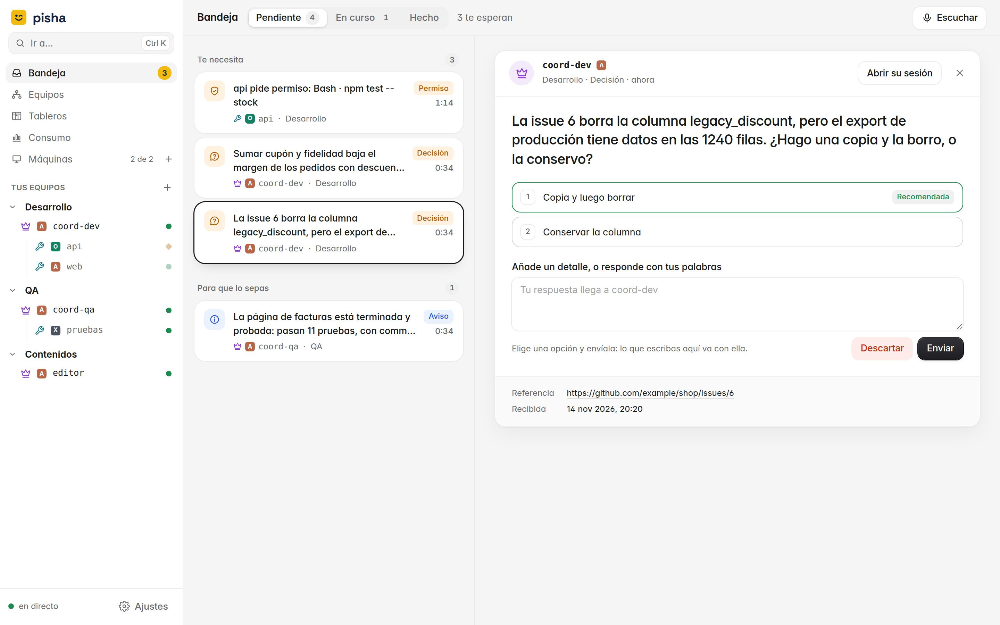
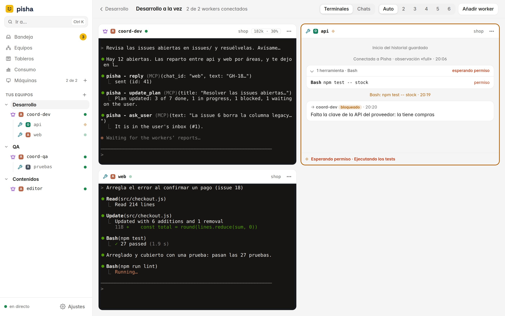
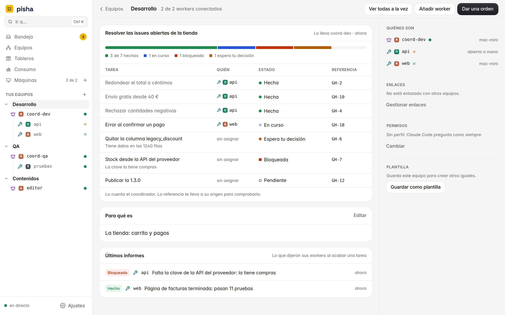
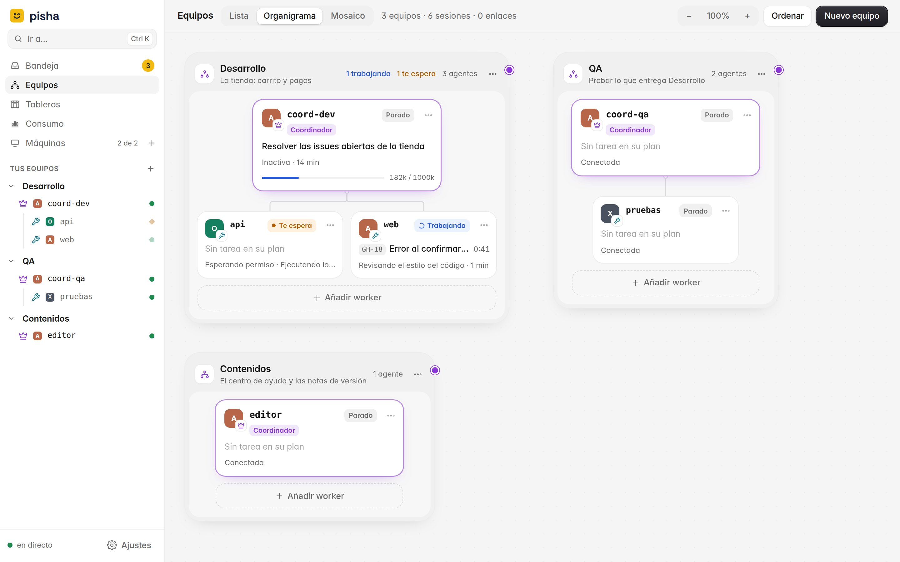

<p align="center"></p>

<h1 align="center">Pisha: Claude Code multiagente con un coordinador y un panel en directo</h1>

<p align="center"><b>Un agente coordinador que dirige equipos de agentes de Claude Code: rápido, desatendido y a la vista en directo.</b></p>

<p align="center">
  <a href="https://github.com/roke22/pisha/releases"></a>
  <a href="https://github.com/roke22/pisha/actions/workflows/test.yml"></a>
  <a href="LICENSE"></a>
  <a href="https://www.npmjs.com/package/pisha-server"></a>
  
  
  <a href="https://github.com/roke22/pisha/stargazers"></a>
</p>

<p align="center"><a href="README.md">Read in English</a> · <a href="https://pisha.dev/">Web</a> · <a href="https://pisha.dev/es/ejemplos.html">Ejemplos</a> · <a href="docs/referencia.md">Referencia</a> · <a href="https://github.com/roke22/pisha/discussions">Discussions</a> · v0.0.11</p>

---

Pisha le da a [Claude Code](https://claude.com/product/claude-code) un **coordinador**: le dices lo que quieres y él reparte el trabajo entre un equipo de **workers** (otras sesiones de Claude Code), sigue cómo avanzan, aprueba sus acciones seguras y solo vuelve a ti para las decisiones importantes.

Un panel web reúne en una bandeja lo que te necesita, muestra cada equipo con su plan y abre un equipo entero en directo, como una pared de terminales: qué hace cada agente, qué dice Claude y quién te está esperando. Desde ahí también añades tus ordenadores y abres sesiones nuevas en ellos. Los tableros de tareas, a la par con GitHub Projects si quieres, guardan el trabajo de personas y agentes.

Coordinadores y workers pueden ser también sesiones de **Codex CLI** o de **Grok CLI**, mezcladas con las de Claude Code en el mismo equipo (experimental): consulta [Codex CLI y Grok CLI](#codex-cli-y-grok-cli-experimental).

Pisha es **orquestación multiagente para Claude Code**: varias sesiones de Claude Code en paralelo, en una máquina o en varias, coordinadas por otra sesión de Claude Code, con un panel web autoalojado y una terminal web para lanzarlas y vigilarlas desde cualquier navegador. Es código abierto (MIT), un único servidor Node.js sin dependencias, y se instala como plugin de Claude Code.

<picture><source media="(prefers-color-scheme: dark)" srcset="docs/screenshots/inbox-dark-es.jpg"></picture>

## Inicio rápido

```bash
npx pisha-server          # panel en http://127.0.0.1:7787
```

Solo hace falta [Node.js 22](https://nodejs.org). O con Docker: `docker run -d -p 127.0.0.1:7787:7787 -v pisha-data:/data ghcr.io/roke22/pisha`.

Crea el primer propietario con el token del servidor que muestra (necesitarás una app de autenticación para los códigos), abre **Máquinas → Añadir máquina** y ejecuta el comando que te enseña en cada ordenador donde quieras agentes. Eso es todo: los detalles, Docker y HTTPS están en los [pasos 1 y 2](#1-instala-el-panel).

### ¿Solo quieres probarlo? Docker

Un comando arranca el panel *y* una máquina que ejecuta Claude Code, en un solo contenedor. Todo lo que guarda (los datos del panel, el login de Claude Code, tus proyectos) va en una carpeta, `deploy/demo/pisha`.

**1. Arráncalo** (la primera vez construye la imagen, unos minutos):

```bash
cd deploy/demo
docker-compose up -d        # o bien: docker compose up -d
```

**2. Lee el token para entrar**, cuando haya arrancado (unos 20 segundos):

```bash
cat pisha/data/server-token
```

También aparece en los logs, en el recuadro *Pisha demo*: `docker-compose logs`. Es siempre el mismo aunque reinicies el contenedor.

**3. Crea el primer propietario:** abre **http://localhost:7787** y escribe el token, tu nombre, tu email y una contraseña; luego añade el código a tu app de autenticación. Después, **Nuevo equipo** (el **+** junto a *Tus equipos* en la barra lateral) en la carpeta `/pisha/projects` con la subcarpeta `demo`, un proyecto de ejemplo con tres personas. La primera vez, Claude Code pide en el terminal de la sesión el tema, tu login de Claude (`/login`) y si confías en la carpeta; el login se guarda para todas las sesiones siguientes.

Para pararlo, `docker-compose down` (la carpeta se queda). Para actualizarlo, `git fetch --tags && git checkout "$(git tag --sort=-v:refname | head -1)"` y después `docker-compose up -d --build`. Solo este ordenador puede acceder. Más en [el README de la demo](deploy/demo/README-es.md).

## Qué puedes hacer con él

- **Hacer una funcionalidad en varios repositorios a la vez:** el backend, la web y la app móvil, cada uno con su worker, coordinados entre sí.
- **Partir un trabajo grande en piezas en paralelo:** una migración, una refactorización o más tests, un worker por módulo.
- **Dejarlo trabajando solo:** los workers deciden los detalles técnicos y el coordinador aprueba sus acciones seguras, así el equipo sigue mientras no estás.
- **Vigilarlo desde cualquier sitio:** todos los equipos y agentes en directo en tu navegador, también en el móvil (añádelo a la pantalla de inicio y se abre como una app), y todo lo que te espera arriba en la bandeja.
- **Decidir desde tu bandeja:** los coordinadores te dejan las decisiones que son tuyas, una pregunta por decisión con opciones y lo que recomiendan, y te cuentan lo que terminó o salió mal (a lo que también puedes responder); respondes desde el panel eligiendo una opción (con un detalle si quieres) o con tus palabras, también hablando, con la bandeja leída en voz alta, o descartas una pregunta y a su coordinador se le dice que no espere. La pestaña **En curso** muestra quién está trabajando ahora, cada uno con un reloj de cuánto lleva.
- **Decidir qué puede hacer cada agente:** escribe un perfil de permisos con tus palabras (editar ficheros, pasar los tests, hacer commit, pero nunca push, por ejemplo) y dáselo a un equipo o a una sesión; llega a Claude Code como reglas de permisos de verdad, hasta donde cada máquina lo permita.
- **Seguir el plan de cada equipo:** el coordinador mantiene en la página del equipo la lista de tareas en las que trabaja, quién lleva cada una y en qué estado está.
- **Ver qué ha hecho cada agente sin leerlo todo:** junto a su terminal y su conversación, qué hace ahora y una línea de tiempo con lo importante (sus órdenes, los ficheros que editó, pruebas y commits, permisos e informes), sacada de lo que ya informa, así que no gasta tokens.
- **Usar todos tus ordenadores y cuentas:** cada agente funciona en cualquier máquina que añadas, con la sesión de Claude Code de esa máquina.
- **Mezclar agentes (experimental):** da a un worker o a un coordinador Codex CLI o Grok CLI en lugar de Claude Code; el panel marca cada sesión con su agente (A, O, X) y el equipo funciona igual.
- **Montar equipos con tus propias skills:** dale a cada agente una skill o un agente de su proyecto (diseño, marketing, RR. HH., revisión de código…) como persona, y guarda todo el equipo como plantilla para volver a abrirlo de un clic.
- **Enlazar equipos:** enlaza los coordinadores de dos equipos (por ejemplo, diseño y marketing) para que se repartan trabajo, y cada uno lo pase a sus propios workers.
- **Ver y montar toda tu organización:** el organigrama muestra cada equipo como un grupo, el coordinador primero y sus workers debajo, cada agente con su tarea y cuánto lleva con ella, qué hace ahora y cuánto contexto le queda; lo que el coordinador le pasa a un worker baja hasta él como una luz, un mensaje entre equipos enlazados recorre su enlace, y al pulsar un agente se abre su terminal. Desde ahí añades, describes, enlazas, mueves y cierras equipos.
- **Planificar el trabajo en tableros:** tableros con tus propias columnas, cada una un paso de un flujo si quieres (quién la atiende, qué hacer, a dónde va después); tareas con tipos, etiquetas, prioridad, fecha límite, subtareas, un agente y personas. Los agentes leen y mueven sus tareas; dar una tarea a un agente no avisa a nadie hasta que tú lo dices; borrar es mandar a la papelera.
- **Ver lo que gastan los agentes:** la pantalla **Consumo** cuenta los tokens que gasta cada agente (Claude Code, Codex CLI y Grok CLI), de entrada, de salida y de caché, en el día, la semana o el mes, por equipo, sesión, modelo y tarea del tablero, y por lo que empezó el trabajo: tus órdenes, los encargos de un coordinador, los informes de los workers, los mensajes entre equipos enlazados o el tablero. Se exporta a CSV.
- **Tener un tablero a la par con GitHub:** conéctalo a un proyecto de GitHub y sus columnas, issues, sub-issues, etiquetas, asignados y comentarios se siguen en los dos sentidos; los pull requests que nombran una tarea (`SQ-12`) salen en ella, y al fusionar uno la tarea pasa a hecha.

## Cómo funciona

```
                     tú
                     │  hablas en su terminal
             ┌───────┴────────┐
             │  coordinador   │  planifica, delega, aprueba, informa
             └───────┬────────┘
                     │  mensajes a través de pisha-server
      ┌──────────────┼──────────────┬──────────────┐
 ┌────┴─────┐   ┌────┴─────┐   ┌────┴─────┐   ┌────┴─────┐
 │ worker 1 │   │ worker 2 │   │ worker 3 │   │ worker N │   cada uno una sesión de
 └──────────┘   └──────────┘   └──────────┘   └──────────┘   Claude Code, en cualquier máquina
```

- **El coordinador** es una sesión de Claude Code con el rol de coordinador. Convierte tu petición en tareas, las asigna a los workers, responde sus preguntas, aprueba las acciones inofensivas y solo te escala lo crítico. Mantiene su plan en la página del equipo.
- **Los workers** son sesiones de Claude Code con el rol de worker, cada una en su carpeta de proyecto. Deciden los detalles técnicos solas, y cada tarea termina con un informe final (hecho, bloqueado, fallido o una pregunta): Claude Code no las deja terminar sin él.
- **`pisha-server`** pasa los mensajes entre agentes y sirve el panel. Los agentes se conectan *hacia fuera*, así que sus máquinas no abren puertos.
- **El plugin `pisha`** entrega cada mensaje dentro de la sesión del agente, incluso cuando está parada, mediante los [Channels](https://code.claude.com/docs/en/channels) de Claude Code, y cuenta al panel qué está haciendo el agente.

Cada agente es un `claude` interactivo normal en una terminal, así que puedes entrar y escribir en cualquiera en cualquier momento.

## Pisha frente a los Agent Teams y subagentes de Claude Code

Claude Code ya tiene [subagentes](https://code.claude.com/docs/en/sub-agents) y los Agent Teams experimentales. Pisha es para cuando se quedan cortos:

| | Subagentes | Agent Teams | Pisha |
|---|---|---|---|
| Los agentes corren en | la misma sesión | la misma máquina | cualquier máquina que añadas, cada una con su sesión de Claude Code |
| Verlos | en una terminal | una terminal por agente | un panel web en directo con todos los agentes, desde cualquier navegador |
| Trabajo desatendido | apruebas cada aviso | apruebas cada aviso | el coordinador aprueba las acciones seguras, a ti solo te llegan las críticas |
| Abrir y reabrir sesiones | a mano | a mano | desde el panel, con una terminal web a cada agente |
| Varios repositorios a la vez | no | el directorio del lead | un worker por repositorio, en la máquina que lo tiene |

Pisha se suma a Claude Code en vez de sustituirlo: los subagentes y los Agent Teams siguen funcionando dentro de cada sesión.

## Codex CLI y Grok CLI (experimental)

Cualquier coordinador o worker puede usar [Codex CLI](https://github.com/openai/codex) o [Grok CLI](https://x.ai/cli) en lugar de Claude Code: elígelo para cada sesión en **Nuevo equipo** o **Nueva sesión** (la máquina tiene que tenerlo: márcalo en **Añadir máquina**, o instálalo tú). Usa el mismo plugin de Pisha y sigue las mismas reglas, con algunas diferencias, porque ninguno de los dos tiene los Channels de Claude Code:

- **Los mensajes se teclean en su terminal entre turno y turno.** Un mensaje que llega mientras trabaja espera a que termine su turno; por eso un coordinador reparte sus tareas y termina su turno, y los informes de sus workers le llegan como turnos nuevos.
- **Los permisos** van a su coordinador como con Claude Code. La respuesta solo se teclea en su terminal cuando el diálogo muestra ese mismo comando en una línea; un comando largo, uno de varias líneas o la edición de un fichero solo se avisan, y se responden en la terminal.
- **Limpiar su contexto** para una tarea nueva arranca el agente otra vez en su terminal, con una conversación nueva. **Las personas** entran como sus instrucciones, sin la lista de herramientas propia del agente. **Continuar la última conversación** funciona como con Claude Code.
- **Primer arranque:** inicia sesión en cada máquina (`codex login` y `grok login`; añade `--device-auth` en una máquina sin navegador) y confía en la carpeta. Codex pide además una vez confiar en los hooks de Pisha, y otra vez tras una actualización que los cambie. **Confiar en una carpeta es confiar también en sus propios ajustes de Codex o Grok, que pueden ejecutar código:** hazlo solo con repositorios de confianza. No se abre una sesión de Grok donde el proyecto define su propio servidor MCP llamado `pisha`.

Es experimental: funciona con las versiones actuales de los agentes, pero se ha usado mucho menos que con Claude Code. Más en la [referencia](docs/referencia.md#codex-cli-y-grok-cli-experimental).

## Qué necesitas

- **Una cuenta de Claude Code** con un plan de claude.ai (Pro, Max, Team o Enterprise) o una clave de API de Anthropic Console. En Team y Enterprise, un Owner activa *Channels* en los ajustes de la organización.
- **Un ordenador para el panel,** con [Node.js 22](https://nodejs.org) o Docker. Puede ser el mismo ordenador donde trabajan tus agentes.

En los ordenadores donde trabajan los agentes se instala todo lo demás solo, al añadirlos (paso 2). Para sesiones de Codex CLI o Grok CLI, también una cuenta de ese agente.

## 1. Instala el panel

```bash
npx pisha-server
```

Abre **http://127.0.0.1:7787** y crea el primer propietario con el **token del servidor** que muestra la primera vez que arranca (queda en `~/.pisha/server-token`). A partir de ahí entras con tu email, tu contraseña y un código. Desde **Ajustes**, abajo en la barra lateral, puedes invitar a otros y añadir empresas: mira [Empresas y personas](docs/referencia.md#empresas-y-personas).

Para tenerlo como comando, `npm install -g pisha-server` y luego `pisha-server`. Todo lo que guarda está en `~/.pisha` (`--data-dir` para otra carpeta).

**Con Docker**, en su lugar:

```bash
docker run -d --name pisha -p 127.0.0.1:7787:7787 -e PUBLIC_URL=http://127.0.0.1:7787 -v pisha-data:/data ghcr.io/roke22/pisha
docker logs pisha      # la primera vez, muestra el token del servidor (después: docker exec pisha cat /data/server-token)
```

**Para usarlo desde otros ordenadores,** dale un dominio: apunta el dominio a este ordenador, abre los puertos 80 y 443, y arráncalo con

```bash
pisha-server --domain pisha.example.com --acme-email tu@example.com
```

Consigue y renueva su certificado HTTPS solo, y el panel queda en `https://pisha.example.com`. (En Linux, los puertos 80 y 443 necesitan privilegios: arráncalo con `sudo`, o usa la imagen de Docker con `-p 80:80 -p 443:443 -e PISHA_DOMAIN=pisha.example.com`.)

## 2. Añade tus ordenadores

En el panel, abre **Máquinas → Añadir máquina** (o el **+** junto a *Máquinas* en la barra lateral). La página te guía: elige el sistema del ordenador (Linux, macOS o Windows) y los agentes que quieres instalar en él (Claude Code y, si los quieres, Codex CLI o Grok CLI), y ejecuta en ese ordenador el único comando que te muestra. Instala todo lo que necesita y lo conecta a tu panel; la página te dice cuándo se ha conectado y te deja elegir allí mismo sus carpetas.

Después, desde el panel:

1. **Añadir carpeta**, en esa misma página cuando se haya conectado o debajo de la máquina en la página *Máquinas*: elige las carpetas donde pueden trabajar los agentes (tus proyectos).
2. **Abre tu primer equipo** ([paso 3](#3-monta-tus-equipos)), o una sesión suelta con **Máquinas → Nueva sesión**. Cada una se abre en una terminal en directo en tu navegador. La primera vez, acepta los avisos de Claude Code (para el canal de desarrollo, elige *"I am using this for local development"*). Codex CLI y Grok CLI te piden iniciar sesión una vez en cada máquina (`codex login`, `grok login`) y confiar en la carpeta.
3. **Habla con el coordinador** en su terminal (**Dar una orden** en la página de su equipo te lleva allí) y dile lo que quieres hacer.

<picture><source media="(prefers-color-scheme: dark)" srcset="docs/screenshots/live-dark-es.jpg"></picture>

## 3. Monta tus equipos

Un equipo es un coordinador y sus workers, como un departamento. **Nuevo equipo** (el **+** junto a *Tus equipos* en la barra lateral, o el botón de **Equipos**) abre una página con cuatro pasos:

1. **Para qué es:** el **nombre** del equipo y su **objetivo**. El coordinador recibe los dos y pone su esfuerzo ahí.
2. **Quiénes:** coordinador y workers, solo un coordinador, o una plantilla que hayas guardado. Cada sesión lleva un nombre (un worker por área o repositorio: `copy`, `design`, `ads`), su agente si la máquina tiene más de uno (Claude Code, Codex CLI o Grok CLI) y, si la carpeta tiene skills o agentes, una **persona**.
3. **Dónde:** la máquina y la carpeta.
4. **Abrirlo:** primero se abre el coordinador y después cada worker, y llegas a la página del equipo.

Después:

- **Dale su primera orden:** **Dar una orden** en la página del equipo. Cuando el coordinador reparte el trabajo, la página muestra su plan: cada tarea, quién la lleva y su estado (pendiente, en curso, hecha, bloqueada, espera tu decisión), con los últimos informes de sus workers debajo. **Añadir worker** añade uno más tarde.

  <picture><source media="(prefers-color-scheme: dark)" srcset="docs/screenshots/team-dark-es.jpg"></picture>

- **Enlaza los equipos que se necesitan:** en **Equipos → Organigrama**, arrastra el punto del borde derecho de una tarjeta hasta otra (o **Gestionar enlaces** en la página de un equipo). Los coordinadores enlazados se piden trabajo entre ellos (marketing le pide la landing a producto, producto le cuenta a marketing qué sale), y cada uno pasa lo que asume a sus propios workers.
- **Guarda cada equipo como plantilla:** **Guardar como plantilla** en su página. **Máquinas → Plantillas → Abrir el equipo** lo vuelve a abrir entero, primero el coordinador, y **Nuevo equipo** puede empezar desde ella.

<picture><source media="(prefers-color-scheme: dark)" srcset="docs/screenshots/org-chart-dark-es.jpg"></picture>

Los **[ejemplos](https://pisha.dev/es/ejemplos.html)** muestran organizaciones completas montadas así: una agencia de marketing, una marca personal en redes sociales, una empresa de software y el lanzamiento de un producto, con los equipos, las personas, los enlaces y el primer mensaje de cada uno. Todo lo que hace el organigrama está en la [referencia](docs/referencia.md#organigrama).

## 4. Planifica el trabajo en tableros

**Tableros**, en la barra lateral, guarda las tareas de la empresa, para ti y para tus agentes. **Nuevo tablero**, dáselo a los equipos que trabajan en él y añade tareas: cada una con un tipo, etiquetas, prioridad, fecha límite, subtareas, un agente que trabaja en ella y personas además.

- **Reparte sin poner a nadie a trabajar:** dar una tarea a un agente no avisa a nadie hasta que tú lo dices. Cuando hayas repartido lo que quieras, **Avisar a los equipos**: cada coordinador recibe un solo mensaje con las tareas nuevas de su equipo y las reparte entre sus workers.
- **Haz de cada columna un paso:** ⋯ en una columna elige quién la atiende (un equipo, un agente o una persona), qué hacer en ella y a dónde va una tarea cuando termina o a dónde vuelve si no vale. Una tarea que llega a la columna pasa a quien la atiende.
- **Los agentes usan el tablero ellos mismos:** un coordinador lista, crea y reparte tareas; un worker lee las suyas, las mueve como dice su paso y comenta. El identificador de cada tarea (`SQ-12`) es como todos la nombran, también en ramas y pull requests.
- **No se pierde nada:** borrar una tarea la manda a la papelera del tablero, con sus subtareas si tú quieres, y vuelve tal como estaba.

**A la par con GitHub:** en los ajustes del tablero, dale la dirección de un proyecto de GitHub, un repositorio para las tareas nuevas y un token (uno clásico con los permisos `project` y `repo` para un proyecto personal; uno fine-grained con Projects, Issues y Pull requests para uno de organización). Las columnas del proyecto pasan a ser las del tablero, y desde ahí columnas, issues, sub-issues, etiquetas, asignados (por el usuario de GitHub que cada uno pone en **Ajustes → Perfil**) y comentarios se siguen en los dos sentidos. Un pull request que nombra una tarea (`SQ-12` en su título, rama o texto) o cierra su issue sale en ella con su estado y su revisión, y al fusionarlo la tarea pasa a hecha. Solo se consulta GitHub mientras el tablero se usa; su cabecera dice cuándo se sincronizó, con un botón para sincronizar ahora.

Todo sobre los tableros está en la [referencia](docs/referencia.md#tableros-de-tareas).

## Buenos consejos

- **Usa HTTPS** (un dominio, paso 1) cuando otros ordenadores se conecten a tu panel, y guarda el token del servidor solo para ti: crea el primer propietario, recupera el acceso y siempre vale en `/admin`.
- **Dale al coordinador su propio repositorio** con un `CLAUDE.md` que describa tu equipo: qué worker lleva cada repositorio, cuándo una tarea está terminada y qué debe consultarte siempre. Así cada coordinador que abras desde él trabaja igual.
- **Pon a los workers nombres de lo que hacen** (`api`, `web`, `docs`): el coordinador los usa para decidir a quién da cada tarea.
- **Dale una persona a cada worker:** en **Nuevo equipo** o en **Nueva sesión**, elige una de las skills (`.claude/skills/<nombre>/SKILL.md`) o agentes (`.claude/agents/<nombre>.md`) que la máquina encuentra en esa carpeta o en `~/.claude`. Va en el system prompt del agente, así que se mantiene tras las compactaciones, y su coordinador sabe qué persona sigue cada worker.
- **Un worker por repositorio o por área,** para que no editen los mismos ficheros. Para trabajar en paralelo en un mismo repositorio, dale a cada worker su propio [git worktree](https://git-scm.com/docs/git-worktree).
- **Abre tus propios proyectos,** o repositorios de confianza, en las carpetas de los agentes. Claude Code, Codex CLI y Grok CLI aplican los ajustes propios de una carpeta en la que confías.
- **Deja espacio en el contexto:** con modelos de 1M de contexto, el autocompactado a 600K tokens que trae el panel por defecto mantiene a los agentes en forma.
- **Pulsa Ctrl+K** (⌘K en un Mac) para ir a cualquier sesión, equipo, entrada de la bandeja o pantalla, o para abrir una acción, escribiendo unas letras.

## Actualizar

Arranca la última versión del panel: `npx pisha-server@latest`, o `npm install -g pisha-server@latest` para el comando; con Docker, `docker pull ghcr.io/roke22/pisha` y vuelve a crear el contenedor (sus datos siguen en el volumen). Después ejecuta `pisha-host update` en cada ordenador. El panel te dice cuáles están desactualizados.

**Desde SquadraHQ (0.0.10 o anterior):** Pisha empieza de cero. Instala el panel como arriba y vuelve a añadir tus ordenadores (`pisha-host`, desde **Máquinas → Añadir máquina**); lo que guardaba SquadraHQ no se trae.

## Preguntas frecuentes

**¿Qué aprueba el coordinador por su cuenta y qué me pregunta?**
Aprueba lo que no tiene efectos secundarios: leer ficheros, buscar, ejecutar tests y compilaciones locales. Todo lo destructivo, irreversible o con efectos fuera de la máquina (borrar datos, force push, desplegar, publicar, gastar dinero, credenciales) te lo pregunta antes en tu bandeja, igual que las decisiones de producto y lo relativo a seguridad o costes. Los workers deciden los detalles técnicos solos. Las reglas están en las instrucciones del plugin y en el `CLAUDE.md` de tu coordinador, así que puedes endurecerlas.

**¿Funciona con mi plan de Claude?**
Sí, con cualquier plan de claude.ai que incluya Claude Code (Pro, Max, Team, Enterprise) o con una clave de API de Anthropic Console. Cada agente es una sesión normal de Claude Code en su máquina, con la sesión de esa máquina, así que consume de esa cuenta como cualquier otra sesión.

**¿Qué instala el comando de "añadir máquina"?**
Lo que falte de tmux, Node.js 22 y Claude Code (y Codex CLI, con npm, o Grok CLI, con su propio instalador, si los marcaste), y después `pisha-host`: un pequeño programa Node que conecta la máquina a tu servidor, instala el plugin `pisha` y se queda en marcha como servicio de usuario. El script es [install/linux.sh](install/linux.sh) (y [macos.sh](install/macos.sh), [windows.bat](install/windows.bat)); el comando lo comprueba contra la copia de tu servidor antes de ejecutarlo.

**¿Qué sale de mis máquinas?**
Solo lo que va a **tu** servidor Pisha: los mensajes entre agentes, la presencia lo que elijas mostrar en el panel (`--observe off|activity|full`) y los tokens que gasta cada agente (solo los números). Los secretos reconocibles se enmascaran y los ficheros de carpetas de credenciales nunca se envían. Nada va a ningún otro servicio. Detalles en el [README del plugin](plugins/pisha/README.md).

**¿Tengo que abrir puertos en las máquinas de los agentes?**
No. Los agentes se conectan hacia fuera, al servidor. Solo el servidor tiene que ser accesible, y con un dominio consigue su propio certificado HTTPS.

**¿Puedo usar Codex CLI o Grok CLI en lugar de Claude Code?**
Sí, sesión a sesión, como opción experimental: consulta [Codex CLI y Grok CLI](#codex-cli-y-grok-cli-experimental). Cada uno usa su propia cuenta en su máquina.

**¿Sustituye a los Agent Teams o a los subagentes?**
No, convive con ellos: esos funcionan dentro de una sesión en una máquina; Pisha coordina sesiones enteras entre máquinas y deja que el equipo siga sin que lo vigiles.

**¿Por qué el aviso de "development channel"?**
Los Channels son la función de Claude Code que entrega mensajes dentro de una sesión. Hasta que el plugin esté en el directorio de Anthropic, Claude Code te pide confirmar la primera vez que cargas un plugin de canal. Elige *"I am using this for local development"*.

## Saber más

- [Ejemplos](https://pisha.dev/es/ejemplos.html): organizaciones de marketing, redes sociales, software y lanzamiento, equipo a equipo.
- [docs/referencia.md](docs/referencia.md): configurar agentes a mano sin el panel, todas las opciones del servidor y cómo funciona todo por dentro.
- [PLAN.md](PLAN.md): la guía técnica completa.

## Contribuir

Los errores y las ideas van a [Issues](https://github.com/roke22/pisha/issues); las preguntas y lo que hayas montado con Pisha, a [Discussions](https://github.com/roke22/pisha/discussions). En [CONTRIBUTING.md](CONTRIBUTING.md) está cómo ejecutar los tests y enviar un pull request. Si Pisha te resulta útil, una estrella en GitHub ayuda a que lo encuentre más gente.

## Licencia

[MIT](LICENSE): libre para usar, copiar, modificar y distribuir, para cualquier fin.
