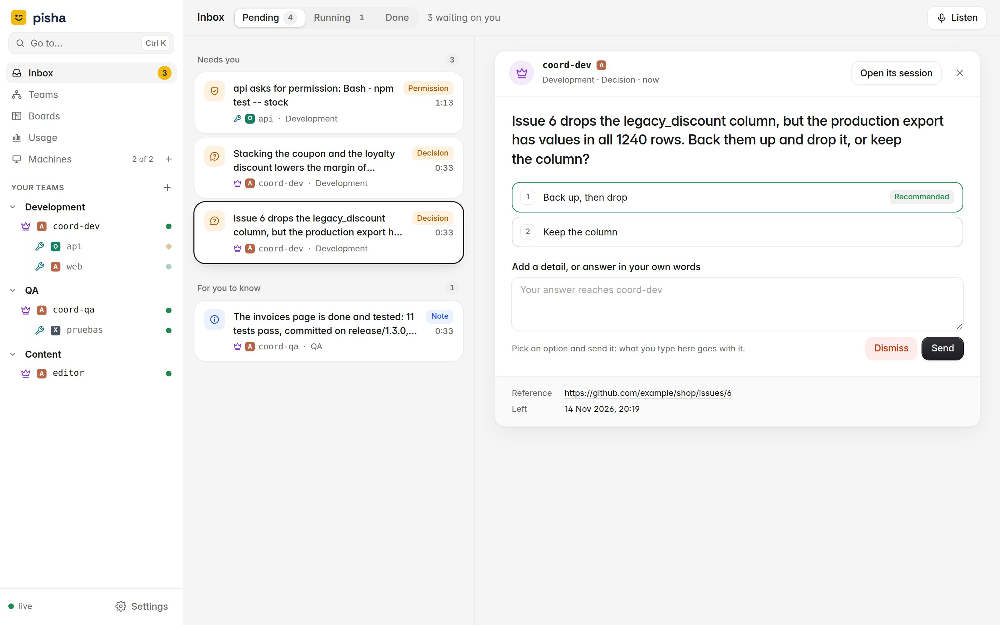
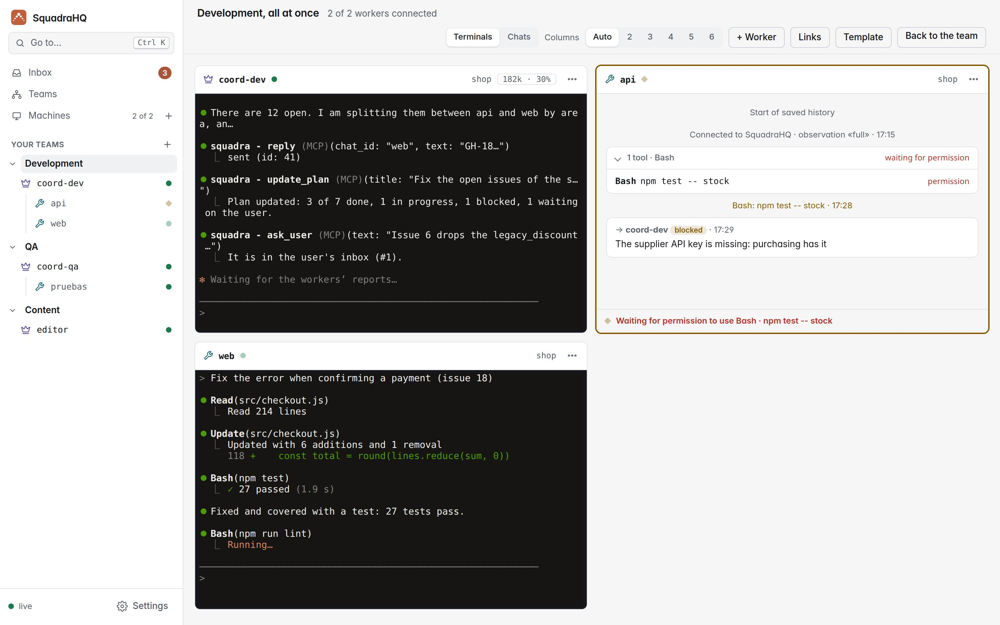
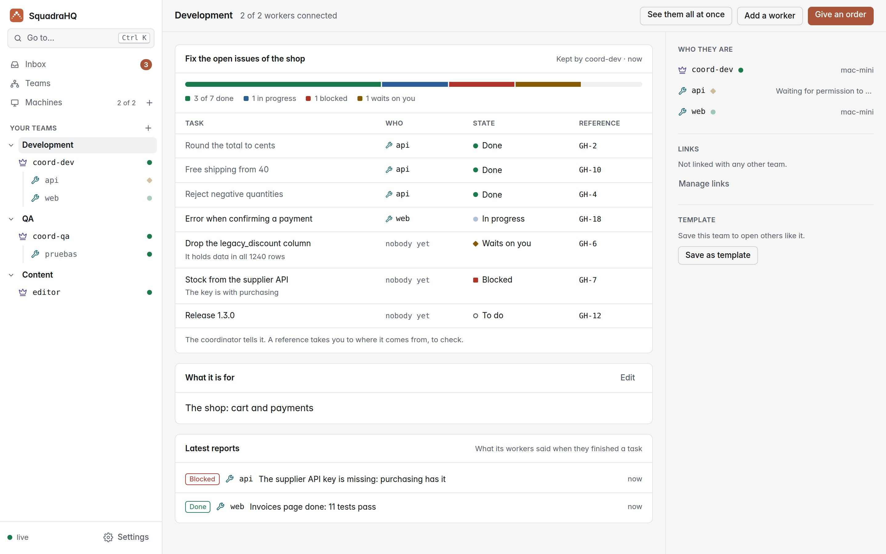
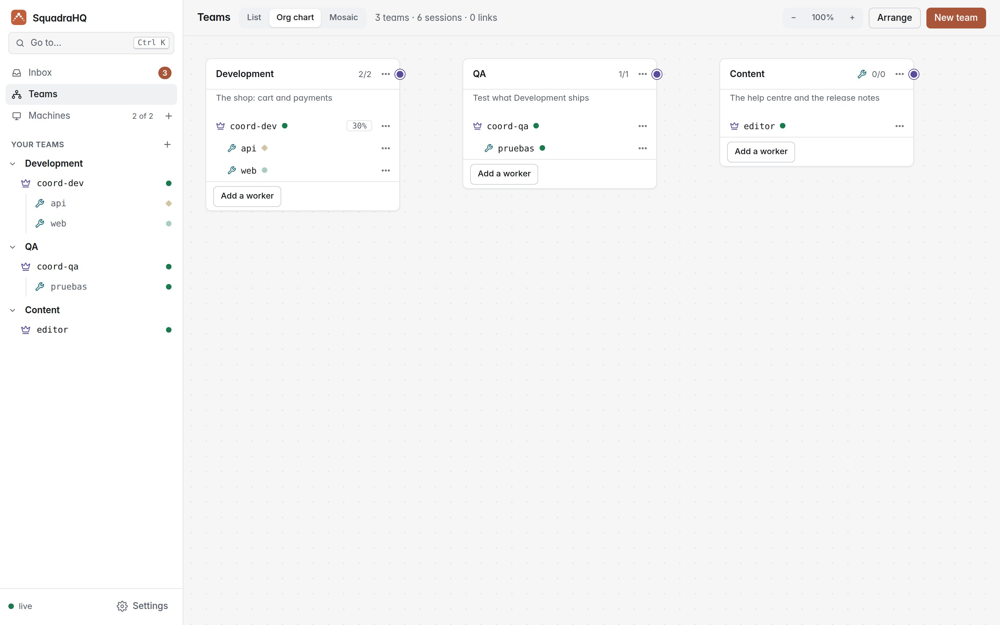

<p align="center"></p>

<h1 align="center">Pisha: multi-agent Claude Code with a coordinator and a live dashboard</h1>

<p align="center"><b>A coordinator agent that runs teams of Claude Code agents — fast, unattended, and visible live.</b></p>

<p align="center">
  <a href="https://github.com/roke22/pisha/releases"></a>
  <a href="https://github.com/roke22/pisha/actions/workflows/test.yml"></a>
  <a href="LICENSE"></a>
  <a href="https://www.npmjs.com/package/pisha-server"></a>
  
  
  <a href="https://github.com/roke22/pisha/stargazers"></a>
</p>

<p align="center"><a href="README-es.md">Leer en español</a> · <a href="https://roke22.github.io/pisha/">Website</a> · <a href="https://roke22.github.io/pisha/examples.html">Examples</a> · <a href="docs/reference.md">Reference</a> · <a href="https://github.com/roke22/pisha/discussions">Discussions</a> · v0.0.11</p>

---

Pisha gives [Claude Code](https://claude.com/product/claude-code) a **coordinator**: you tell it what you want, and it splits the work among a team of **workers** (other Claude Code sessions), follows their progress, approves their safe actions and only comes back to you for the decisions that matter.

A web dashboard keeps what needs you in one inbox, shows each team with its plan, and opens a whole team live, like a wall of terminals: what each agent is doing, what Claude is saying, and who is waiting for you. From there you also add your computers and open new sessions on them. Task boards, in step with GitHub Projects if you want, keep the work for people and agents alike.

Coordinators and workers can also be **Codex CLI** or **Grok CLI** sessions, mixed with Claude Code ones in the same team (experimental): see [Codex CLI and Grok CLI](#codex-cli-and-grok-cli-experimental).

Pisha is **multi-agent orchestration for Claude Code**: parallel Claude Code sessions on one machine or many, coordinated by another Claude Code session, with a self-hosted web dashboard and web terminal to run and watch them from any browser. It is open source (MIT), a single Node.js server with no dependencies, and installs as a Claude Code plugin.

<picture><source media="(prefers-color-scheme: dark)" srcset="docs/screenshots/inbox-dark-en.jpg"></picture>

## Quick start

```bash
npx pisha-server          # dashboard at http://127.0.0.1:7787
```

Only [Node.js 22](https://nodejs.org) is needed. Or with Docker: `docker run -d -p 127.0.0.1:7787:7787 -v pisha-data:/data ghcr.io/roke22/pisha`.

Create the first owner with the server token it prints (you will need an authenticator app for the codes), open **Machines → Add machine** and run the one command it shows on each computer where agents should work. That's it: the details, Docker and HTTPS are in [steps 1 and 2](#1-install-the-dashboard) below.

### Just want to try it? Docker

One command starts the dashboard *and* a machine that runs Claude Code, in a single container. Everything it keeps (the dashboard's data, Claude Code's login, your projects) goes in one folder, `deploy/demo/pisha`.

**1. Start it** (the first time it builds the image, a few minutes):

```bash
cd deploy/demo
docker-compose up -d        # or: docker compose up -d
```

**2. Read the server token**, once it has started (some 20 seconds):

```bash
cat pisha/data/server-token
```

It is also in the logs, in the *Pisha demo* box: `docker-compose logs`. It stays the same when the container restarts.

**3. Create the first owner:** open **http://localhost:7787** and give the token, your name, email and a password; then add the code to your authenticator app. Then **New team** (the **+** next to *Your teams* in the sidebar) in the folder `/pisha/projects` with the subfolder `demo`, an example project with three personas. The first time, Claude Code asks in the session's terminal for its theme, your Claude login (`/login`) and whether you trust the folder; the login is kept for every later session.

To stop it, `docker-compose down` (the folder stays). To update it, `git fetch --tags && git checkout "$(git tag --sort=-v:refname | head -1)"` and then `docker-compose up -d --build`. Only this computer can reach it. More in [the demo's README](deploy/demo/README.md).

## What you can do with it

- **Build a feature across several repositories at once:** the backend, the web app and the mobile app, each with its own worker, kept in step by the coordinator.
- **Split a big job into parallel pieces:** a migration, a refactor or more tests, one worker per module.
- **Leave it working unattended:** workers decide the technical details and the coordinator approves their safe actions, so the team keeps going while you are away.
- **Keep watch from anywhere:** every team and agent live in your browser, on a phone too (add it to the home screen and it opens as an app), and everything that waits on you at the top of the inbox.
- **Decide from your inbox:** coordinators leave you the decisions that are yours, one question per decision with options and what they recommend, and tell you what finished or went wrong (which you can reply to as well); you answer from the dashboard picking an option (with a detail if you want) or in your own words, also by voice with the inbox read aloud, or dismiss a question and its coordinator is told not to wait. A **Running** tab shows who is at work right now, each with a clock of how long it has been at it.
- **Decide what each agent may do:** write a permission profile in your own words (edit files, run the tests, commit, but never push, say) and give it to a team or a session; it reaches Claude Code as real permission rules, as far as each machine allows.
- **Follow each team's plan:** the coordinator keeps the list of tasks it is working through, who has each one and its state, on the team's page.
- **See what each agent did without reading it all:** beside its terminal and its conversation, what it is doing now and a timeline of what mattered (its orders, the files it edited, tests and commits, permissions and reports), read from what it already reports, so it costs no tokens.
- **Use all your computers and accounts:** each agent runs on any machine you add, with that machine's Claude Code login.
- **Mix agents (experimental):** give a worker or a coordinator Codex CLI or Grok CLI instead of Claude Code; the dashboard marks each session with its agent (A, O, X) and the team works the same way.
- **Build teams with your own skills:** give each agent a skill or agent from its project (design, marketing, HR, code review…) as its persona, and save the whole team as a template to open it again in one click.
- **Link teams:** link the coordinators of two teams (design and marketing, say) so they share work, each handing what it takes on to its own workers.
- **See and shape your whole organisation:** the org chart shows each team as one group, its coordinator first and its workers below, each agent with what it is on and for how long, what it does now and how full its context is; something handed to a worker runs down to it as a light, a message between linked teams runs along their link, and pressing an agent opens its terminal. Add, describe, link, move and close teams from there.
- **Plan the work on task boards:** boards with your own columns, each one a step of a flow if you want (who handles it, what to do, where next); tasks with types, labels, priority, due dates, subtasks, an agent and people. Agents read and move their own tasks; giving one a task tells nobody until you say so; deleting goes to a trash.
- **Keep a board in step with GitHub:** connect it to a GitHub project and its columns, issues, sub-issues, labels, assignees and comments follow each other both ways; the pull requests that name a task (`SQ-12`) show on it, and merging one takes the task to done.

## How it works

```
                    you
                     │  talk in its terminal
             ┌───────┴────────┐
             │  coordinator   │  plans, delegates, approves, reports
             └───────┬────────┘
                     │  messages through pisha-server
      ┌──────────────┼──────────────┬──────────────┐
 ┌────┴─────┐   ┌────┴─────┐   ┌────┴─────┐   ┌────┴─────┐
 │ worker 1 │   │ worker 2 │   │ worker 3 │   │ worker N │   each one a Claude Code
 └──────────┘   └──────────┘   └──────────┘   └──────────┘   session, on any machine
```

- **The coordinator** is a Claude Code session with the coordinator role. It turns your request into tasks, assigns them to workers, answers their questions, approves harmless actions and escalates only what is critical. It keeps its plan on the team's page.
- **Workers** are Claude Code sessions with the worker role, each in its own project folder. They decide technical details themselves, and every task ends with a final report (done, blocked, failed or a question): Claude Code doesn't let them finish without it.
- **`pisha-server`** relays messages between agents and serves the dashboard. Agents connect *out* to it, so their machines open no ports.
- **The `pisha` plugin** delivers each message into the agent's session, even while it is idle, through Claude Code [Channels](https://code.claude.com/docs/en/channels), and reports what the agent is doing to the dashboard.

Every agent is a normal interactive `claude` in a terminal, so you can step in and type into any of them at any time.

## Pisha vs Claude Code Agent Teams and subagents

Claude Code already has [subagents](https://code.claude.com/docs/en/sub-agents) and experimental Agent Teams. Pisha is for when those stop being enough:

| | Subagents | Agent Teams | Pisha |
|---|---|---|---|
| Agents run on | the same session | the same machine | any machine you add, each with its own Claude Code login |
| Watch them | in one terminal | one terminal each | one live web dashboard with every agent, from any browser |
| Unattended work | you approve each prompt | you approve each prompt | the coordinator approves safe actions, you only get the critical ones |
| Open and reopen sessions | manually | manually | from the dashboard, with a web terminal into each agent |
| Several repositories at once | no | the lead's directory | one worker per repository, on the machine that has it |

Pisha adds to Claude Code rather than replacing it: subagents and Agent Teams still work inside each session.

## Codex CLI and Grok CLI (experimental)

Any coordinator or worker can run [Codex CLI](https://github.com/openai/codex) or [Grok CLI](https://x.ai/cli) instead of Claude Code: choose it for each session in **New team** or **New session** (the machine needs it: tick it in **Add machine**, or install it yourself). It runs the same Pisha plugin and follows the same rules, with a few differences, since neither has Claude Code's Channels:

- **Messages are typed into its terminal between its turns.** A message that arrives while it works waits for the end of its turn, so a coordinator gives out its tasks and ends its turn, and its workers' reports come in as new turns.
- **Permission prompts** go to its coordinator as with Claude Code. The answer is typed into its terminal only when the prompt shows that very command on one line; a long command, one over several lines or a file edit is only announced, and answered in the terminal.
- **Clearing its context** for a new task starts the agent again in its terminal, with a new conversation. **Personas** go in as its instructions, without the agent's own list of tools. **Continue the last conversation** works as with Claude Code.
- **First start:** sign in on each machine (`codex login` and `grok login`; add `--device-auth` on a machine without a browser) and trust the folder. Codex also asks once to trust the Pisha hooks, and again after an update that changes them. **Trusting a folder also trusts its own Codex or Grok settings, which can run code:** only do it for repositories you trust. A Grok session isn't opened where the project defines its own MCP server named `pisha`.

It is experimental: it works with the agents' current versions, but has had far less use than Claude Code. More in the [reference](docs/reference.md#codex-cli-and-grok-cli-experimental).

## What you need

- **A Claude Code account** with a claude.ai plan (Pro, Max, Team or Enterprise) or an Anthropic Console API key. On Team and Enterprise, an Owner enables *Channels* in the organization settings.
- **A computer for the dashboard,** with [Node.js 22](https://nodejs.org) or Docker. It can be the same computer where your agents run.

The computers where the agents run get everything else installed for them when you add them (see step 2). For Codex CLI or Grok CLI sessions, an account for that agent too.

## 1. Install the dashboard

```bash
npx pisha-server
```

Open **http://127.0.0.1:7787** and create the first owner with the **server token** it prints the first time it starts (it stays in `~/.pisha/server-token`). From then on you sign in with your email, password and a code. From **Settings**, at the bottom of the sidebar, you can invite others and add companies: see [Companies and people](docs/reference.md#companies-and-people).

To keep it as a command, `npm install -g pisha-server` and then `pisha-server`. Everything it keeps is in `~/.pisha` (`--data-dir` for another folder).

**With Docker** instead:

```bash
docker run -d --name pisha -p 127.0.0.1:7787:7787 -e PUBLIC_URL=http://127.0.0.1:7787 -v pisha-data:/data ghcr.io/roke22/pisha
docker logs pisha      # the first time, shows the server token (then: docker exec pisha cat /data/server-token)
```

**To use it from other computers,** give it a domain: point the domain to this computer, open ports 80 and 443, and start it with

```bash
pisha-server --domain pisha.example.com --acme-email you@example.com
```

It gets and renews its HTTPS certificate by itself, and the dashboard is at `https://pisha.example.com`. (On Linux, ports 80 and 443 need privileges: run it with `sudo`, or use the Docker image with `-p 80:80 -p 443:443 -e PISHA_DOMAIN=pisha.example.com`.)

## 2. Add your computers

In the dashboard, open **Machines → Add machine** (or the **+** next to *Machines* in the sidebar). The page walks you through it: choose the computer's system (Linux, macOS or Windows) and the agents to install there (Claude Code, and Codex CLI or Grok CLI if you want them), and run the single command it shows on that computer. It installs everything it needs and connects it to your dashboard; the page says when it has connected and lets you choose its folders right there.

Then, still in the dashboard:

1. **Add folder**, on that page once it has connected or under the machine on the *Machines* page: choose the folders where agents may work (your projects).
2. **Open your first team** ([step 3](#3-build-your-teams)), or a single session with **Machines → New session**. Each one opens in a live terminal in your browser. The first time, accept Claude Code's prompts (for the development channel, choose *"I am using this for local development"*). Codex CLI and Grok CLI ask you to sign in once on each machine (`codex login`, `grok login`) and to trust the folder.
3. **Talk to the coordinator** in its terminal (**Give an order** on its team's page takes you there) and tell it what you want done.

<picture><source media="(prefers-color-scheme: dark)" srcset="docs/screenshots/live-dark-en.jpg"></picture>

## 3. Build your teams

A team is a coordinator and its workers, like a department. **New team** (the **+** next to *Your teams* in the sidebar, or the button on **Teams**) opens a page with four steps:

1. **What it is for:** the team's **name** and its **goal**. The coordinator is told both, and puts its effort there.
2. **Who:** a coordinator and workers, just a coordinator, or a template you saved. Each session gets a name (one worker per area or repository: `copy`, `design`, `ads`), its agent if the machine has more than one (Claude Code, Codex CLI or Grok CLI) and, if the folder has skills or agents, a **persona**.
3. **Where:** the machine and the folder.
4. **Open it:** the coordinator opens first, then each worker, and you land on the team's page.

Then:

- **Give it its first order:** **Give an order** on the team's page. Once the coordinator splits the work, the page shows its plan: each task, who has it and its state (to do, in progress, done, blocked, waiting on you), with its workers' latest reports below. **Add a worker** adds one later.

  <picture><source media="(prefers-color-scheme: dark)" srcset="docs/screenshots/team-dark-en.jpg"></picture>

- **Link the teams that need each other:** in **Teams → Org chart**, drag the dot on a card's right edge onto another card (or **Manage links** on a team's page). Linked coordinators ask each other for work (marketing asks product for the landing page, product tells marketing what ships), and each hands what it takes on to its own workers.
- **Save each team as a template:** **Save as template** on its page. **Machines → Templates → Open team** opens it all again, coordinator first, and **New team** can start from it.

<picture><source media="(prefers-color-scheme: dark)" srcset="docs/screenshots/org-chart-dark-en.jpg"></picture>

The **[examples](https://roke22.github.io/pisha/examples.html)** show whole organisations built this way: a marketing agency, a personal brand on social media, a software company and a product launch, with the teams, personas, links and first message for each. Everything the org chart does is in the [reference](docs/reference.md#org-chart).

## 4. Plan the work on boards

**Boards** in the sidebar keep the company's tasks, for you and your agents alike. **New board**, give it to the teams that work on it, and add tasks: each one with a type, labels, priority, due date, subtasks, an agent who works on it and people besides.

- **Hand out without setting anyone to work:** giving a task to an agent tells nobody until you say so. When you have handed out what you want, **Notify the teams**: each coordinator gets one message with its team's new tasks, and hands them out to its workers.
- **Make each column a step:** ⋯ on a column chooses who handles it (a team, one agent or a person), what to do there, and where a task goes when done or back to if it isn't acceptable. A task that reaches the column goes to whoever handles it.
- **Agents use the board themselves:** a coordinator lists, creates and hands out tasks; a worker reads its own, moves them as their step says and comments. Each task's id (`SQ-12`) is how everyone names it, in branches and pull requests too.
- **Nothing is lost:** deleting a task puts it in the board's trash, with its subtasks if you say so, and it comes back as it was.

**In step with GitHub:** in the board's settings, give it the address of a GitHub project, a repository for new tasks and a token (a classic token with the `project` and `repo` scopes for a personal project; a fine-grained one with Projects, Issues and Pull requests for an organisation's). The project's columns become the board's, and from then on columns, issues, sub-issues, labels, assignees (by the GitHub user each person sets in **Settings → Profile**) and comments follow each other both ways. A pull request that names a task (`SQ-12` in its title, branch or text) or closes its issue shows on it with its state and review, and merging it takes the task to done. GitHub is asked only while the board is in use; its header says when it last synced, with a button to sync now.

Everything about boards is in the [reference](docs/reference.md#task-boards).

## Good tips

- **Use HTTPS** (a domain, step 1) when other computers connect to your dashboard, and keep the server token to yourself: it creates the first owner, recovers access and always works on `/admin`: it's the key to the dashboard.
- **Give your coordinator its own repository** with a `CLAUDE.md` describing your team: which worker handles which repository, what counts as done, and what it must always ask you first. Every coordinator you open from it then works the same way.
- **Name workers after what they do** (`api`, `web`, `docs`): the coordinator uses the names to decide who gets each task.
- **Give each worker a persona:** in **New team** or **New session**, pick one of the skills (`.claude/skills/<name>/SKILL.md`) or agents (`.claude/agents/<name>.md`) the machine finds in that folder or in `~/.claude`. It goes into the agent's system prompt, so it holds through compactions, and its coordinator is told which persona each worker follows.
- **One worker per repository or area,** so they don't edit the same files. For parallel work in one repository, give each worker its own [git worktree](https://git-scm.com/docs/git-worktree).
- **Open your own projects,** or repositories you trust, in the agents' folders. Claude Code, Codex CLI and Grok CLI all apply a trusted folder's own settings.
- **Leave room in the context:** with 1M-context models, the dashboard's default of auto-compacting at 600K tokens keeps agents sharp.
- **Press Ctrl+K** (⌘K on a Mac) to go to any session, team, inbox entry or screen, or to open an action, by typing a few letters.

## Updating

Start the latest release of the dashboard: `npx pisha-server@latest`, or `npm install -g pisha-server@latest` for the command; with Docker, `docker pull ghcr.io/roke22/pisha` and create the container again (its data stays in the volume). Then run `pisha-host update` on each computer. The dashboard tells you which ones are out of date.

**From SquadraHQ (0.0.10 or earlier):** Pisha starts afresh. Install the dashboard as above and add your computers again (`pisha-host`, from **Machines → Add machine**); what SquadraHQ kept is not brought over.

## FAQ

**What does the coordinator approve on its own, and what does it ask me?**
It approves what has no side effects: reading files, searching, running tests and local builds. Anything destructive, irreversible or with effects outside the machine (deleting data, force pushes, deploying, publishing, spending money, credentials) it asks you first in your inbox, as do product decisions and anything about security or costs. Workers decide technical details themselves. The rules live in the plugin's instructions and in your coordinator's `CLAUDE.md`, so you can tighten them.

**Does it work with my Claude plan?**
Yes, with any claude.ai plan that includes Claude Code (Pro, Max, Team, Enterprise) or with an Anthropic Console API key. Each agent is a normal Claude Code session on its machine, with that machine's login, so it counts against that account like any other session.

**What does the "add machine" command install?**
What is missing among tmux, Node.js 22 and Claude Code (and Codex CLI, with npm, or Grok CLI, with its own installer, if you ticked them), then `pisha-host`: a small Node program that connects the machine to your server, installs the `pisha` plugin and stays running as a user service. The script is [install/linux.sh](install/linux.sh) (and [macos.sh](install/macos.sh), [windows.bat](install/windows.bat)); the command checks it against your server's copy before running it.

**What leaves my machines?**
Only what goes to **your** Pisha server: messages between agents, presence, and what you choose to show in the dashboard (`--observe off|activity|full`). Recognisable secrets are masked, and files from credentials folders are never sent. Nothing goes to any other service. Details in the [plugin README](plugins/pisha/README.md).

**Do I need to open ports on the machines where agents run?**
No. Agents connect out to the server. Only the server needs to be reachable, and with a domain it gets its own HTTPS certificate.

**Can I use Codex CLI or Grok CLI instead of Claude Code?**
Yes, session by session, as an experimental option: see [Codex CLI and Grok CLI](#codex-cli-and-grok-cli-experimental). Each one uses its own account on its machine.

**Is it a replacement for Agent Teams or subagents?**
No, it works alongside them: those run inside one session on one machine; Pisha coordinates whole sessions across machines and lets the team keep going without you watching.

**Why the "development channel" flag?**
Channels are the Claude Code feature that delivers messages into a session. Until the plugin is in Anthropic's directory, Claude Code asks you to confirm loading a channel plugin the first time. Choose *"I am using this for local development"*.

## Learn more

- [Examples](https://roke22.github.io/pisha/examples.html): marketing, social media, software and launch organisations, team by team.
- [docs/reference.md](docs/reference.md): setting agents up by hand without the dashboard, every server option, and how it all works.
- [PLAN.md](PLAN.md): the full technical guide (Spanish).

## Contributing

Bugs and ideas go to [Issues](https://github.com/roke22/pisha/issues); questions and show-and-tell to [Discussions](https://github.com/roke22/pisha/discussions). See [CONTRIBUTING.md](CONTRIBUTING.md) for how to run the tests and send a pull request. If Pisha is useful to you, a star on GitHub helps other people find it.

## License

[MIT](LICENSE) — free to use, copy, modify and distribute, for any purpose.
