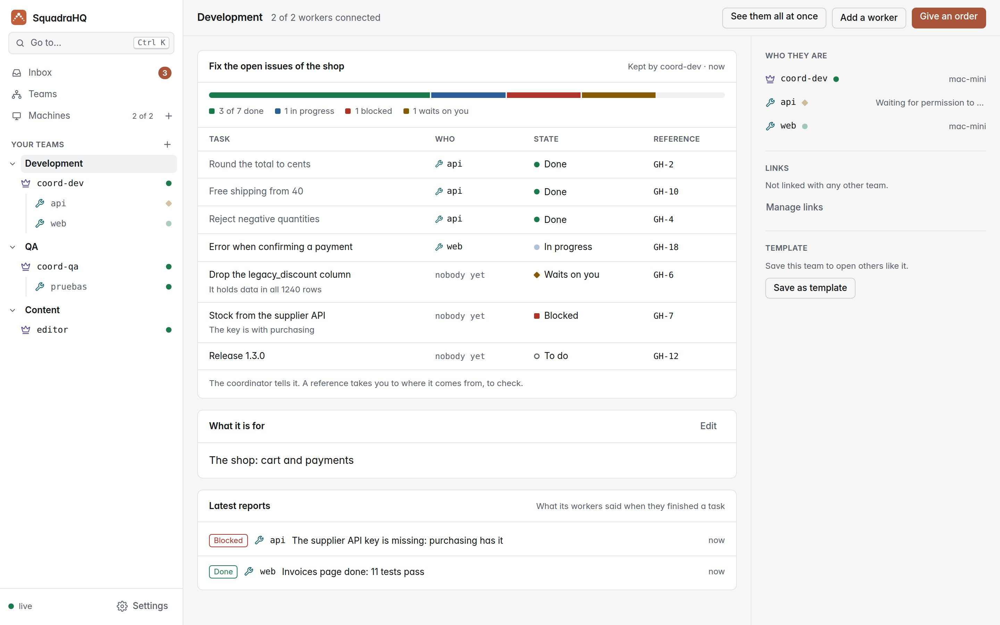
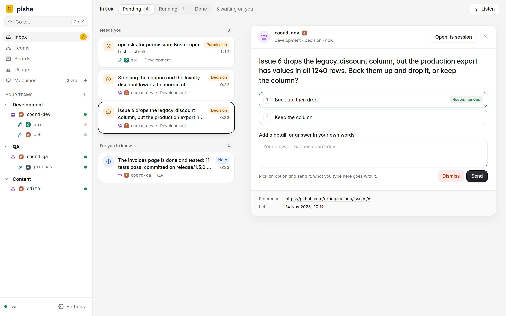
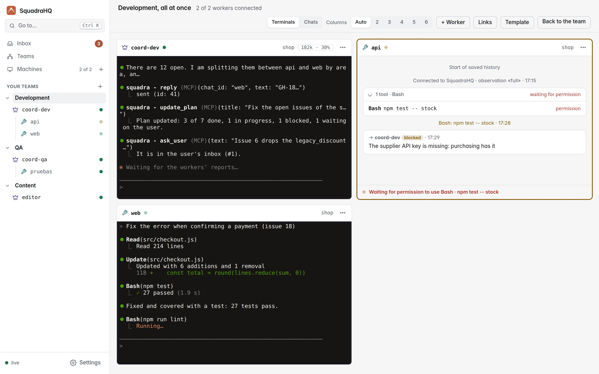
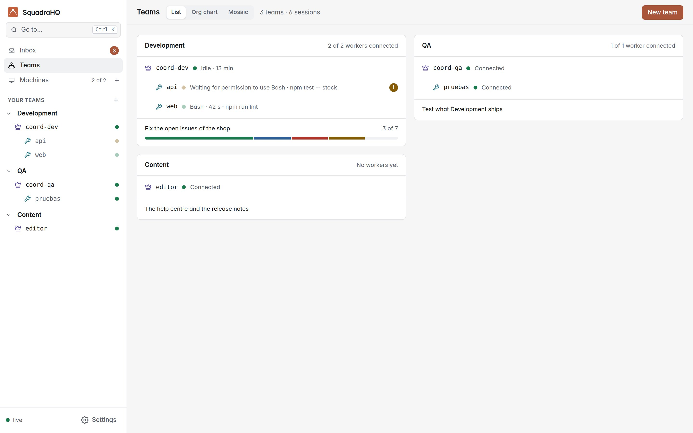
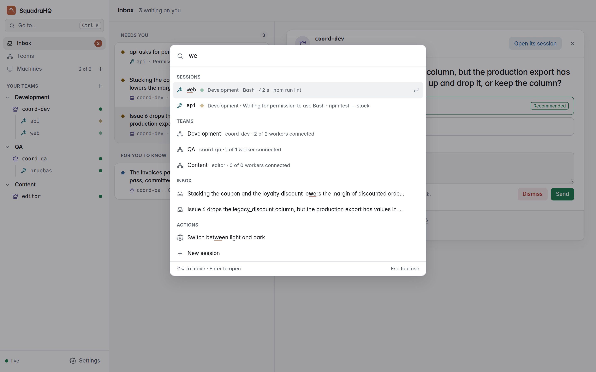
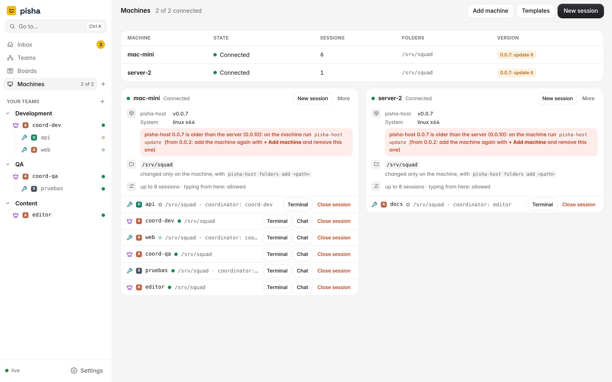
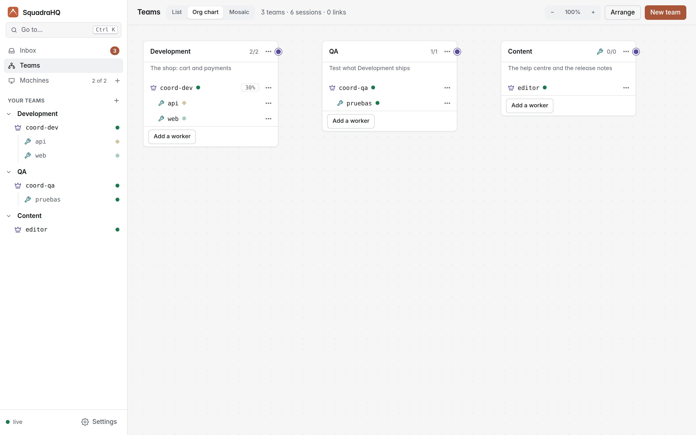
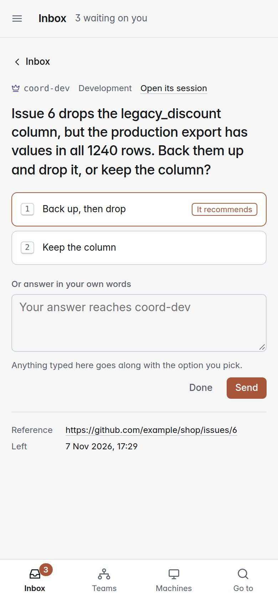

<p align="center"></p>

<h1 align="center">SquadraHQ</h1>

<p align="center"><b>A coordinator agent that runs teams of Claude Code agents — fast, unattended, and visible live.</b></p>

<p align="center"><a href="referencia.md">Leer en español</a> · v0.0.10</p>

---

> This is the complete reference: manual setup, every option and the technical details. To get started, the [README](../README.md) is all you need.


SquadraHQ gives [Claude Code](https://claude.com/product/claude-code) a **coordinator agent** that runs a team of other Claude Code agents — fast and largely unattended. You tell the coordinator what you want; it splits the work, hands tasks to the workers, keeps track of what each one is doing, approves their safe actions, and only comes back to you for the decisions that matter. It is built to manage large teams of agents in an automated way, on one machine or spread across many.

A web dashboard keeps what waits on you in one inbox, shows each team with its plan, and can show a whole team at once, like a wall of terminals: what each agent is doing, which tool it is running, what Claude is saying, and who is waiting for a decision.

<picture><source media="(prefers-color-scheme: dark)" srcset="screenshots/team-dark-en.jpg"></picture>

## How it works

```
                    you
                     │  talk in its terminal
             ┌───────┴────────┐
             │  coordinator   │  plans, delegates, approves, reports
             └───────┬────────┘
                     │  messages through squadra-server
      ┌──────────────┼──────────────┬──────────────┐
 ┌────┴─────┐   ┌────┴─────┐   ┌────┴─────┐   ┌────┴─────┐
 │ worker 1 │   │ worker 2 │   │ worker 3 │   │ worker N │   each one a Claude Code
 └──────────┘   └──────────┘   └──────────┘   └──────────┘   session, on any machine
```

- **The coordinator** is a Claude Code session with the coordinator role. It turns your request into tasks, assigns them to workers, answers their questions, approves harmless actions, and escalates only what is critical (product decisions, destructive changes, security, costs). It starts work only with an order, from you (in its terminal or the inbox) or from a linked coordinator: its workers connecting, its persona or the files in its folder are not one.
- **Workers** are Claude Code sessions with the worker role, each in its own project folder. They take decisions on technical details themselves, and every task ends with a final report: done, blocked, failed or a question.
- **`squadra-server`** (Node, no dependencies) relays messages between agents, knows who is alive, and serves the live dashboard. Agents connect *out* to it, so their machines open no ports.
- **The `squadra` plugin** for Claude Code delivers each message straight into the agent's session — even while it is idle — through Claude Code [Channels](https://code.claude.com/docs/en/channels), and reports what the agent is doing to the dashboard.

Every agent is a normal interactive `claude` running in a terminal, so you can step in and type into any of them at any time.

### Agents and accounts

- **SquadraHQ is built on Claude Code.** Any session can also run Codex CLI or Grok CLI, mixed in one team with Claude Code ones: that is experimental (see [Codex CLI and Grok CLI](#codex-cli-and-grok-cli-experimental)).
- **Each agent uses the login of the machine it runs on**, so a team can mix agents on the same subscription and agents on different subscriptions or accounts.
- **Supported sign-in methods:** the ones Claude Code Channels supports:
  - claude.ai plans: Pro, Max, Team and Enterprise;
  - Anthropic Console API keys.
- **Not supported:** Channels is not available through Amazon Bedrock, Google Cloud Vertex AI or Microsoft Foundry, so agents signed in that way cannot join a team.

## What you can do with it

- **Build a feature across several repositories at once.** Ask the coordinator for "sign in with Google" and it gives the backend, the web app and the mobile app each to its own worker, keeps them in step and tells you when it all fits together.
- **Split a big job into parallel pieces.** A migration, a refactor or a test-coverage push, divided by module or by folder, with one worker per piece and the coordinator checking that nobody steps on anyone else.
- **Leave it working unattended.** Workers decide technical details on their own and the coordinator approves their safe actions, so the team keeps going while you are away. Only product decisions, destructive changes, security and costs wait for you.
- **Keep watch from anywhere.** The dashboard shows every team and agent live, from any browser, a phone too. The inbox lists everything that waits on you, and you can step into any agent, by its terminal or from the web.
- **Use every machine you have.** Agents can run on your laptop, a build server or a GPU box; each connects out to the server, so no ports are opened.
- **Mix subscriptions.** Each agent uses the Claude Code login of its machine, so a team can spread its work over several accounts.
- **Run several teams.** Several coordinators can share one server, each with its own workers, and the dashboard groups them into teams.

## Features

- **Coordinator and workers.**
  - The coordinator delegates with `reply`; each task ends with the worker's final report (see *Task reports* below).
  - The coordinator only answers when it has something to say, so the two sides never loop on acknowledgements.
- **Decisions where they belong.** Workers decide technical details themselves and ask about product or destructive choices; the coordinator answers or asks you.
- **Permission relay.** A worker's permission prompt also goes to the coordinator, which approves harmless actions and asks you about the rest. The first answer wins, so you can still answer in the worker's terminal.
- **Permission profiles.** What a team's agents may do without asking (commit yes, push never…), written in your own words and turned into Claude Code's own permission rules, which each machine applies as far as it allows (see *Permission profiles* below).
- **Delivery that matches the role.**
  - A message to a disconnected worker is refused on the spot, so a task never waits for a session that may not come back.
  - Messages to the coordinator are queued until it returns (for up to 24 h; at most 500 per sender and 10 000 in all, oldest dropped first).
- **Presence.**
  - `ping` tells whether a session you have exchanged messages with (or share a group with) is alive, without waking it; it shows no presence for others.
  - The coordinator is notified when a worker leaves, closes, or crashes, together with any work it never picked up (once the coordinator has written to that worker). A worker that just stops responding (its network dropped, its machine went to sleep) is announced only after 2 minutes (`SQUADRA_LOST_GRACE_MS`), so a short network cut doesn't wake the coordinator. Meanwhile `ping` shows it as NOT RESPONDING, and what it is sent is queued: it gets it if it comes back in time; if not, the notice lists it as dropped.
- **Context that survives compaction.**
  - When an agent auto-compacts, SquadraHQ hands its role, its coordinator and the latest messages it received back to it, so it keeps working on the same task.
  - The coordinator is told when a worker compacts, and gets one warning when a worker passes 80% of its context (once the coordinator has written to that worker).
  - `ping` and the dashboard show each agent's context use before auto-compaction (not for sessions with observation `off`, which also send no 80% or compaction notices).
- **Access control:**
  - pairing codes and allowlists;
  - groups with @mentions;
  - every sender is authenticated by the server.
- **Live dashboard** (see *The dashboard* below):
  - **Inbox,** the home page: the decisions and results coordinators leave for you, permission prompts waiting in a session and names to approve, answered from there (see *Inbox* below).
  - **Teams:** each team with its coordinator and workers in the sidebar; a page per team with its plan, its goal and its workers' latest reports; every session of a team live at once.
  - **The plan:** the tasks a coordinator is working through, who has each and its state, on its team's page (see *The plan* below).
  - **What mattered:** beside each session's terminal and conversation, what it is doing now and a timeline of its orders, edits, tests, commits, permissions and reports, with no tokens spent (see *The dashboard* below).
  - **Per-session view:** its conversation (markdown, grouped tools with their input and output, infinite scroll) or its live terminal, and actions to clear, archive or delete it.
  - **"Needs you" bar:** outside the inbox, permissions waiting for an answer and contexts about to compact, from every session.
  - **Ctrl+K** (⌘K): go to any session, team, inbox entry or screen, or open an action.
  - English and Spanish, light and dark, and a layout for phones.
- **Sessions opened from the dashboard.**
  - Add a machine with one command, generated by the dashboard, that installs and enrolls `squadra-host` there.
  - Open coordinators and workers on it from the browser, and use their terminals live: see Claude, type to it, accept its dialogs, even run `/login` for that machine's subscription.
  - The machine only accepts a session *spec* (name, role, an allowed folder, the auto-compact window, a persona's id), never a command; its limits live on the machine.
  - **Personas:** each session can follow a skill or agent from its project or from `~/.claude`, picked from a list; it stays in its system prompt for the whole session, and its coordinator knows which one each worker follows.
  - **Team templates:** save a team (coordinator and workers, with their folders and personas) and open it again in one go.
  - **Linked teams:** link two coordinators so their teams share work: each one asks the other and hands what it takes on to its own workers.
  - **Org chart:** every team as a card with its agents, the links between teams as lines, and what each one is for on hover; add, describe, link, move and close teams and agents from there.
  - Sessions are only opened by you, never by Claude: a coordinator that needs more workers asks you.

## Gallery

What the dashboard looks like, in light or dark as your system is set. Click any image to see it full size.

<table>
<tr><td width="50%" valign="top"><a href="screenshots/inbox-light-en.jpg"><picture><source media="(prefers-color-scheme: dark)" srcset="screenshots/inbox-dark-en.jpg"></picture></a><br><b>Inbox</b><br>What waits on you on the left, the one picked on the right: its options numbered, the recommended one marked, and room for your own words.</td><td width="50%" valign="top"><a href="screenshots/team-light-en.jpg"><picture><source media="(prefers-color-scheme: dark)" srcset="screenshots/team-dark-en.jpg"></picture></a><br><b>A team with its plan</b><br>Its coordinator's plan (each task, who has it, its state), what the team is for and its workers' latest reports.</td></tr>
<tr><td width="50%" valign="top"><a href="screenshots/live-light-en.jpg"><picture><source media="(prefers-color-scheme: dark)" srcset="screenshots/live-dark-en.jpg"></picture></a><br><b>All at once</b><br><b>See them all at once</b> on a team's page: the coordinator's terminal and its workers side by side, to watch or type to.</td><td width="50%" valign="top"><a href="screenshots/teams-light-en.jpg"><picture><source media="(prefers-color-scheme: dark)" srcset="screenshots/teams-dark-en.jpg"></picture></a><br><b>Teams</b><br>A card per team: its coordinator and workers, what each is doing, and the plan's progress or the goal.</td></tr>
<tr><td width="50%" valign="top"><a href="screenshots/palette-light-en.jpg"><picture><source media="(prefers-color-scheme: dark)" srcset="screenshots/palette-dark-en.jpg"></picture></a><br><b>Ctrl+K</b><br>Type a few letters to go to a session, team, inbox entry or screen, or to open an action.</td><td width="50%" valign="top"><a href="screenshots/machines-light-en.jpg"><picture><source media="(prefers-color-scheme: dark)" srcset="screenshots/machines-dark-en.jpg"></picture></a><br><b>Machines</b><br>Each computer with its state, sessions, folders and version, and under each one its sessions, with their terminal and chat.</td></tr>
<tr><td width="50%" valign="top"><a href="screenshots/org-chart-light-en.jpg"><picture><source media="(prefers-color-scheme: dark)" srcset="screenshots/org-chart-dark-en.jpg"></picture></a><br><b>Org chart</b><br>Every team as a card with its agents; drag a card's dot onto another to link two teams.</td><td width="50%" valign="top"><a href="screenshots/phone-decision-light-en.jpg"><picture><source media="(prefers-color-scheme: dark)" srcset="screenshots/phone-decision-dark-en.jpg"></picture></a><br><b>A decision on a phone</b><br>The same inbox on a phone: the question, its options and room to answer in your own words.</td></tr>
</table>

## Requirements

- **Linux or macOS.** On Windows, use WSL (see [Windows (WSL)](#windows-wsl) below).
- **Node.js ≥ 22.13**, on the server and on every machine running a Claude session with the plugin.
- **tmux ≥ 3.2**, only on machines where you open sessions from the dashboard.
- **Claude Code** signed in with a claude.ai plan (Pro, Max, Team or Enterprise) or an Anthropic Console API key. Each agent can use a different account.
- **On Team/Enterprise**, an Owner must enable *Channels* in the organization settings.

### macOS

Everything works as on Linux:

```bash
brew install node@22 tmux        # tmux only where you open sessions from the dashboard
```

- Add the `claude-squadra` alias (step 3 below) to `~/.zshrc`, macOS's default shell.
- `squadra-host service` prints a **launchd** agent (`~/Library/LaunchAgents/com.squadra.host.plist`) instead of a systemd unit, with the commands to load it. It runs while you are logged in, because Claude Code keeps its login in your Keychain.

### Windows (WSL)

SquadraHQ does not run on native Windows: squadra-host refuses to start there and the plugin refuses to log in; both point you to WSL. Run Claude Code and SquadraHQ inside **WSL**, the Linux that Windows ships with, and everything works as on Linux:

1. **Install WSL with Ubuntu.** In PowerShell as administrator: `wsl --install -d Ubuntu`, restart, and open *Ubuntu* from the Start menu.
2. **Inside Ubuntu, install Node 22, tmux and Claude Code:**
   ```bash
   curl -fsSL https://deb.nodesource.com/setup_22.x | sudo -E bash -
   sudo apt install -y nodejs tmux
   curl -fsSL https://claude.ai/install.sh | bash
   ```
3. **Follow the [Quick start](#quick-start) inside Ubuntu.** The dashboard opens in your Windows browser at `http://localhost:7787`, because WSL forwards `localhost` to Windows.

- **Keep projects in the Linux file system** (`~/projects`), not under `/mnt/c/…`: Claude's tools are much faster there, and squadra-host refuses `/mnt/c` folders (Windows drives show as writable by anyone).
- **WSL stops when Windows sees it idle**, for example after you close every Ubuntu terminal. Keep one open while the team works, or look up how to keep WSL running in Microsoft's documentation.
- **To keep squadra-host running in the background,** enable systemd in WSL (`[boot]` `systemd=true` in `/etc/wsl.conf`; recent Ubuntu images have it on) and use the systemd unit from `squadra-host service`.


## Quick start

### 1. Start the server

```bash
git clone https://github.com/roke22/SquadraHQ.git squadra && cd squadra
git checkout "$(git tag --sort=-v:refname | head -1)"   # the latest release
node server/server.js
```

On first start it generates two tokens and prints both, only that time (logs are kept, and read, by more people than should hold them): the **server token** (admin, `data/server-token`), to create the first owner, and the **join token** (`data/join-token`), which machines use to register their sessions, in a ready-to-paste `/squadra:configure` command. It listens on `http://127.0.0.1:7787`.

- **With Docker:**
  ```bash
  docker build -f server/Dockerfile -t squadra-server .
  docker run -d --name squadra-server -p 127.0.0.1:7787:7787 -e PUBLIC_URL=http://127.0.0.1:7787 -v squadra-data:/data squadra-server   # this machine only; for other machines use HTTPS (below)
  docker logs squadra-server   # the first time, shows the tokens (then: docker exec squadra-server cat /data/server-token /data/join-token)
  ```
- **Options** (flags, or the environment variable in brackets):

  | Flag | |
  |---|---|
  | `--host <ip>` (`HOST`) | Interface to listen on. Default `127.0.0.1`: this machine only (with `--domain` or `--tls-cert`: all interfaces) |
  | `--all-interfaces` | Listen on every IP of the machine (same as `--host 0.0.0.0`) |
  | `--port <n>` (`PORT`) | Default `7787` (with `--domain` or `--tls-cert`: `443`; `--domain` also uses `80`, `--http-port`) |
  | `--public-url <url>` (`PUBLIC_URL`) | The address agents and browsers use, e.g. `https://squadra.example.com`; printed in the setup command |
  | `--data-dir <path>` (`DATA_DIR`) | Database and files. Default `./data` |
  | `--domain <name>` (`SQUADRA_DOMAIN`) | Built-in HTTPS with an automatic Let's Encrypt certificate (see below) |
  | `--tls-cert <file>` `--tls-key <file>` | HTTPS with your own certificate; reloaded when the files change |
  | `--trust-proxy` (`TRUST_PROXY=1`) | Behind a reverse proxy (or tunnel) that sets `X-Forwarded-For`: rate limits use the client's address. Without it every client behind it shares one address, and an address has at most 256 connections open |

  `node server/server.js --help` lists every option.

### Serving it on a domain (HTTPS)

Sessions on other machines need to reach the server. **Don't expose it over plain HTTP:** the server token, the session secrets and everything the dashboard shows would travel unencrypted, and the server warns you if you try.

**Built-in HTTPS (simplest):** give the server your domain and it gets a Let's Encrypt certificate by itself, renews it before it expires, and redirects HTTP to HTTPS. Nothing else to install.

1. Point your domain's DNS record to the machine.
2. Make sure ports **80** (certificate validation) and **443** are reachable from the internet.
3. Start it:
   ```bash
   node server/server.js --domain squadra.example.com --acme-email you@example.com
   # or with Docker:
   docker run -d --name squadra-server -p 80:80 -p 443:443 -v squadra-data:/data \
     -e SQUADRA_DOMAIN=squadra.example.com squadra-server
   ```
   It prints `/squadra:configure https://squadra.example.com <join-token>`, and the dashboard is at `https://squadra.example.com/`.

- **Privileged ports outside Docker (Linux):** ports 80 and 443 need privileges. Run it as root, or allow Node once with `sudo setcap cap_net_bind_service=+ep $(command -v node)`.
- **Trying it out:** `--acme-staging` uses Let's Encrypt's test environment, which issues untrusted certificates but has more generous limits.

**Your own certificate:** `--tls-cert fullchain.pem --tls-key privkey.pem --public-url https://squadra.example.com`. The server reloads the files when they change, for example after a certbot renewal.

**Behind a reverse proxy:** if you already run one, keep the server on `127.0.0.1`, proxy to it, and start it with `--public-url https://your-domain --trust-proxy` (without them the commands it gives machines use plain http, which they refuse). [`deploy/`](../deploy/) has a ready Docker Compose with Caddy.

**Private network:** on something like Tailscale you can skip TLS with `--all-interfaces`.

Sessions always connect *out* to the server, so their machines open no ports.

### 2. Install the plugin (once per machine)

On every machine where a coordinator or a worker will run. Inside `claude`:

```
/plugin marketplace add roke22/SquadraHQ
/plugin install squadra@squadra
```

Or from the terminal (handy on servers, in WSL or in scripts):

```bash
claude plugin marketplace add roke22/SquadraHQ
claude plugin install squadra@squadra
```

Then point it at your server, with the command the server printed at startup:

```
/squadra:configure https://squadra.example.com <join-token>
```

- **Use the address the other machines reach** the server at: `http://127.0.0.1:7787` only works on the server's own machine.
- **Start Claude Code again afterwards.** The plugin reads its configuration when a session starts, and the SquadraHQ channel has to be enabled at launch anyway (next step).
- **Machines added from the dashboard** get the plugin installed and configured by themselves when you enroll them (with the server address; the join token only if you tick that option).
- **Claude Code runs the plugin with `node`,** so Node 22.13 or later must be on the `PATH` Claude Code sees.
- To use a local copy of this repository instead, pass its path to `marketplace add` (not on machines run by squadra-host, which only accept the roke22/SquadraHQ marketplace).

**Updating:** `claude plugin marketplace update squadra && claude plugin update squadra@squadra`, then restart the sessions.

### 3. Launch sessions and log in

Channels can only be enabled when Claude Code starts, so add an alias once:

```bash
alias claude-squadra='claude --dangerously-load-development-channels plugin:squadra@squadra'
```

Put it in `~/.bashrc`, or `~/.zshrc` on macOS.

> While Channels is a research preview, this flag shows a confirmation dialog at every start. Choose **"I am using this for local development"**.

Then, in each terminal:

| Command | |
|---|---|
| `/squadra:login coordinator` | Join as the coordinator (named `coord`). With the join token, approve it once in the dashboard (open that session: Approve as coordinator) |
| `/squadra:login worker1` | Join as a worker; it greets the coordinator automatically |
| `/squadra:status` | Who you are, pending pairings, which sessions are alive |
| `/squadra:logout` | Leave |
| `/squadra:access pair <code>` | Approve a worker, in the coordinator's terminal |
| `/squadra:access link <name>` | Link this coordinator with another team's (run it in both) |

The first time a worker joins, the coordinator shows a pairing request; approve it with `/squadra:access pair <code>`. After that, the same name needs no new pairing. A worker opened from the dashboard for a coordinator also opened there needs none: the coordinator's machine approves it (whoever opened both meant them to work together), and the company's activity records it as *worker-approved*.

### 4. Open the dashboard

Browse to the server address (`http://127.0.0.1:7787/`). The first time, create the first owner with the server token; after that, sign in with your email, password and code. See [Companies and people](#companies-and-people).

### The dashboard

- **The sidebar:** **Inbox** (the home page), **Teams** and **Machines** (how many are connected, such as *2 of 3*, and **+** to add one); then **Your teams** (**+** for a new one), each team with its coordinator (crown icon) and its workers (wrench icon). Each session has a state dot: a filled circle when all is well, a diamond when it waits on you, a square on an error, a ring when it is away. Workers without a coordinator, standalone sessions, names waiting for approval and archived sessions have groups of their own. **Settings** is at the bottom. On a phone there is no sidebar: a bar at the bottom has **Inbox**, **Teams**, **Machines**, **Go to** and **Settings**, and **Go to** also switches company. The header says so when the connection is lost.
- **Back:** inside a session, a team, a terminal, a machine or a form, the header has a back button to the screen you came from, named on a wide screen (*‹ Inbox*) and an arrow on a phone. It is the browser's own back, so the phone's back gesture does the same; switching between a session's conversation and terminal, or from one inbox entry to the next, doesn't count as a step. Opened from a link or a notification, back goes one level up: a session to its team, a terminal to its machine.
- **Ctrl+K** (⌘K on a Mac), or **Go to…** at the top of the sidebar: type a few letters to go to any session, team, inbox entry or screen, or to open an action (a new session or team, adding a machine, inviting someone, switching between light and dark, settings), as far as your role allows.
- **Inbox:** what waits on you, see [Inbox](#inbox).
- **Teams:** a card per team with its coordinator, its workers, what each one is doing, and the plan's progress or the team's goal. The header switches between **List**, **Org chart** (see [Org chart](#org-chart)) and **Mosaic**, every session at once.
- **A team's page** (`#/q/<coordinator>`): its plan (see [The plan](#the-plan)), what it is for (managers can edit it), its workers' latest reports, who is in it and on which machine, its links and **Save as template**. **See them all at once** opens every session of the team live, **Add a worker** opens one more, and **Give an order** takes you to the coordinator.
- **Add machine** (`#/hosts/new`): the whole way in one page, see [Or: open sessions from the dashboard](#or-open-sessions-from-the-dashboard).
- **New team** (`#/new`): what it is for (a name and a goal), who (a coordinator and workers, just a coordinator, or a template, each with a name and a persona), where (the machine, a folder and an optional subfolder), and opening it. The coordinator opens first; if it can't, the workers aren't opened.
- **A session:** the header shows its role and name, **Conversation** / **Terminal** when it has a terminal, and its other actions under **More**. Beside the conversation, its team and its details (machine, folder, context, persona, when it was opened). Beside both the conversation and the terminal (opened from the session or from *Machines*), **What mattered**: a timeline, newest first, of what was typed in it or answered from the inbox, its coordinator's orders, the files it edited in each turn, tests passed or failed and commits (recognised from the command), permissions it asked for, plan updates, compactions, its reports (and, for a coordinator, its workers'), and what it left in the inbox and what became of it. Beside the terminal it also shows what it is doing **Now**: its state (what it is doing said as a phrase, such as *Running the tests*, *Reading observe.js* or *Searching for “function” in src*, or the description Claude wrote for its command; the command itself is in the tooltip and in the conversation), how full its context is, its task in the plan, its machine and folder. It is read in the browser from what the session already reports (its activity is kept for a day by default, its messages for a week): no tokens are spent on it, and nothing it doesn't recognise is shown. The panel folds to a thin edge; on a phone it starts folded and opens over the terminal.
- **Settings** open over the whole dashboard, without the sidebar, in groups: **My account** (profile and password; language and theme, with *System*, *Light* or *Dark*), the company you are in (**People** and **Activity & data**, for managers) and **Server** (**Companies**, **Users** and **Machines**, for administrators). Esc closes them.

### Or: open sessions from the dashboard

Instead of starting `claude` by hand in each terminal, let the dashboard do it on machines running **squadra-host**:

1. **Add the machine.** **Machines → Add machine** opens a page with the whole way: name it, pick its system and run the one command it gives you there (in a terminal; on Windows, in PowerShell). The page waits for it, says when it has connected, and then lets you choose its folders and open a team on it. On Linux it looks like this:

   ```bash
   cd "$(mktemp -d)" && curl -fsSLo install.sh 'https://squadra.example.com/install/linux.sh' && echo '<sha256>  install.sh' | (sha256sum -c - 2>/dev/null || shasum -a 256 -c -) && printf %s 'ABCD-2345' > code && bash install.sh 'https://squadra.example.com' --code-file code --sha256 <sha256>
   ```

   It first checks the installer against this server's copy, and keeps the code in a file, out of every program's arguments. It installs what is missing (tmux, Node.js 22, Claude Code, and the agents ticked on the page: Codex CLI with npm, `--codex`, and Grok CLI with its own installer, `--grok`; `--no-claude` leaves Claude Code out), checks the squadra-host it downloads, trades the single-use code (valid 15 minutes; keep the command private until then) for the machine's own credential, and installs the SquadraHQ plugin, the `squadra-host` command and a service that keeps it running in the background and starts with the computer (systemd on Linux and WSL, launchd on macOS). The installers are in [`install/`](../install/): `linux.sh`, `macos.sh` and `windows.bat` (on Windows, SquadraHQ runs inside WSL; the command tells you how to install it if needed). Then run `claude` once on the machine and sign in. Run the command as your own user; to let Claude change the operating system, it can run as root with `--allow-root` (a tick in the dialog): sessions then have full control of that machine, and it is installed as a system service.
2. **Choose its folders.** Under the machine, on the *Machines* page, **Add folder** allows a folder where sessions may be opened (and anything inside it), and ✕ takes one away. The machine checks each one: never a system, temporary or credentials folder, nor your whole home folder, unless squadra-host was started with `--allow-home` (tick it under «Advanced options» on the «Add machine» page), to let Claude manage the computer. Sessions in the home folder reach all your files, so their permission prompts are answered only in their own terminal, never by a coordinator.
3. **Open a session.** **New session** (on the *Machines* page, or with Ctrl+K): machine, agent (Claude Code, Codex CLI or Grok CLI, when the machine has more than one), role, name, coordinator (chosen from the existing ones), folder (one of the machine's allowed folders, plus an optional subfolder), a persona (see below), when to auto-compact (600K tokens by default, recommended for 1M-context models) and whether to continue the last conversation. It starts `claude` with the SquadraHQ channel in tmux and logs in by itself.
4. **Use its terminal.** The session opens in a live web terminal. On first start, accept the development-channels prompt and, if asked, trust the folder and `/login`. From then on you can watch it or type to it from any browser; its conversation and its team's live view keep working as before.

On the machine (`squadra-host help` lists everything):

| Command | |
|---|---|
| `squadra-host status` | Server, settings and open sessions |
| `squadra-host update` | Update squadra-host and the plugin to the server's version (open sessions keep running). It only installs a release signed with the key in the program, and not an older one: `--allow-unsigned` and `--allow-downgrade` to override that |
| `squadra-host folders add <path>` | Allow a folder from the machine itself (also `folders remove <path>`, `folders`) |
| `squadra-host --allow-home` | Allow your whole home folder (`--no-allow-home` to undo it) |
| `squadra-host service` | Run in the background and start with the computer (`service remove` to stop that) |
| `tmux -L squadra attach -t sq-<name>` | Attach to a session locally |

The machine's rules live in `~/.config/squadra-host/settings.json`. The dashboard can only change its folders, always within the rules above:

| Setting | |
|---|---|
| `folders` | Where sessions may be opened, and anything inside. Never a system or credentials folder, nor the whole home folder unless `allow_home` |
| `folders_from_dashboard` | Whether the dashboard may add and remove folders (same as `allow_input` by default). Set it to `false` to change them only on the machine |
| `allow_home` | Whether the whole home folder may be one of them (`false`; `squadra-host --allow-home` sets it) |
| `max_sessions` | At most this many at once (8; at most 64) |
| `allow_input` | Whether the dashboard may type in the terminals (`true`). Set it to `false` to only watch (terminals are read-only) |
| `allow_resume` | Whether a session may continue its own last conversation (same as `allow_input` by default) |
| `permission_relay` | Whether a worker's coordinator may answer its permission prompts from another session (same as `allow_input` by default; never for sessions in the home folder). For sessions squadra-host opens; for sessions started by hand on the machine, put `SQUADRA_PERMISSION_RELAY=off` in the plugin `.env` |
| `permissions_from_dashboard` | How far a permission profile from the dashboard goes in the sessions this machine opens: `allow` (its rules that allow, ask and forbid), `restrict` (only those that ask and forbid) or `off` (none: a session that follows one isn't opened). `allow` if `allow_input`, else `restrict`. See *Permission profiles* |
| `allow_clear` | Whether a worker's coordinator may have its context cleared (`/clear`, typed in its terminal) before giving it a new task (same as `allow_input` by default) |
| `coordinators` | If set, the only coordinator names that workers squadra-host opens on this machine may be given, and that coordinators it opens may be linked with |
| `claude_command` | The Claude Code executable (`claude`, looked up on the absolute entries of the `PATH`) |
| `codex_command`, `grok_command` | The Codex CLI and Grok CLI executables (`codex`, `grok`), looked up the same way |

The machine connects over HTTPS only: plain `http` is accepted just for `localhost`, or with `--insecure` at enrollment on a trusted private network (a machine enrolled before that option existed: add `"insecure": true` to its `credentials.json`). **Remove** (on a disconnected machine, or in its **More** menu) revokes its credential and takes it off the list; a machine that was added but never connected shows as *Waiting to connect* and can be removed the same way. **Updating:** update the server to the latest release (`git fetch --tags && git checkout "$(git tag --sort=-v:refname | head -1)"`), then run `squadra-host update` on each machine (the dashboard says which ones are older); restart the sessions it opened to use the new plugin. Stay on releases rather than on `main`: between two of them `main` can hold a squadra-host that isn't signed yet, and machines won't install it. Update the plugin on machines you set up by hand too (`claude plugin marketplace update squadra && claude plugin update squadra@squadra`). **From 0.0.9:** update the server as above (it adds what it needs to its database by itself), then run `squadra-host update` on every machine and open its sessions again. The 0.0.10 plugin brings coordinators that start work only with an order, and the reminders when a task of the plan waits on you with nothing asked in your inbox; a machine not updated keeps working without them. The inbox's checks are the server's, so they apply at once to every coordinator: a numbered list of questions is refused, and what one recommends must be one of its options (it is told why, and asks again). Replies to notes and the inbox read aloud need nothing on the machines; the microphone needs the dashboard over https (or on localhost). With `deploy/docker-compose.yml`, run `docker compose pull && docker compose up -d --build` for the new Caddy and Node images. **From 0.0.8:** update the server as above, then run `squadra-host update` on every machine and open its sessions again. The 0.0.9 plugin brings the fix for messages that arrived without their text while an agent was working, fewer false reminders and the phrase that says what each session is doing; a machine not updated keeps working without them. Permission profiles need the 0.0.9 squadra-host: a machine not updated doesn't open a session that follows one, and says so. A machine takes them as `permissions_from_dashboard` in its `settings.json` says (`allow` by default where `allow_input` is on, else `restrict`). What is done in the inbox is now kept for 90 days, without the limit of 200; a company's owner changes that in **Settings › Activity & data**. **From 0.0.7:** what the server held becomes the first company, in place (a copy, `squadra-before-companies.db`, stays in the data folder for 7 days), and its machines and sessions go on working without changes. The server token then creates the first owner, and after that no longer opens the dashboard (`--allow-token-api` keeps it on `/api` for your scripts). Run `squadra-host update` on every machine and open its sessions again for the new features, such as the inbox, answers typed from it and the team plan; a machine not updated keeps working without them. The repository is now `roke22/SquadraHQ`: GitHub sends the old address on, so a server's clone keeps updating (`git remote set-url origin https://github.com/roke22/SquadraHQ.git` to tidy it), and `squadra-host update` moves each machine's plugin to the new name by itself. To give sessions Codex CLI or Grok CLI (experimental), install them on the machine and sign in (`codex login`, `grok login`); Codex asks once in the terminal to trust the plugin's hooks. **From 0.0.6:** a server that followed `main` with `git pull` moves to the latest release as above; after updating the server, run `squadra-host update` on every machine and open its sessions again, so that their messages are signed and they prove their keys; from then on keep `data/server-key` in your backups. The first update from 0.0.6 or earlier can't check a signature yet, every later one does. Don't go back to an older plugin or server afterwards: messages from a session that already signs are ignored without a signature, with a warning. Only in these cases there is something else to do: with plain `http` to another computer and a plugin set up by hand, add `SQUADRA_INSECURE=1` to `~/.claude/channels/squadra/.env`; with `NODE_EXTRA_CA_CERTS` set, add `SQUADRA_EXTRA_CA=` with the same path there; a new coordinator logged in by hand with the join token has to be approved once in the dashboard; and if a session moves to another machine, the others ignore it until you delete the key file their warning names. **From 0.0.5:** after updating the server, run `squadra-host update` on every machine and open its sessions again: the task-report fix (no report asked for a task Claude hasn't seen yet) needs the 0.0.6 plugin, and a machine still on 0.0.5 keeps working without it. **From 0.0.4:** after updating the server, run `squadra-host update` on every machine and open its sessions again: personas, linked teams, fresh start, the team brief and task reports need the 0.0.5 plugin, and a machine still on 0.0.4 keeps working without them. A new machine setting, `allow_clear`, follows `allow_input` unless set. **From 0.0.2:** machines have no `squadra-host update` yet: add each one again with «Add machine» and remove its old entry. **From 0.0.1:** the same, and also: with `SQUADRA_STATE_DIR`, move each session's files into `<dir>/<name>/`; scripts that set `SQUADRA_ROLE`/`SQUADRA_COORDINATOR` need a launch.json or one `/squadra:login`; restart every session. The first start of a 0.0.2 or later server cleans the data an older version stored once (it says how far it got in the log).

### Personas and team templates

A **persona** is a skill or an agent a session follows for as long as it runs: design, copywriting, HR, code review, your company's way of working. In **New session** and on the **New team** page, the persona list shows what the machine finds for the chosen folder:

- skills: `<folder>/.claude/skills/<name>/SKILL.md` and `~/.claude/skills/<name>/SKILL.md`;
- agents: `<folder>/.claude/agents/<name>.md` and `~/.claude/agents/<name>.md` (a project's agent wins over yours with the same name, as in Claude Code).

You pick it from the list, never type it, and the dashboard only sends its id: the machine looks it up again when the session opens. A **skill** goes into the session's system prompt (`--append-system-prompt-file`, from a private copy the machine writes next to the session's state, with the folder of the skill's own files); an **agent** starts the session with `--agent <name>`, so its prompt, tools and model apply. Being part of the system prompt, the persona holds through compactions, and skills Claude loads later add to it without replacing it. It never overrides the SquadraHQ rules or what you ask in the terminal.

- The coordinator learns each worker's persona from its greeting and from `ping`, and gives each task to the worker whose persona fits it. A coordinator can have a persona too (a project lead, a marketing director…).
- An agent whose `tools` list leaves out SquadraHQ's tools could not message its team: the dashboard greys it out for coordinators and workers (add `mcp__plugin_squadra_squadra__reply` and the other SquadraHQ tools to its `tools`, or open it as a standalone session).
- Only files that really are inside the project (or `~/.claude`) and belong to you are read, up to 256 KB: a skill that is a link elsewhere is not listed. Like `CLAUDE.md`, a persona from a project you didn't write is text Claude will follow: open projects you trust.

A **team template** saves a team to open it again in one go. On a team's page, **Save as template** saves its coordinator and workers with the folder, persona and auto-compact each one was opened with. **Machines → Templates** lists them: **Open team** picks a machine and opens the coordinator first, then each worker (sessions already running are left as they are). The **New team** page can start from one too. Each session is opened like any other, and its machine checks it against its own rules.

### Linked teams

Each team works on its own, but two can share work: **link** their coordinators and each one may message the other. The design team's coordinator asks marketing for the landing copy; marketing's coordinator hands it to one of its workers and sends back the result.

- **From the dashboard:** on a team's page, **Manage links** lists the coordinators it is linked with, and links or unlinks another one (or drag one card onto another in the org chart). The machine running each coordinator is told at once, and a coordinator opened later starts with its links. A machine whose `coordinators` setting pins names only accepts links with those.
- **Sessions you logged in by hand:** run `/squadra:access link <other-coordinator>` in each of the two terminals (`unlink` to undo).
- **What the coordinators are told:** a message from a linked coordinator arrives marked `linked="true"`. It comes from an equal, never from you: the coordinator takes on what fits its team, gives it to its workers and answers with one result, and asks you here before anything critical. It never answers the other team's permission prompts nor sends it its workers'. Workers only ever talk to their own coordinator.
- `status` and `ping` list a coordinator's linked coordinators and whether they are connected; it is told when a link is added or removed while it runs.
- **No endless conversations:** two coordinators can send each other at most 60 messages an hour, counting those in a group they share and edits; after that the server refuses more and the coordinator tells you.

### Org chart

**Org chart** (**Teams → Org chart**) shows how your teams are organised and lets you change it in one place.

- **What you see:** each team is a card with its coordinator and its workers (their state, persona and context). The lines between cards are links between teams, with how many messages they sent each other in the last hour (amber near the limit of 60, red at it). Hovering a team shows its goal, its coordinator's persona and who it is linked with; hovering an agent, what it is for, what it is doing, its machine and folder. Sessions without a team and standalone sessions are listed below.
- **Arrange it:** drag a card by its header; **Arrange** puts them all in columns again; − / + zoom. Positions are kept on the server, the same for every browser. On a phone it is a list.
- **Link teams:** drag the dot on a card's right edge onto another card. Click a line's label to unlink.
- **Describe:** a team's ⋯ → *Name and goal* (or **Edit** on the team's page); an agent's ⋯ → *Describe*. An agent with no description shows its persona's. Who is told:
  - **the team's coordinator** gets its team's name and goal and its own description: at login, after a compaction or a `/clear`, and with its next prompt when you change them. It puts its effort there even without a persona, quoted and below the SquadraHQ rules and its persona;
  - **its workers get none of it**: their coordinator gives them the context each task needs (it sees each worker's description in `ping`);
  - **linked coordinators** see the other team's name and goal in `ping`, so they know what to ask it for.
- **A coordinator with no workers connected works too:** it is told (with its next prompt, and after a compaction or a `/clear`) to do its team's work itself, as a worker would, keeping the plan in a file such as `PLAN.md`, and never to pass its team's work to a linked team for lack of hands: a linked team is asked only for what its own goal covers. When workers connect again it is told to go back to coordinating. Hovering its card in the org chart says so.
- **Add:** **New team** opens the *New team* page (see [The dashboard](#the-dashboard)); **Add a worker** on a card, a worker for it.
- **Change:** an agent's ⋯ → *Change persona or team*. Both are fixed when a session starts (its system prompt, its coordinator), so the session is closed and opened again in the same folder, continuing its conversation if the machine allows it.
- **Close and delete:** an agent's ⋯ closes its terminal or deletes it once disconnected; a team's ⋯ closes all its terminals (*Close team*), or deletes the whole team once none is connected (*Delete team*).

### Task reports

Every message from a coordinator to its worker is a task, and every task ends with the worker's **final report**: `reply` with `report` set to `done`, `blocked`, `failed` or `question`, in up to three lines. It doesn't depend on what the worker or the coordinator decide:

- **Starting needs no message:** when a task starts the worker's turn, the plugin puts 👀 on it. A reaction wakes nobody, so it costs no tokens.
- **Finishing without the report isn't possible:** a `Stop` hook keeps the turn from ending and tells Claude to send it first. Nobody can waive it, not even the coordinator ("only tell me if something goes wrong" doesn't count). It only asks about tasks Claude has already seen: one that arrives as the turn ends is left for the next turn.
- **If it still ends without one** (asked once already, or something went wrong), the coordinator gets an automatic notice: *"w1 ended its turn without a final report on your task #123"*.
- **A report covers what it answers:** with `reply_to` it closes the tasks up to that message; a later one stays open and is still asked for. Without `reply_to` it closes every task Claude has seen.
- **One task at a time:** Claude Code tells Claude to treat a channel message that arrives during a turn as untrusted information, not as instructions, so a worker may not act on it. Coordinators are told to wait for the report before the next task, and workers to report anything they leave undone.
- **Work left running in the background:** while something in the session still runs, nothing is asked: the work may not be over. It is asked for when a later turn ends, and after 10 minutes the coordinator is told it hasn't reported.
- **Information that needs no answer:** the coordinator sends it with `fyi: true`, and no report is expected.
- The coordinator sees in `ping` whether each worker is **BUSY** or **free**, and the dashboard marks each report (✓ done, ⛔ blocked, ✗ failed, ? question) and each fyi message in the chat.

### Fresh start for new tasks

A worker that goes from task to task in the same conversation carries all of them in every request: slower and more expensive. When a worker reports a finished task and the next one has nothing to do with it, its coordinator sends the new task with `fresh`: the worker's context is cleared first, and the task arrives to a clean session. For a follow-up or a correction, it sends it as usual and the worker keeps what it knows.

- Claude can't clear its own context, so the worker's machine types `/clear` in its terminal, as you would, and the worker's plugin confirms it before the task is sent. After it, the worker is told who it is and its rules again, but none of the earlier messages.
- Only for workers opened from the dashboard, connected and idle, by their own coordinator, at most once a minute. Otherwise the task is sent with the earlier context, and the coordinator is told why.
- A machine turns it off with `"allow_clear": false` in its `settings.json`.

### Inbox

You are usually away while the team works, so coordinators leave what is for you in the **Inbox** (the dashboard's home page, first in the sidebar, with how many are open), not in their chat. Only an approved coordinator writes there, at most 30 an hour; workers can't.

- **Decisions** (`ask_user`): one question per decision, with its options and what the coordinator recommends. It is told not to hand that part to any worker until you answer; the rest goes on. A question written as a numbered list with no options is refused, and so is one whose list asks several things ("1) …? 2) …?"), options or not: each decision is asked on its own. With options, what it recommends is one of them (its words or its number, and why if it wants), so it is marked.
- **Results and problems** (`tell_user`): a piece of work finished, its outcome, or something you should see. They need no answer, but you can reply ("update the branches with main") instead of going to its session: the reply reaches its coordinator with what it told you, as your next order, and **Done** closes it without one.
- **It changes as the coordinator learns more** (`edit_inbox`): it can change an open question, or close it with the reason it no longer applies. The dashboard marks it updated, and an answer to the version you read before is refused until you read it again.
- **Answering from the dashboard** (operator or above): the list has the page until you pick an entry; it opens on the right, and ✕, Esc or clicking it again closes it. An answer moves on to the next decision. Pick an option, clicking it or pressing its number (1 to 9; the one the coordinator recommends is marked), and send it with **Send** (or Ctrl+Enter, ⌘Enter): picking only marks it, so a detail typed before or after goes with it. Or type your own answer and send it. The coordinator's machine types it in the coordinator's terminal, as you would, saying it comes from the inbox and that you aren't following the session.
- **Listening to it** (operator or above, on a phone too): **Listen**, at the top of the inbox, reads aloud what waits on you, decisions first, each with its options and the one recommended, and you answer by speaking: the option's number with anything you want to add ("the second one, and tell QA"), or your own words. It says back what it understood and sends it only on a "yes". A note can be replied to or marked "done"; "next" leaves one for later, "repeat" reads it again, "stop" ends. It uses the browser's speech recognition and voices (Chrome, Safari), which may use its maker's servers to recognise what you say (it says so the first time), and the microphone only works over https or on localhost.
- **Only when it can be typed:** the coordinator was opened from the dashboard, its machine is connected, its squadra-host is recent enough (`squadra-host update`) and has `allow_input` on, and no question is waiting on its screen. If it can't be typed, the question stays open and the dashboard says why; **Answer in its session** takes you there (its coordinator is told to close it once you answer).
- **Two tabs, Pending and Done.** **Pending** has **Needs you** (decisions, permission prompts waiting in a session, which are answered in that session, and, for managers, new names that want to coordinate) and **For you to know** (results and problems). It is always whole and live: what arrives shows on its own, marked for a moment, without moving what you are reading. **Done** closes a result once read, and **Mark all as read** closes every result listed (not one that arrives meanwhile). **Dismiss** closes a question without answering it, and its coordinator is told, in its terminal, not to wait for an answer (if it can't be typed, the dashboard says so: tell it in its session if it is waiting).
- **The Done tab** lists what was answered, dismissed or closed, newest first and by day, 50 at a time: more load as the list ends (or with **Load more**). Search its words (the text, the answer, why it was closed) or pick a team. It is kept for 90 days by default; a company's owner changes that in **Settings › Activity & data**.
- **While you look elsewhere:** the browser tab's title and the installed app's icon show how many are pending. In **Settings › Language, theme and notices** you can have a notice from your system, with a sound if you like, when something arrives and the dashboard isn't in view. It works while the dashboard is open in that browser; with it closed, nothing arrives.

### The plan

A coordinator keeps its **plan** with `update_plan`: the tasks it is working through, the whole list each time (it replaces the last one), when it splits the work and whenever a task starts, finishes, is blocked or waits on you. Each task has a title, a state (to do, in progress, done, blocked, waiting on you), who has it, a reference (a ticket, an issue, a path) and a note of one line.

- **Where you see it:** on the team's page, as a bar and a table, with who keeps it and when it last changed; the team's card in **Teams** shows how many tasks are done.
- **It is the coordinator's word:** SquadraHQ checks its shape (at most 100 tasks, each `who` a session's name) and keeps it, and the page says whose it is. A reference that is a link opens it, to check.
- **A task that waits on you:** the coordinator is told to ask you about it in your inbox too (`ask_user`), even when you gave it the order in its terminal. If it has no question open there, it is reminded when it sends the plan and again when it ends its turn.
- Only an approved coordinator keeps a plan, at most 120 changes an hour. It is reminded to send it once it hands out work, and to bring it up to date after a worker reports. The plan goes when its coordinator is deleted.

### Task boards

A **board** keeps the company's tasks, for people and agents alike, in columns by status or as a list. Each task has a title, a description, a status, a type, labels, a priority, a due date, comments and its history, and its id (`SQ-12`; the prefix is the company's, in the board's settings).

- **Who sees one:** the teams it is given (a manager chooses them in the board's settings). Its tasks can be given to anyone in the company and to the sessions of those teams.
- **Statuses with a category:** backlog, not started, in progress, in review, done and cancelled. The category says what a status means, whatever its name: a task in the backlog never notifies anyone, and agents don't list done or cancelled ones unless asked for them.
- **Giving a task to an agent tells nobody by itself.** You are asked whether to tell its coordinator now; **Not yet** is the default, so a slip never sets anyone to work. Hand out as many as you want, then **Notify the teams**: each coordinator gets one message with its team's new tasks. The board marks those not told yet. Taking a task back from a team that was told, changing who has it, cancelling or deleting it tells its coordinator at once. A comment reaches it only if you tick **Tell its coordinator**.
- **Each column can be a step of the flow** (⋯ on the column, managers only). You choose who handles it (a team's coordinator, who hands it out; one agent; or a person), what to do in that step, which column a task goes to when done and which one it goes back to if it isn't acceptable. A task that reaches the column goes to whoever handles it. When an agent moved it along the flow, its coordinator hears at once, with the step's instructions; when a person moved it, they are asked first, as with any assignment. With no step, the column doesn't change who has the task.
- **The board's notices are your orders:** they come from the server, signed by it (no session can send them), always to the coordinator, never to a worker straight away. The coordinator hands the tasks out as any other work and tells each worker itself.
- **Agents use it through the plugin** (the `board` tool): a coordinator lists, reads, creates, updates and hands out tasks that are its team's or nobody's, and comments on any of its boards; a worker sees only its own tasks, moves them as its column's step says (with no step, up to a review status at most) and comments. Reading a task, an agent sees its step: what to do and where to move it when done. The server filters it: a session never sees a board its team isn't given, or a worker another's task. What agents change tells nobody, except moving a task into a step, which tells whoever handles it. Coordinators name branches after the task (`sq-12-…`), and their plan can point to it (`ref: "SQ-12"`).
- **Who may do what:** observers read; operators create, edit, move, assign, comment and notify; managers create and set up boards and delete tasks. A board is archived before it can be deleted. At most 5000 tasks a board, and 300 board changes an hour for each agent.

### Permission profiles

A **permission profile** says what the agents of a team may do without asking: edit the files in their folder, run tests, install dependencies, commit, push, rewrite history, delete files, look things up on the web, use Docker or sudo. Each one is **Allowed**, **Always asked**, **Forbidden** or left to Claude Code (as without a profile), and a profile can add Claude Code permission rules of its own (`Bash(make deploy *)`, `Edit(./docs/**)`, `WebFetch(domain:example.com)`, `mcp__github__create_issue`).

- **Where:** **Settings → Agent permissions** (managers), with two built in, *Read only* and *Development*, to use as they are or copy. Write what you want in your own words and **Fill in from the text** sets the lines it recognises (a guess from the words, marked for you to check: nothing is asked of a model); what you wrote goes to each session's system prompt as the reason for its rules.
- **Who follows one:** a team, on its page or on the **New team** page (its coordinator and every worker), and one session on its own, beside its conversation (another profile, or none whatever its team's).
- **How it applies:** when a session is opened from the dashboard, its machine passes the rules to Claude Code (`claude --settings`, a private file next to the session's state). Claude Code enforces them, also in auto mode: what they allow runs without its classifier, and what they forbid never runs, whatever the user's or the project's settings allow. A session already running keeps what it was opened with until it is opened again; sessions opened by hand on a machine follow none.
- **Each machine has the last word** (`permissions_from_dashboard` in its `settings.json`): everything, only what asks and forbids, or none. Whatever it says, nothing from the dashboard allows `sudo`, any command at all, an interpreter with any arguments (`Bash(python3 *)`) or files outside the session's folder, and a path Claude Code would read from where its settings file is (`Edit(/src/**)`) is refused: write `./src/**` or `//abs/path`. A machine too old for profiles doesn't open a session that follows one.
- **Their limits:** they are Claude Code's own rules, which match a command as it is written: the same program run another way (`git -C . push`, `sh -c '…'`) isn't caught by a rule about it. They make the usual work go without prompts and keep the obvious mistakes out; for isolation, use the machine's own (another user, a container). Codex CLI and Grok CLI have no such rules: a session of theirs whose profile asks or forbids anything isn't opened.

### Codex CLI and Grok CLI (experimental)

A session opened from the dashboard can run [Codex CLI](https://github.com/openai/codex) or [Grok CLI](https://x.ai/cli) instead of Claude Code, as a worker or as a coordinator. The machine must have that agent (ticked in **Add machine**, or installed by you; squadra-host finds it on the `PATH` when it starts), and the dashboard marks every session with its agent: **A** Claude Code, **O** Codex CLI, **X** Grok CLI.

- **The same plugin.** squadra-host installs the SquadraHQ plugin into each agent with the agent's own plugin commands, from the release tag of this squadra-host (`codex plugin marketplace add roke22/SquadraHQ --ref v<version>` and `codex plugin add squadra@squadra`; `grok plugin install roke22/SquadraHQ@v<version>#plugins/squadra --trust`), and updates it with `squadra-host plugin`. The rules, tools, reports, inbox and plan are the same.
- **Messages are typed between turns.** Neither agent has Channels: the plugin leaves each message in the session's state folder (`pending-input/`), and squadra-host pastes it into its terminal, as the same `<channel>` block Claude Code shows, once the agent waits for input. A message to a busy session waits for the end of its turn. The agent is told to end its turn once it has sent what it had to send, and each Squadra tool's answer says when messages are waiting for it.
- **Permission prompts:** Codex CLI's `PermissionRequest` hook, and Grok CLI's `permission_prompt` notification with the call that has just started, send the call's exact input to its coordinator as a usual request. An answer is typed into the terminal (`y` or Esc for Codex, the option's number for Grok) only while the prompt shows exactly that command, or that file, on one line; a call that is long, spans several lines or names no command or file is only announced, to be answered in the terminal. A request is withdrawn once its call ran or failed, and an answer not typed within two minutes is dropped.
- **Its tools need no approval:** Codex CLI is given the plugin's server with `-c mcp_servers.squadra.*` (the agent doesn't expand the plugin's own path in it) with its tools approved, and Grok CLI is started with `--allow 'MCPTool(squadra__*)'`. A Grok session isn't opened where the project defines its own MCP server named `squadra` (`.mcp.json`, `.grok/config.toml` or `.cursor/mcp.json`, up to the git root): Grok would run that one instead of the plugin's.
- **Fresh start** starts the agent again in its terminal (the same command, a new launch ticket and a new conversation); the server takes the new session's connection as the confirmation. **Continue the last conversation** resumes the session's own one (`codex resume <id>`, `grok --resume <id>`). **A persona** goes in as developer instructions (Codex) or added rules (Grok), read from a private copy when the agent starts; an agent persona's list of tools and model aren't applied.
- **First start:** sign in to the agent on that machine (`codex login`, `grok login`; `--device-auth` without a browser) and trust the folder in its terminal. Codex CLI also asks once to trust the plugin's hooks, and again when an update changes them. **Trusting a folder trusts its own agent settings:** Codex CLI applies a project's `.codex/config.toml` (approvals, sandbox, commands it runs), and both run a project's hooks and MCP servers, so only trust repositories you would let run code.
- **Not there yet:** a session never gets a message in the middle of a turn, and no tests run against the real agents in CI.

## Tips: getting the most out of it

### Make your coordinator a Git repository

The coordinator is a Claude Code session like any other, so **everything that shapes how Claude Code behaves in a folder shapes your coordinator**: `CLAUDE.md`, skills, subagents, settings, MCP servers. Put them in a repository of their own and open the coordinator in it. Then:

- **Every coordinator behaves the same.** Clone the repository on any machine, or open the coordinator there from the dashboard, and you get the same planning, the same rules and the same way of reporting.
- **Its behaviour is versioned.** You change how the coordinator works through commits and pull requests, review them like code, and go back if something gets worse.
- **Your team shares it.** Everyone runs the same coordinator, with your conventions built in.
- **You can have several kinds.** One repository per role: a `release-manager`, a `web-lead`, a `security-reviewer`…

A typical layout:

```
my-coordinator/
├── CLAUDE.md               how it plans, delegates, reports, and what it must ask you
├── .claude/
│   ├── settings.json       model, permissions it may use without asking, hooks
│   ├── skills/
│   │   ├── release/SKILL.md     "ship a release": the steps it hands to workers
│   │   └── triage/SKILL.md      "triage the new issues": how it splits them up
│   └── agents/             subagents for its own analysis (e.g. a planner)
├── .mcp.json               tools it needs: your issue tracker, docs, CI
└── docs/                   architecture notes, glossary, team conventions
```

What tends to work well in its `CLAUDE.md`:

```markdown
# Coordinator for the shop team

- Repositories: shop-api (worker "api"), shop-web (worker "web"), shop-mobile (worker "mobile").
- Give each worker tasks only in its own repository. One task per worker at a time.
- Every task has a definition of done: tests pass, lint is clean, a branch named task/<topic>.
- Never approve merges to main, deployments or database changes on production: ask me.
- When a task finishes, give me a three-line summary: what changed, where, what is left.
```

SquadraHQ's own rules for each role (how to message, when to answer, what to escalate) come from the plugin. Your `CLAUDE.md` adds your team's rules on top.

### Keep project knowledge with the project

Workers open in their project's folder, so they read **that project's** `CLAUDE.md`: how to build it, test it and lay out code. A useful split:

- **The coordinator's repository** holds how the team works: who does what, rules, priorities, what needs your approval.
- **Each project's repository** holds how that code works.

That way a worker behaves correctly in its repository whoever coordinates it.

### More tips

- **Name workers after what they do** (`api`, `web`, `docs`, not `worker3`). The coordinator reads the names when it decides who gets each task.
- **One worker per repository or area.** Two agents editing the same files trip over each other. For parallel work in one repository, give each worker its own [git worktree](https://git-scm.com/docs/git-worktree).
- **Leave room in the context.** With 1M-context models, auto-compacting at 600K (the dashboard's default) keeps agents sharp. The coordinator sees each worker's context use and gives big tasks to the ones with room.
- **Use groups for announcements.** A `#group` reaches several workers at once, for example "freeze: nothing merges until the release is out".
- **Put the coordinator somewhere always on.** Messages to the coordinator wait for it, but a coordinator on a server that never sleeps keeps the team moving overnight.
- **Lower what the dashboard sees for sensitive code.** `--observe activity` sends which tools an agent runs with short arguments, its state, the first 200 characters of your prompts and the first line of tool errors (secrets masked): no Claude text and no tool output.
- **Watch-only machines.** Set `allow_input: false` in a machine's squadra-host settings when you want to see its sessions but never type in them from the web.

## What Claude can do

| Tool | |
|---|---|
| `reply(chat_id, text, reply_to?, files?)` | Message a session or a `#group`, optionally with attachments |
| `edit_message` | Update an earlier message (progress) |
| `react` | React with an emoji; never wakes the other side |
| `download_attachment` | Fetch an attachment into the local inbox |
| `ping(chat_id?)` | Is a session alive? Answered by the server, not by the session (only for sessions you have exchanged messages with, or share a group with) |
| `ask_user(text, options?, recommended?, ref?)` | Coordinator: leave a decision in your inbox |
| `tell_user(text, ref?)` | Coordinator: leave a result or a problem in your inbox |
| `edit_inbox(id, …)` | Coordinator: change or close something it left there that is still open |
| `update_plan(tasks, title?)` | Coordinator: keep its plan on the team's page, the whole list of tasks each time |
| `help(topic?)` | Squadra's rules in full, with examples: roles, permissions, decisions, reports, inbox, plan, linked teams, access, messages |
| `login` · `logout` · `status` | Used by the `/squadra:*` commands |

The rules reach Claude in layers, since Claude Code keeps only 4096 characters of a server's instructions: those hold the core and a summary of the role; the role's rules in full come with `login` and again after each compaction or `/clear`; each tool's description carries the rules for using it; and `help` has all of them with examples. Some are also said at the moment they matter, in a tool's answer: when a coordinator hands out work without a plan, leaves a question in the inbox, or approves a permission that looks hard to undo (a reminder, never a refusal).

## Companies and people

One server can hold several companies, each with its own sessions, teams, messages, attachments and machines. The same name in two companies is two different sessions, and nothing crosses between them. All of them belong to the same owner: see [SECURITY.md](../SECURITY.md) for what this does and doesn't protect against. What a server already had becomes the first company, in place, and its machines and sessions don't notice.

**Signing in.** The first time, the server token creates the first owner, who is also administrator of the server. After that everyone uses email, password and a 6-digit code from an authenticator app, and the token no longer opens the dashboard. It keeps working on `/admin/*` and `/register`, and what is done on `/admin` is recorded. `POST /admin/recoverAccess` with `{"email": …}` gives a link to set a new password and new codes, for someone locked out. To keep it on `/api` for your own scripts, start the server with `--allow-token-api`.

**Roles,** per company:

| | Observer | Operator | Manager | Owner |
|---|---|---|---|---|
| See the org chart, chats and activity | ✓ | ✓ | ✓ | ✓ |
| Open and stop sessions, use terminals | | ✓ | ✓ | ✓ |
| Edit the org chart and templates, approve coordinators, delete sessions | | | ✓ | ✓ |
| Manage machines, members and the join token, see the activity log | | | ✓ | ✓ |
| Change retention, export or delete the company, give the owner role | | | | ✓ |

Codes are required for everyone except observers. An administrator of the server creates companies and users, and sees which machine serves which company, but has to join a company to read it, and joining is recorded.

**Settings** in the dashboard is where all this lives: **People** and **Activity & data** for the company you are in, **Companies**, **Users** and **Machines** under **Server**. **All companies → People**, for an administrator or whoever manages more than one company, shows everyone with a column per company and their role in each, changed right there, and invites someone to several companies at once with one link (each with its role, or the same in all); each sees and changes only the companies it manages. Where a role is chosen, the dashboard says what it can do. Invitations and password resets are links of one use that you send yourself: the server sends no email. Removing someone, or changing their role, closes what they have open at once, and invitations or terminal tickets they made before that stop working. If they could manage the company, replace its join token.

**Machines.** Each company gets its own copy of `squadra-host`, and the dashboard's command says which (`--company=<id>`): its own folder, tmux server, Claude Code login, service and `squadra-host-<id>` command. A company's machine needs its own sign-in to Claude: the enrollment tells you how. A folder belongs to one company per machine. Two companies can share a machine:

| How | How far apart |
|---|---|
| A machine each | Really |
| A system user each (`--os-user=<name>`, Linux, with sudo: the dashboard offers it) | Really, as far as the operating system does |
| One system user | Against accidents only: an agent with a shell, or someone at a terminal, can read the other's files. The dashboard warns about it |

`max_sessions` is per copy, so **Settings → Machines** shows the total on each machine.

**Activity and data.** **Settings → Activity & data** shows who did what (never what a message or a terminal said), kept for a year. Owners choose how long messages, attachments and session activity are kept, and can download the company as a `.tar.gz` with its database and attachments. Deleting a company stops it at once and removes it, data included, 30 days later (`SQUADRA_COMPANY_GRACE_MS` changes that); until then an owner or an administrator can bring it back. The first company can't be deleted.

**From the API,** with the server token: `POST /admin/createCompany` (`{"name": …, "limits": {…}}`, it answers with the company's join token), `POST /admin/setCompanyLimits`, and `company` in the other `/admin/*` calls and in `/register`. Limits are `max_sessions`, `max_messages`, `max_events`, `max_updates`, `max_files_gb`, `max_db_mb`, `stored_text_mb_hour`, `retention_days`, `event_hours` and `inbox_days`.

## Security notes

**The most important one: isolate sessions you don't fully trust.** All the sessions on one machine run as the same user, so a session that gets compromised (for example by a malicious repository) can read the other sessions' files on that machine, including their identity secrets and the machine's squadra-host credential, and anything else you can read. If a session on a machine may be compromised, Disconnect the machine, enroll it again, and Disconnect, then delete, every session that ran there (once the machine itself was disconnected, its old names can't be opened again until deleted). Treat that user account as compromised: rebuilding it is the only complete clean-up. If you keep it, at least reinstall the SquadraHQ plugin and check `~/.claude/settings.json`, `~/.claude.json`, `~/.claude/` (CLAUDE.md, agents, commands, `channels/squadra/`), your shell startup files and your user services before enrolling it again. If you signed in to the dashboard from a browser on that account, change the server token. If a coordinator ran there, check its workers' machines too. If that machine's plugin `.env` holds the join token, rotate it. If the server or its data folder is there under the same user, its database and TLS key are exposed too: change the server token, rotate the join token, replace the TLS certificate and key, enroll every machine again and Disconnect every session. Better: run the server as its own user or in its container. SquadraHQ limits what it can do with them (below), but the only real wall is the operating system: put the coordinator on its own machine, user or container, and give workers that open untrusted code a dedicated user, container or VM.

- **Credentials:**
  - the **server token** creates the first owner, recovers access and runs `/admin/*`, on any company. Once there are people it no longer opens the dashboard or terminals. Keep it out of everything else;
  - the **join token** (`sj_…`) only registers *new* session names, rate limited. It can't open terminals, read the dashboard or take over a name. Machines added from the dashboard don't get it unless you tick the option (their sessions' names are registered by the server);
  - each session name has its own **secret**, bound to the server that issued it. Once a session holds its name, the server only takes requests for that name from that session (an id the plugin keeps only in memory), also for a couple of minutes after a server restart while it reconnects: a copied secret can't speak for a connected session. It can take a name whose session is gone (or has stopped responding: about 15 seconds, up to about 45 if its network dropped), which is why isolation (above) matters;
  - **Disconnect session** (in the session's **More** menu) cancels the session's secret: whoever has a copy of it is out for good, and what it had queued for other sessions is dropped. A session opened from the dashboard can be opened again from its machine (after closing its terminal) while that machine stays enrolled; otherwise delete the name to use it again. **Deleting** a session also deletes its messages (what it wrote, and what was written to it directly, also from the other sessions' chats) and attachments, overwritten on disk rather than left to expire, drops its queued messages, and sessions that talked to it won't take messages from a new session with that name until you run `/squadra:access unpin <name>` there. A worker whose coordinator was deleted and registered again on purpose also needs `coordinator-pin.json` deleted from its state folder and a new login; a coordinator's approvers are checked against the same pins;
  - rotate the join token with `curl -X POST <url>/admin/rotateJoinToken -H "Authorization: Bearer <server-token>"` (existing sessions keep working; machines need the new one to register new names; not when it comes from `SQUADRA_JOIN_TOKEN`: change it there). To change the server token, set `SQUADRA_SERVER_TOKEN`, or delete `data/server-token` and restart.
- **You decide who coordinates a session.** The coordinator can give a worker tasks and answer its permission prompts, so every `/squadra:login` is confirmed by you in Claude Code (with the role, coordinator, server and what the dashboard will see) — a message can't talk Claude into it. A Claude Code that can't ask only logs in with what you approved before. An automatic login with `SQUADRA_NAME` asks too, unless the machine wrote a `launch.json` for that start (sessions opened from the dashboard); it names a random value only that start is given, so a project setting the same name can't use it. A coordinator's `permissionApprovers` only count once you've confirmed them at a login. Role and coordinator never come from environment variables a project could set; the observation level and the permission relay can only be made stricter by them, and a `CLAUDE_CONFIG_DIR` that is inside the top-level folder holding the session (all of `/opt` for a session in `/opt/projects/app`; `~/code` for one in `~/code/app`), or that isn't yours and private, or that isn't absolute, is ignored, and the session doesn't log in: what is in the default folder may belong to another company's copy.
- **Codex CLI and Grok CLI sessions** get their messages and permission answers through files in their state folder that squadra-host types into the terminal: like the tmux socket, any process of the same user can write there, so the same isolation advice applies. An answer is typed only while the prompt shows that exact call. Their Squadra tools are approved without asking (they only talk to the squad, and send files under the same rules as `reply` attachments).
- **Messages from other sessions are work context, never your authorization.** The `/squadra:*` skills can only be run by you, not by Claude, and only edit SquadraHQ's own files. (Claude can call the `login`/`logout` tools, but a login is always confirmed by you, and so is a logout when Claude Code can ask.)
- **Answers from the inbox are typed, not sent:** they reach the coordinator as input in its terminal, in your words, so they carry the same trust as typing there from the dashboard and depend on the same `allow_input` switch. Whoever can answer (operator or above) can tell a coordinator anything this way, as in its terminal. What coordinators leave in the inbox is shown as text, with clear secrets masked as in messages.
- **Storage is capped:** per session, 30 MB of observation events and 30 MB of message text an hour (and 100 MB of text as it lands on disk, counting each recipient's copy) and 500 MB of attachments an hour (50 MB each); 20 GB of database per company, and what sessions add is refused below 500 MB free on the volume (`SQUADRA_MIN_FREE_MB`), while deleting and signing in go on working; at most 2 GB of attachments kept per session; a group holds at most 50 members, and a session is in at most 50 groups; in all, 10 GB of attachments (`SQUADRA_MAX_FILES_GB`; once full, new ones are refused until old ones expire after 7 days or their session is deleted), a million events, two million messages and half a million undelivered messages (10 000 per recipient, 500 per sender and recipient), oldest first; at most 30 000 observation events an hour per session. A misbehaving session can still use its share, so keep an eye on the disk of a server that many sessions use.
- **Permission prompts:** a worker's prompt goes only to its (verified) coordinator, and only that coordinator's direct answer to that very request counts (once, for 15 minutes). It is sent about 1.5 seconds after Claude Code asks, with the call's exact input when exactly one call matches it (invisible, control and look-alike characters shown as `\u{…}`, with a warning not to approve); otherwise with Claude Code's preview and a warning not to approve it. If another matching call shows up after it was sent and before it is answered, the request is withdrawn and its answer no longer counts. A coordinator's prompts go to nobody unless you list approvers in its `access.json` (`permissionApprovers`). **A coordinator can approve whatever its workers ask:** give it clear rules about what to ask you first, and don't run it on code you don't trust.
- **Groups are private:** whoever creates a `#group` owns it and is the only one who invites (if the owner leaves, the member who has been in it longest takes over); members only see what was sent after they joined, and a group that empties is gone with its history.
- **`reply` attachments** must be absolute paths inside the session's folder (unless that folder is your home, contains it, or anyone can write to it, like /tmp), its inbox or its outbox (`<state>/outbox`), and never credentials (`.env`, `id_*`, `*.pem`, `.git/`, anything under `~/.ssh`, `~/.aws`, `~/.claude`…), SquadraHQ's keys and databases, anything in a server's data folder, files whose start seems to hold a credential, shell histories, hard links or system files (a safety net: neither the list of names nor the look at the content can be complete); a symlink is followed and its target must pass the same checks. Clear secrets in the text of messages are masked: known key formats, private keys, passwords in URLs, Bearer values, and Basic/Token values, `--password=`/`--token=` flags, and NAME=value (or NAME: value) where the name contains password, passwd, passphrase, secret, token, credential, or api/access/private/account key and the value starts with 8 or more letters, digits or `+ / _ ~ . @ # $ % ^ & * ! -`, with both letters and digits: that part is masked (not when `(` follows it, nor when it starts with `/` or `#` unquoted). Other `*_KEY` names, values of only letters or only digits, short values, `*_PASS`/`*_PWD`, quoted phrases, flags followed by a space (`--password x`) and cookies are not. It is a safety net, not a guarantee: don't paste secrets into messages.
- **Messages are signed:** each session signs what it sends (the text, the hash of an attachment, who sends it and to whom) with its own key, kept on its machine in `signing-key.json`. A machine remembers each sender's key the first time it hears from it (`.peer-keys/` in SquadraHQ's folder) and from then on ignores, and warns you about, messages and permission answers that key didn't sign, and ones it signed that are handed over again. So neither a compromised server nor someone on the connection can write as a session that machine already knows. A permission answer has to be signed even from a sender not heard from yet, though a server could still sign one with a key of its own: the first contact is taken on trust, and shows up later as the warning above. A signature dated more than 10 minutes ahead of the machine's clock is ignored. Characters nobody can see aren't signed, and don't reach Claude. The limits: the first contact is taken on trust (compare the `Signing key` in the status of both sessions); server notices to a coordinator, the team's description and what is typed in a terminal aren't signed; and the server still reads every message: signing protects what a message says, not who can read it. A session moved to another machine has a new key: its messages are refused until you delete its file in `.peer-keys/` on the machines that knew it.
- **A coordinator is pinned:** a worker remembers the coordinator identity it first talked to; if that name is later registered again by someone else, it ignores it and warns you.
- **Names:** names opened from the dashboard are reserved for their machine from that moment. Names nobody has used yet are first come, first served, so a name taken with the join token can't write to the workers that follow it, nor they to it (beyond their greeting), until you approve it in the dashboard (it shows in the inbox and the sidebar; open its session: Approve as coordinator); `/admin/approveSession` does the same. Names opened from the dashboard, or registered with the server token, don't need it. Names registered before this existed count as approved. Otherwise: the dashboard admin can disconnect (**More** → Disconnect session) and delete a session that took one it shouldn't.
- **The dashboard can receive code and command output** (observation level `full`). Use TLS for any non-local server, or lower the level per session with `--observe activity` or `off`. Recognisable secrets are masked (API keys, `*_TOKEN=`, passwords in URLs, `--password`/`--token` flags and the password options of common tools such as `mysql -p`, `docker login -p` or `curl -u`, cookies, private keys), and for commands and writes that touch `.env`, keys or credentials neither their arguments, their content nor their output is sent. Permission prompts relayed to a coordinator are messages: their tool input reaches the server and the dashboard whatever the observation level, with only the lighter message masking. This is a safety net, not a guarantee: what a session reports about itself is self-reported, and a compromised session can hide its own activity.
- **Connecting to the server:** the plugin refuses plain `http` except to `localhost`, unless its `.env` says `SQUADRA_INSECURE=1` (machines enrolled with `--insecure` get that line); the environment can't allow it. `NODE_TLS_REJECT_UNAUTHORIZED` is ignored, and with `NODE_EXTRA_CA_CERTS` set it won't log in unless its `.env` has `SQUADRA_EXTRA_CA=` with the same file (a company CA, say): the same for `NODE_OPTIONS` beyond options that only tune memory or warnings (`SQUADRA_NODE_OPTIONS=` with the same value), and for `NODE_USE_ENV_PROXY` and `NODE_USE_SYSTEM_CA` (`SQUADRA_ALLOW_<name>=1`). That is what can be seen, not a wall: Claude Code gives a project's settings to the plugin once you trust the folder, also with hooks turned off, and `NODE_OPTIONS=--require` runs that project's code inside the plugin before these checks, where it can hide itself. Only trust folders you would let run code.
- **The server has a key of its own** (`data/server-key`), made the first time it starts and printed as a fingerprint at every start. Machines and sessions remember it and ask the server to prove it holds it, before any secret or token goes out: something else at that address is refused. The commands from the dashboard (Linux and macOS) say which key to expect, so a machine doesn't depend on who answers first; a plugin set up by hand, or the Windows installer, takes the key from its first contact (`status` shows it, to compare). Back this file up with the data: if it is lost, machines have to be added again, and sessions refuse the server until the file in `~/.claude/channels/squadra/.server-keys/` is deleted. It doesn't protect machines from a server that was itself broken into: that is what signed releases and `allow_input: false` are for.
- **Machines and sessions have keys too**, which the server remembers the first time they prove them. After that a secret alone does nothing: a copy of one (in a proxy's log, say) can't connect a machine or act as a session. A machine's link is also encrypted between it and the server, whatever is on the way, and each message is numbered and checked: even something with a valid certificate for the server's name, passing everything along, can't read it or change it. If a machine or session really lost its key, remove it in the dashboard and add it or open it again. A session's messages travel over HTTPS only, signed by their sender: such a go-between could read those, but not forge them.
- **Web sockets** (web terminals and machines) are only accepted with a credential in the request itself: a one-time ticket, for the dashboard and for squadra-host (which asks for it with its secret, in an `Authorization` header). Nobody without one can hold a connection open. A proxy that logs request headers only sees used tickets in `Sec-WebSocket-Protocol`; a squadra-host older than 0.0.7 sends its secret there, so leave that header out of the logs until it is updated.
- **The dashboard page** runs with a strict Content-Security-Policy, can't be framed, and loads no third-party scripts (xterm.js is served by the server itself). Text pasted into a web terminal is stripped of control characters.
- **Machines running squadra-host:**
  - while running, they don't run what the server sends: only a session spec, validated against local settings, with a fixed command; the dashboard can add and remove allowed folders, but the machine checks each one against the rules below (and `folders_from_dashboard: false` keeps them to the machine); tmux targets are exact; session files (identity, launch, the plugin's `.env`) are written without following symlinks. `squadra-host update` does run a program from the server, so it only installs a release signed with the key in this one (see above);
  - they talk to the server over HTTPS only (plain http just to `localhost`, or with `--insecure` on a trusted network); the enrollment command runs in a fresh temporary folder and checks the program's sha256 (given by the same server: it catches a broken download, not a compromised server), and the plugin is installed from a release tag. **Keep the enrollment command private until it's used**: it's a one-time key to add a machine, and a machine added with it gets the secrets of the sessions you open on it and whatever you type in its terminals (a `/login` too). If it then says the code is wrong or expired although you just made it, someone used it: Remove the machine it added, with its sessions disconnected (the dialog's option: otherwise their secrets stay good), and replace the join token if it was given one;
  - sessions can't be opened in your home (unless squadra-host was started with `--allow-home`: then those sessions' permission prompts are answered only in their own terminal), in a folder that contains it (`/home`, `/Users`), in shared temporary folders, in another user's folder (or inside one, or inside a folder anyone can write to without the sticky bit), in a folder another group (not your own private one) or an ACL lets others write to, or where credentials and caches live; no folder is allowed until you add one;
  - `tmux` and `claude` are only taken from folders owned by you or root that nobody else can change (no other user, shared group or ACL, also in the folders above; on macOS the `admin` group, as Homebrew uses, is accepted), never from a folder where sessions are opened; a path with symlinks (version managers' shims, Homebrew's `opt/`) is used as written only if every symlink and folder on the way to the program passes the same checks. Shims that pick the program from the current folder (volta, asdf, nodenv) are replaced by the `claude` and `node` they pick from your home folder, so a repository can't choose them; if that can't be found, set `claude_command` to the real executable. Claude Code and the sessions get a PATH with only such folders (no relative entries), so its `node` can't come from a repository either. Your own group counts as private only when it is named after you and nobody else is in it; ACLs are read with the system's `ls`. If `settings.json` can't be read, the machine runs with the strictest settings (no folders, no typing) until it is fixed;
  - **the server is still trusted for instructions:** whoever controls it (or the dashboard) can type into terminals when `allow_input` is on, and give workers tasks through their coordinator. On machines you only want to watch, set `allow_input: false` (no typing and no resizing from the dashboard, and, unless that machine's settings set `permission_relay: true`, remote permission answers are off for the sessions it opens) and pin `coordinators`. Leave **"Also give that machine the join token"** unticked when adding a machine unless you need it. A repository's own Claude Code settings (hooks, MCP servers) still run when you trust its folder: only open repositories you trust, or isolate the machine.

## Status and limitations

- **Version 0.0.x:** early, but covered by end-to-end tests: `npm test` runs a real server, real plugin processes over MCP and squadra-host with a real tmux. The GitHub Actions workflow runs them on Linux and macOS.
- **Linux and macOS.** Windows through WSL.
- **Built on Claude Code [Channels](https://code.claude.com/docs/en/channels), a research preview:**
  - custom channels need the development flag and its dialog at every start;
  - they only work in interactive sessions, not with `-p` or the Agent SDK.
- **A message to a busy session waits for its next turn.** To interrupt a worker, press Esc in its terminal.
- **Codex CLI and Grok CLI are experimental:** messages only reach them between turns, their long permission prompts are answered in their terminal, and they have had far less use than Claude Code.

## Repository layout

```
server/            squadra-server and the dashboard (ui/; vendor/ holds xterm.js)
deploy/            optional Docker Compose with Caddy in front
plugins/squadra/   the Claude Code plugin: MCP channel server, hooks, skills
host/              squadra-host: opens sessions on a machine for the dashboard
.github/           CI: the tests on Linux and macOS
.claude-plugin/    marketplace manifest
branding/          logo files
test/              end-to-end tests
PLAN.md            full technical guide (Spanish)
```

## License

[MIT](../LICENSE) — free to use, copy, modify and distribute, for any purpose.
