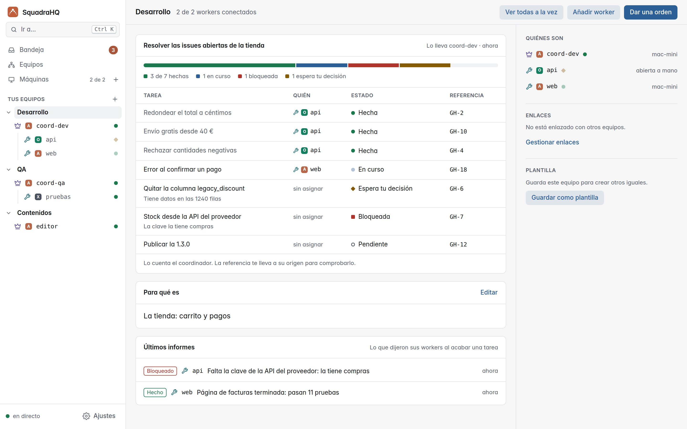
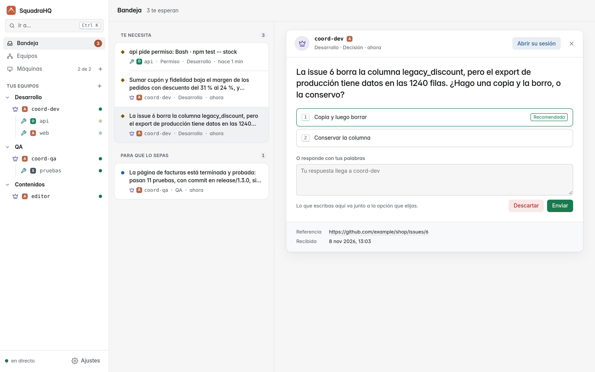
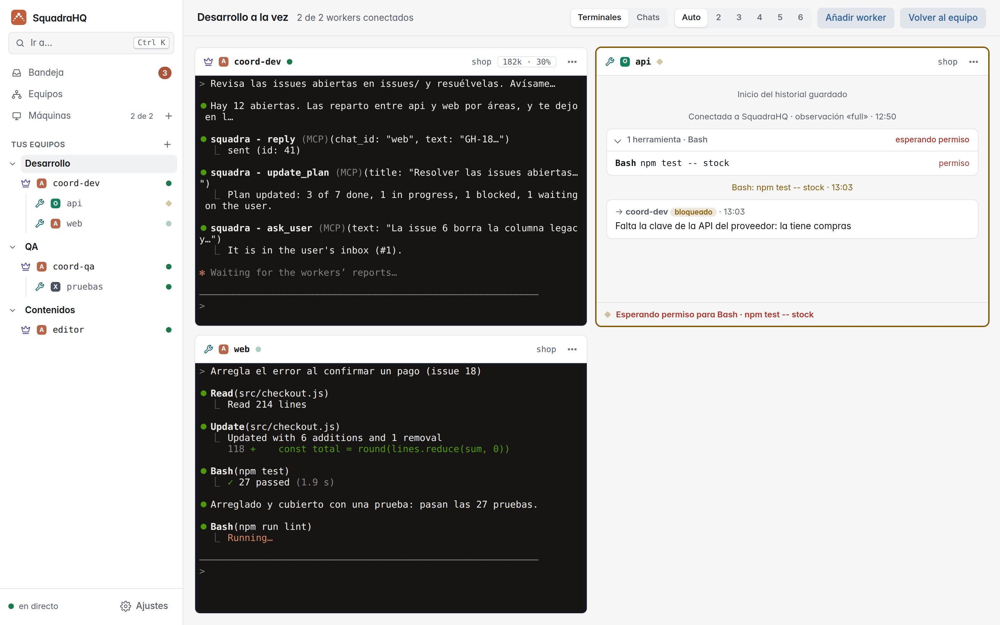
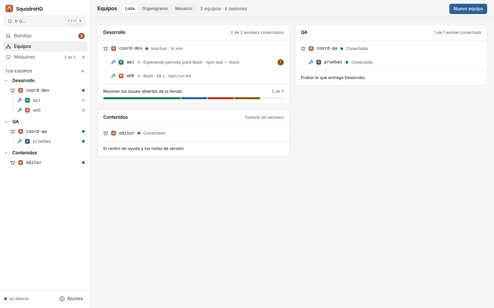
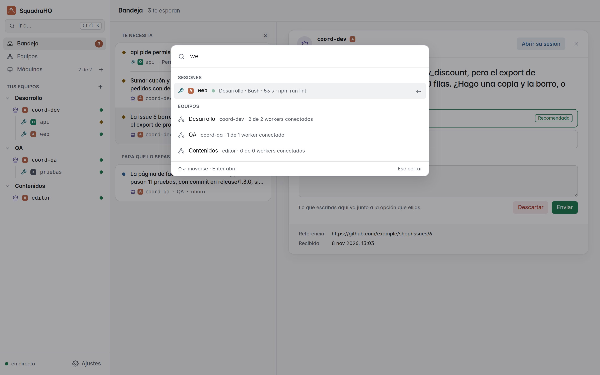
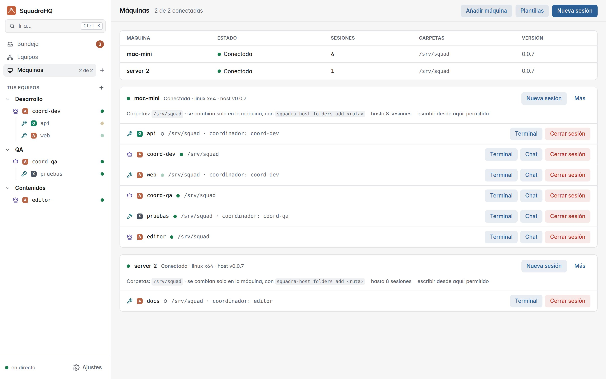
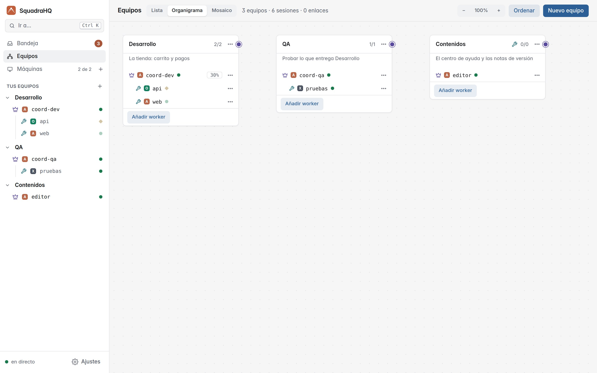
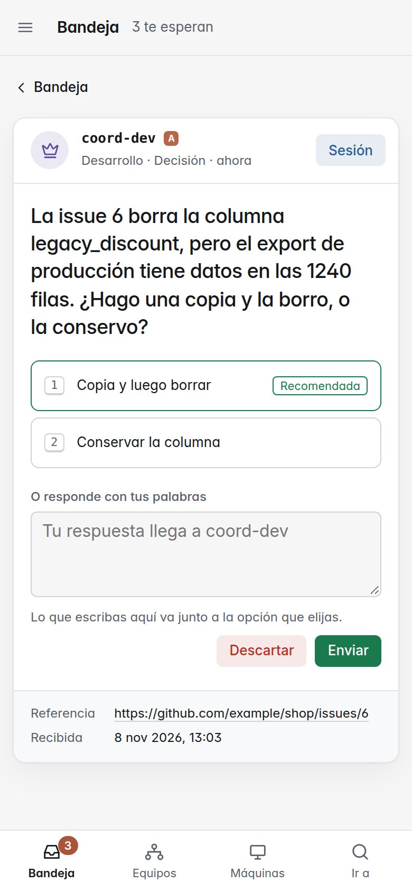

<p align="center"></p>

<h1 align="center">SquadraHQ</h1>

<p align="center"><b>Un agente coordinador que dirige equipos de agentes de Claude Code: rápido, desatendido y a la vista en directo.</b></p>

<p align="center"><a href="reference.md">Read in English</a> · v0.0.7</p>

---

> Esta es la referencia completa: instalación manual, todas las opciones y los detalles técnicos. Para empezar basta con el [README](../README-es.md).


SquadraHQ le da a [Claude Code](https://claude.com/product/claude-code) un **agente coordinador** que dirige un equipo de otros agentes de Claude Code, de forma rápida y en gran parte desatendida. Le dices al coordinador lo que quieres; él reparte el trabajo, asigna las tareas a los workers, sigue lo que hace cada uno, aprueba sus acciones seguras y solo vuelve a ti para las decisiones importantes. Está pensado para gestionar grandes equipos de agentes de forma automatizada, en una sola máquina o repartidos en varias.

Un panel web reúne en una bandeja lo que te espera, muestra cada equipo con su plan y puede mostrar un equipo entero a la vez, como una pared de terminales: qué hace cada agente, qué herramienta está ejecutando, qué dice Claude y quién está esperando una decisión.

<picture><source media="(prefers-color-scheme: dark)" srcset="screenshots/team-dark-es.jpg"></picture>

## Cómo funciona

```
                     tú
                     │  le hablas en su terminal
             ┌───────┴────────┐
             │  coordinador   │  planifica, delega, aprueba, informa
             └───────┬────────┘
                     │  mensajes a través de squadra-server
      ┌──────────────┼──────────────┬──────────────┐
 ┌────┴─────┐   ┌────┴─────┐   ┌────┴─────┐   ┌────┴─────┐
 │ worker 1 │   │ worker 2 │   │ worker 3 │   │ worker N │   cada uno una sesión de
 └──────────┘   └──────────┘   └──────────┘   └──────────┘   Claude Code, en cualquier máquina
```

- **El coordinador** es una sesión de Claude Code con el rol de coordinador. Convierte tu petición en tareas, las asigna a los workers, responde sus preguntas, aprueba las acciones inofensivas y solo te consulta lo crítico (decisiones de producto, cambios destructivos, seguridad, costes).
- **Los workers** son sesiones de Claude Code con el rol de worker, cada una en la carpeta de su proyecto. Deciden por sí mismos los detalles técnicos, y cada tarea termina con un informe final: hecho, bloqueado, fallido o una pregunta.
- **`squadra-server`** (Node, sin dependencias) reparte los mensajes entre agentes, sabe quién está vivo y sirve el panel en directo. Los agentes se conectan *hacia* él, así que sus máquinas no abren puertos.
- **El plugin `squadra`** para Claude Code entrega cada mensaje directamente en la sesión del agente, aunque esté parada, mediante los [Channels](https://code.claude.com/docs/en/channels) de Claude Code, e informa al panel de lo que hace el agente.

Cada agente es un `claude` interactivo normal en un terminal, así que puedes intervenir y escribir en cualquiera en cualquier momento.

### Agentes y cuentas

- **SquadraHQ está hecho sobre Claude Code.** Cualquier sesión puede usar también Codex CLI o Grok CLI, mezclada en un equipo con sesiones de Claude Code: es experimental (consulta [Codex CLI y Grok CLI](#codex-cli-y-grok-cli-experimental)).
- **Cada agente usa la sesión iniciada en la máquina donde corre**, así que un equipo puede mezclar agentes de la misma suscripción con agentes de suscripciones o cuentas distintas.
- **Métodos de acceso compatibles:** los que admiten los Channels de Claude Code:
  - planes de claude.ai: Pro, Max, Team y Enterprise;
  - claves de API de Anthropic Console.
- **No compatibles:** los Channels no están disponibles a través de Amazon Bedrock, Google Cloud Vertex AI ni Microsoft Foundry, así que los agentes que inicien sesión de esa forma no pueden unirse a un equipo.

## Qué puedes hacer

- **Desarrollar una funcionalidad en varios repositorios a la vez.** Pide al coordinador «login con Google» y él da el backend, la web y la app móvil a un worker cada uno, los mantiene coordinados y te avisa cuando todo encaja.
- **Partir un trabajo grande en piezas paralelas.** Una migración, una refactorización o subir la cobertura de tests, divididas por módulo o por carpeta, con un worker por pieza y el coordinador vigilando que nadie pise a nadie.
- **Dejarlo trabajando solo.** Los workers deciden los detalles técnicos y el coordinador aprueba sus acciones seguras, así que el equipo sigue mientras no estás. Solo esperan por ti las decisiones de producto, los cambios destructivos, la seguridad y los costes.
- **Vigilarlo desde cualquier sitio.** El panel muestra a todos los equipos y agentes en directo desde cualquier navegador, también desde el móvil. La bandeja reúne todo lo que te espera, y puedes intervenir en cualquier agente, en su terminal o desde la web.
- **Aprovechar todas tus máquinas.** Los agentes pueden correr en tu portátil, en un servidor de compilación o en una máquina con GPU; cada uno se conecta hacia fuera al servidor, sin abrir puertos.
- **Combinar suscripciones.** Cada agente usa el login de Claude Code de su máquina, así que un equipo puede repartir su trabajo entre varias cuentas.
- **Llevar varios equipos.** Varios coordinadores pueden compartir un servidor, cada uno con sus workers, y el panel los agrupa en equipos.

## Qué ofrece

- **Coordinador y workers.**
  - El coordinador delega con `reply`; cada tarea termina con el informe final del worker (mira *Informes de tareas* más abajo).
  - El coordinador solo responde cuando tiene algo que decir, así que nunca se forman bucles de acuses de recibo.
- **Cada decisión en su sitio.** Los workers deciden los detalles técnicos y preguntan lo de producto o lo destructivo; el coordinador responde o te lo pregunta a ti.
- **Permisos retransmitidos.** La petición de permiso de un worker llega también al coordinador, que aprueba lo inofensivo y te pregunta el resto. Vale la primera respuesta, así que también puedes contestar en el terminal del worker.
- **Entrega según el rol.**
  - Un mensaje a un worker desconectado se rechaza en el momento, para que una tarea nunca espere a una sesión que quizá no vuelva.
  - Los mensajes al coordinador se guardan hasta que vuelve (hasta 24 h; como mucho 500 por remitente y 10 000 en total, descartando primero los más antiguos).
- **Presencia.**
  - `ping` dice si está viva, sin despertarla, una sesión con la que ya has intercambiado mensajes (o compartes grupo); de las demás no muestra presencia.
  - El coordinador recibe un aviso cuando un worker sale, se cierra o se cae, junto con el trabajo que no llegó a recoger (una vez que el coordinador le ha escrito a ese worker). Si un worker solo deja de responder (se le cayó la red, su máquina entró en reposo), el aviso llega a los 2 minutos (`SQUADRA_LOST_GRACE_MS`), para que un corte corto de red no despierte al coordinador. Mientras tanto `ping` lo muestra como NOT RESPONDING y lo que se le envía queda en cola: le llega si vuelve a tiempo; si no, el aviso lo lista como descartado.
- **Contexto que sobrevive a la compactación.**
  - Cuando un agente se autocompacta, SquadraHQ le devuelve su rol, su coordinador y los últimos mensajes que recibió, para que siga con la misma tarea.
  - El coordinador recibe un aviso cuando un worker compacta, y otro, uno solo, cuando un worker pasa del 80 % de su contexto (una vez que el coordinador le ha escrito a ese worker).
  - `ping` y el panel muestran cuánto contexto lleva usado cada agente antes de autocompactar (no en sesiones con observación `off`, que tampoco envían avisos del 80 % ni de compactación).
- **Control de acceso:**
  - códigos de emparejamiento y listas de permitidos;
  - grupos con @menciones;
  - el servidor autentica a cada remitente.
- **Panel en directo** (ver *El panel* más abajo):
  - **Bandeja,** la página de inicio: las decisiones y los resultados que te dejan los coordinadores, los permisos que esperan en una sesión y los nombres por aprobar, respondidos desde ahí (ver *Bandeja* más abajo).
  - **Equipos:** cada equipo con su coordinador y sus workers en la barra lateral; una página por equipo con su plan, su objetivo y los últimos informes de sus workers; todas las sesiones de un equipo en directo a la vez.
  - **El plan:** las tareas en las que trabaja un coordinador, quién lleva cada una y su estado, en la página de su equipo (ver *El plan* más abajo).
  - **Lo importante:** junto a la terminal y la conversación de cada sesión, qué hace ahora y una línea de tiempo con sus órdenes, ediciones, pruebas, commits, permisos e informes, sin gastar tokens (ver *El panel* más abajo).
  - **Vista de cada sesión:** su conversación (markdown, herramientas agrupadas con su entrada y su salida, scroll infinito) o su terminal en directo, y acciones para limpiarla, archivarla o eliminarla.
  - **Barra «Te necesitan»:** fuera de la bandeja, los permisos pendientes de respuesta y los contextos a punto de compactarse, de todas las sesiones.
  - **Ctrl+K** (⌘K): ir a cualquier sesión, equipo, entrada de la bandeja o pantalla, o abrir una acción.
  - En español e inglés, en claro y oscuro, y con una versión para el móvil.
- **Sesiones abiertas desde el panel.**
  - Añade una máquina con un comando, generado por el panel, que instala y da de alta `squadra-host` en ella.
  - Abre allí coordinadores y workers desde el navegador y usa sus terminales en directo: ves a Claude, le escribes, aceptas sus diálogos e incluso haces `/login` con la suscripción de esa máquina.
  - La máquina solo acepta una *especificación* de sesión (nombre, rol, una carpeta permitida, la ventana de autocompactación y el id de una persona), nunca un comando; sus límites viven en la propia máquina.
  - **Personas:** cada sesión puede seguir una skill o un agente de su proyecto o de `~/.claude`, elegido de una lista; se queda en su system prompt toda la sesión, y su coordinador sabe cuál sigue cada worker.
  - **Plantillas de equipo:** guarda un equipo (coordinador y workers, con sus carpetas y personas) y vuelve a abrirlo de una vez.
  - **Equipos enlazados:** enlaza dos coordinadores para que sus equipos compartan trabajo: cada uno pide al otro y reparte lo que acepta entre sus workers.
  - **Organigrama:** cada equipo como una tarjeta con sus agentes, los enlaces entre equipos como líneas y, al pasar el ratón, para qué sirve cada uno; desde ahí se añaden, describen, enlazan, mueven y cierran equipos y agentes.
  - Las sesiones solo las abres tú, nunca Claude: si un coordinador necesita más workers, te los pide.

## Galería

Así se ve el panel, en claro u oscuro según tengas el sistema. Pulsa cualquier imagen para verla a tamaño completo.

<table>
<tr><td width="50%" valign="top"><a href="screenshots/inbox-light-es.jpg"><picture><source media="(prefers-color-scheme: dark)" srcset="screenshots/inbox-dark-es.jpg"></picture></a><br><b>Bandeja</b><br>Lo que te espera a la izquierda y lo que eliges a la derecha: sus opciones numeradas, la recomendada marcada y sitio para tus palabras.</td><td width="50%" valign="top"><a href="screenshots/team-light-es.jpg"><picture><source media="(prefers-color-scheme: dark)" srcset="screenshots/team-dark-es.jpg"></picture></a><br><b>Un equipo con su plan</b><br>El plan de su coordinador (cada tarea, quién la lleva, su estado), para qué es el equipo y los últimos informes de sus workers.</td></tr>
<tr><td width="50%" valign="top"><a href="screenshots/live-light-es.jpg"><picture><source media="(prefers-color-scheme: dark)" srcset="screenshots/live-dark-es.jpg"></picture></a><br><b>Todas a la vez</b><br><b>Ver todas a la vez</b> en la página de un equipo: la terminal del coordinador y las de sus workers, una al lado de otra, para mirar o escribir.</td><td width="50%" valign="top"><a href="screenshots/teams-light-es.jpg"><picture><source media="(prefers-color-scheme: dark)" srcset="screenshots/teams-dark-es.jpg"></picture></a><br><b>Equipos</b><br>Una tarjeta por equipo: su coordinador y sus workers, qué hace cada uno, y cómo va el plan o el objetivo.</td></tr>
<tr><td width="50%" valign="top"><a href="screenshots/palette-light-es.jpg"><picture><source media="(prefers-color-scheme: dark)" srcset="screenshots/palette-dark-es.jpg"></picture></a><br><b>Ctrl+K</b><br>Escribe unas letras para ir a una sesión, un equipo, una entrada de la bandeja o una pantalla, o para abrir una acción.</td><td width="50%" valign="top"><a href="screenshots/machines-light-es.jpg"><picture><source media="(prefers-color-scheme: dark)" srcset="screenshots/machines-dark-es.jpg"></picture></a><br><b>Máquinas</b><br>Cada ordenador con su estado, sus sesiones, sus carpetas y su versión, y debajo de cada uno sus sesiones, con su terminal y su chat.</td></tr>
<tr><td width="50%" valign="top"><a href="screenshots/org-chart-light-es.jpg"><picture><source media="(prefers-color-scheme: dark)" srcset="screenshots/org-chart-dark-es.jpg"></picture></a><br><b>Organigrama</b><br>Cada equipo como una tarjeta con sus agentes; arrastra el punto de una tarjeta hasta otra para enlazar dos equipos.</td><td width="50%" valign="top"><a href="screenshots/phone-decision-light-es.jpg"><picture><source media="(prefers-color-scheme: dark)" srcset="screenshots/phone-decision-dark-es.jpg"></picture></a><br><b>Una decisión en el móvil</b><br>La misma bandeja en el móvil: la pregunta, sus opciones y sitio para responder con tus palabras.</td></tr>
</table>

## Requisitos

- **Linux o macOS.** En Windows, usa WSL (mira [Windows (WSL)](#windows-wsl) más abajo).
- **Node.js ≥ 22.13**, en el servidor y en cada máquina donde corra una sesión de Claude con el plugin.
- **tmux ≥ 3.2**, solo en las máquinas donde abras sesiones desde el panel.
- **Claude Code** con sesión iniciada en un plan de claude.ai (Pro, Max, Team o Enterprise) o con una clave de API de Anthropic Console. Cada agente puede usar una cuenta distinta.
- **En Team/Enterprise**, un Owner tiene que activar *Channels* en la configuración de la organización.

### macOS

Todo funciona igual que en Linux:

```bash
brew install node@22 tmux        # tmux solo donde abras sesiones desde el panel
```

- Añade el alias `claude-squadra` (paso 3, más abajo) a `~/.zshrc`, el shell por defecto de macOS.
- `squadra-host service` imprime un agente de **launchd** (`~/Library/LaunchAgents/com.squadra.host.plist`) en lugar de un servicio de systemd, con los comandos para cargarlo. Funciona mientras tengas la sesión iniciada, porque Claude Code guarda su login en el Llavero.

### Windows (WSL)

SquadraHQ no funciona en Windows nativo: squadra-host se niega a arrancar y el plugin a hacer login; los dos te remiten a WSL. Ejecuta Claude Code y SquadraHQ dentro de **WSL**, el Linux que trae Windows, y todo funciona igual que en Linux:

1. **Instala WSL con Ubuntu.** En PowerShell como administrador: `wsl --install -d Ubuntu`, reinicia y abre *Ubuntu* desde el menú Inicio.
2. **Dentro de Ubuntu, instala Node 22, tmux y Claude Code:**
   ```bash
   curl -fsSL https://deb.nodesource.com/setup_22.x | sudo -E bash -
   sudo apt install -y nodejs tmux
   curl -fsSL https://claude.ai/install.sh | bash
   ```
3. **Sigue la [puesta en marcha](#puesta-en-marcha) dentro de Ubuntu.** El panel se abre en tu navegador de Windows en `http://localhost:7787`, porque WSL reenvía `localhost` a Windows.

- **Guarda los proyectos en el sistema de ficheros de Linux** (`~/projects`), no en `/mnt/c/…`: las herramientas de Claude van mucho más rápido, y squadra-host rechaza las carpetas de `/mnt/c` (las unidades de Windows aparecen como escribibles por cualquiera).
- **WSL se detiene cuando Windows lo ve inactivo**, por ejemplo al cerrar todas las terminales de Ubuntu. Deja una abierta mientras trabaja el equipo, o consulta en la documentación de Microsoft cómo mantener WSL en marcha.
- **Para tener squadra-host siempre en segundo plano,** activa systemd en WSL (`[boot]` `systemd=true` en `/etc/wsl.conf`; las imágenes recientes de Ubuntu ya lo traen) y usa el servicio de systemd que imprime `squadra-host service`.


## Puesta en marcha

### 1. Arrancar el servidor

```bash
git clone https://github.com/roke22/Squadra.git squadra && cd squadra
git checkout "$(git tag --sort=-v:refname | head -1)"   # la última versión
node server/server.js
```

La primera vez genera dos tokens y muestra los dos, solo esa vez (los logs los guarda, y los lee, más gente de la que debería tenerlos): el **token del servidor** (administración, `data/server-token`), para crear el primer propietario, y el **token de alta** (`data/join-token`), con el que las máquinas registran sus sesiones, dentro de un comando `/squadra:configure` listo para copiar. Escucha en `http://127.0.0.1:7787`.

- **Con Docker:**
  ```bash
  docker build -f server/Dockerfile -t squadra-server .
  docker run -d --name squadra-server -p 127.0.0.1:7787:7787 -e PUBLIC_URL=http://127.0.0.1:7787 -v squadra-data:/data squadra-server   # solo esta máquina; para otras máquinas usa HTTPS (abajo)
  docker logs squadra-server   # la primera vez, muestra los tokens (después: docker exec squadra-server cat /data/server-token /data/join-token)
  ```
- **Opciones** (parámetro, o la variable de entorno entre paréntesis):

  | Parámetro | |
  |---|---|
  | `--host <ip>` (`HOST`) | Interfaz en la que escucha. Por defecto `127.0.0.1`: solo esta máquina (con `--domain` o `--tls-cert`: todas las interfaces) |
  | `--all-interfaces` | Escucha en todas las IPs de la máquina (igual que `--host 0.0.0.0`) |
  | `--port <n>` (`PORT`) | Por defecto `7787` (con `--domain` o `--tls-cert`: `443`; `--domain` usa además el `80`, `--http-port`) |
  | `--public-url <url>` (`PUBLIC_URL`) | La dirección que usan los agentes y el navegador, por ejemplo `https://squadra.example.com`; aparece en el comando de configuración |
  | `--data-dir <ruta>` (`DATA_DIR`) | Base de datos y ficheros. Por defecto `./data` |
  | `--domain <nombre>` (`SQUADRA_DOMAIN`) | HTTPS integrado con certificado automático de Let's Encrypt (ver abajo) |
  | `--tls-cert <fichero>` `--tls-key <fichero>` | HTTPS con tu propio certificado; se recarga si cambian los ficheros |
  | `--trust-proxy` (`TRUST_PROXY=1`) | Detrás de un proxy inverso (o túnel) que pone `X-Forwarded-For`: los límites de frecuencia usan la dirección del cliente. Sin esto, todos los clientes de detrás comparten una dirección, y una dirección tiene como mucho 256 conexiones abiertas |

  `node server/server.js --help` muestra todas las opciones.

### Publicarlo con un dominio (HTTPS)

Las sesiones de otras máquinas tienen que poder llegar al servidor. **No lo expongas en HTTP sin cifrar:** el token del servidor, los secretos de las sesiones y todo lo que muestra el panel viajarían en claro, y el servidor avisa si lo intentas.

**HTTPS integrado (lo más sencillo):** dale al servidor tu dominio y él mismo obtiene un certificado de Let's Encrypt, lo renueva antes de que caduque y redirige el HTTP a HTTPS. No hay que instalar nada más.

1. Apunta el registro DNS de tu dominio a la máquina.
2. Asegúrate de que los puertos **80** (validación del certificado) y **443** son accesibles desde internet.
3. Arráncalo:
   ```bash
   node server/server.js --domain squadra.example.com --acme-email tu@example.com
   # o con Docker:
   docker run -d --name squadra-server -p 80:80 -p 443:443 -v squadra-data:/data \
     -e SQUADRA_DOMAIN=squadra.example.com squadra-server
   ```
   Muestra `/squadra:configure https://squadra.example.com <token-de-alta>`, y el panel queda en `https://squadra.example.com/`.

- **Puertos privilegiados fuera de Docker (Linux):** los puertos 80 y 443 necesitan privilegios. Ejecútalo como root, o da permiso a Node una sola vez con `sudo setcap cap_net_bind_service=+ep $(command -v node)`.
- **Para probar:** `--acme-staging` usa el entorno de pruebas de Let's Encrypt, que emite certificados no confiables pero tiene límites más amplios.

**Tu propio certificado:** `--tls-cert fullchain.pem --tls-key privkey.pem --public-url https://squadra.example.com`. El servidor recarga los ficheros cuando cambian, por ejemplo tras una renovación de certbot.

**Detrás de un proxy inverso:** si ya tienes uno, deja el servidor en `127.0.0.1`, apunta el proxy hacia él y arráncalo con `--public-url https://tu-dominio --trust-proxy` (sin ellos, los comandos que da a las máquinas usan http sin cifrar, que estas rechazan). En [`deploy/`](../deploy/) hay un Docker Compose listo con Caddy.

**Red privada:** en algo como Tailscale puedes prescindir de TLS con `--all-interfaces`.

Las sesiones siempre se conectan *hacia* el servidor, así que sus máquinas no abren puertos.

### 2. Instalar el plugin (una vez por máquina)

En cada máquina donde vaya a correr un coordinador o un worker. Dentro de `claude`:

```
/plugin marketplace add roke22/Squadra
/plugin install squadra@squadra
```

O desde el terminal (útil en servidores, en WSL o en scripts):

```bash
claude plugin marketplace add roke22/Squadra
claude plugin install squadra@squadra
```

Después apúntalo a tu servidor, con el comando que el servidor mostró al arrancar:

```
/squadra:configure https://squadra.example.com <token-de-alta>
```

- **Usa la dirección con la que las demás máquinas llegan** al servidor: `http://127.0.0.1:7787` solo funciona en la propia máquina del servidor.
- **Vuelve a arrancar Claude Code después.** El plugin lee su configuración al empezar la sesión y, de todas formas, el channel de SquadraHQ se activa al arrancar (siguiente paso).
- **Las máquinas añadidas desde el panel** instalan y configuran el plugin solas al darlas de alta (con la dirección del servidor; el token de alta solo si marcas esa opción).
- **Claude Code ejecuta el plugin con `node`,** así que Node 22.13 o posterior tiene que estar en el `PATH` que ve Claude Code.
- Para usar una copia local de este repositorio, pasa su ruta a `marketplace add` (no en máquinas con squadra-host, que solo aceptan el marketplace roke22/Squadra).

**Actualizar:** `claude plugin marketplace update squadra && claude plugin update squadra@squadra`, y reinicia las sesiones.

### 3. Arrancar las sesiones y hacer login

Los channels solo se pueden activar al arrancar Claude Code, así que crea un alias una vez:

```bash
alias claude-squadra='claude --dangerously-load-development-channels plugin:squadra@squadra'
```

Ponlo en `~/.bashrc`, o en `~/.zshrc` en macOS.

> Mientras Channels esté en *research preview*, este flag muestra un diálogo de confirmación en cada arranque. Elige **"I am using this for local development"**.

Después, en cada terminal:

| Comando | |
|---|---|
| `/squadra:login coordinador` | Entra como coordinador (con el nombre `coord`). Con el token de alta, apruébalo una vez en el panel (abre esa sesión: Aprobar como coordinador) |
| `/squadra:login worker1` | Entra como worker; saluda al coordinador automáticamente |
| `/squadra:status` | Quién eres, emparejamientos pendientes y qué sesiones están vivas |
| `/squadra:logout` | Sale |
| `/squadra:access pair <código>` | Aprueba a un worker, en el terminal del coordinador |
| `/squadra:access link <nombre>` | Enlaza este coordinador con el de otro equipo (en los dos) |

La primera vez que entra un worker, el coordinador muestra una petición de emparejamiento: apruébala con `/squadra:access pair <código>`. A partir de ahí, ese nombre no necesita emparejarse de nuevo. Un worker abierto desde el panel para un coordinador también abierto allí no lo necesita: lo aprueba la máquina del coordinador (quien abrió los dos quería que trabajasen juntos), y la actividad de la empresa lo apunta como *worker-approved*.

### 4. Abrir el panel

Abre la dirección del servidor (`http://127.0.0.1:7787/`). La primera vez, crea el primer propietario con el token del servidor; después, entra con tu email, tu contraseña y tu código. Mira [Empresas y personas](#empresas-y-personas).

### El panel

- **La barra lateral:** **Bandeja** (la página de inicio), **Equipos** y **Máquinas** (cuántas están conectadas, como *2 de 3*, y **+** para añadir una); después **Tus equipos** (**+** para uno nuevo), cada equipo con su coordinador (icono de corona) y sus workers (icono de llave inglesa). Cada sesión lleva un punto de estado: un círculo relleno cuando todo va bien, un rombo cuando te espera, un cuadrado si hay un error, un aro cuando no está. Los workers sin coordinador, las sesiones independientes, los nombres por aprobar y las sesiones archivadas tienen sus propios grupos. **Ajustes** está abajo. En el móvil, la barra lateral se abre desde el botón de menú, y una barra abajo tiene **Bandeja**, **Equipos**, **Máquinas** e **Ir a**.
- **Ctrl+K** (⌘K en un Mac), o **Ir a…** arriba en la barra lateral: escribe unas letras para ir a cualquier sesión, equipo, entrada de la bandeja o pantalla, o para abrir una acción (una sesión o un equipo nuevos, añadir una máquina, invitar a alguien, cambiar entre claro y oscuro, los ajustes), hasta donde permita tu rol.
- **Bandeja:** lo que te espera, mira [Bandeja](#bandeja).
- **Equipos:** una tarjeta por equipo con su coordinador, sus workers, qué hace cada uno, y cómo va el plan o el objetivo del equipo. La cabecera cambia entre **Lista**, **Organigrama** (mira [Organigrama](#organigrama)) y **Mosaico**, todas las sesiones a la vez.
- **La página de un equipo** (`#/q/<coordinador>`): su plan (mira [El plan](#el-plan)), para qué es (los gestores pueden editarlo), los últimos informes de sus workers, quiénes son y en qué máquina está cada uno, sus enlaces y **Guardar como plantilla**. **Ver todas a la vez** abre en directo todas las sesiones del equipo, **Añadir worker** abre uno más y **Dar una orden** te lleva al coordinador.
- **Añadir máquina** (`#/hosts/new`): todo el camino en una página, ver [O bien: abre sesiones desde el panel](#o-bien-abrir-las-sesiones-desde-el-panel).
- **Nuevo equipo** (`#/new`): para qué es (un nombre y un objetivo), quiénes (coordinador y workers, solo un coordinador, o una plantilla, cada uno con un nombre y una persona), dónde (la máquina, una carpeta y una subcarpeta opcional), y abrirlo. Primero se abre el coordinador; si no puede abrirse, los workers no se abren.
- **Una sesión:** la cabecera muestra su rol y su nombre, **Conversación** / **Terminal** cuando tiene terminal, y el resto de sus acciones en **Más**. Junto a la conversación, su equipo y sus detalles (máquina, carpeta, contexto, persona, cuándo se abrió). Junto a la conversación y a la terminal (abierta desde la sesión o desde *Máquinas*), **Lo importante**: una línea de tiempo, de lo más reciente a lo más antiguo, con lo que se escribió en ella o le respondiste desde la bandeja, las órdenes de su coordinador, los ficheros que editó en cada turno, las pruebas en verde o en rojo y los commits (reconocidos por el comando), los permisos que pidió, las veces que actualizó el plan, las compactaciones, sus informes (y, en un coordinador, los de sus workers) y lo que dejó en la bandeja y qué pasó con ello. Junto a la terminal muestra además lo que hace **Ahora**: su estado, cuánto contexto lleva, su tarea del plan, su máquina y su carpeta. Se calcula en el navegador con lo que la sesión ya informa (su actividad se guarda un día por defecto y sus mensajes, una semana): no gasta tokens y no muestra nada que no reconozca. El panel se pliega a un borde fino; en el móvil empieza plegado y se abre por encima de la terminal.
- **Ajustes** se abren sobre todo el panel, sin la barra lateral, por grupos: **Mi cuenta** (perfil y contraseña; idioma y tema, con *Sistema*, *Claro* u *Oscuro*), la empresa en la que estás (**Personas** y **Actividad y datos**, para gestores) y **Servidor** (**Empresas**, **Usuarios** y **Máquinas**, para quien administra el servidor). Esc los cierra.

### O bien: abrir las sesiones desde el panel

En vez de arrancar `claude` a mano en cada terminal, deja que lo haga el panel en las máquinas con **squadra-host**:

1. **Añade la máquina.** **Máquinas → Añadir máquina** abre una página con todo el camino: ponle nombre, elige su sistema y ejecuta allí el único comando que te da (en una terminal; en Windows, en PowerShell). La página espera, dice cuándo se ha conectado y después te deja elegir sus carpetas y abrir un equipo en ella. En Linux es así:

   ```bash
   cd "$(mktemp -d)" && curl -fsSLo install.sh 'https://squadra.example.com/install/linux.sh' && echo '<sha256>  install.sh' | (sha256sum -c - 2>/dev/null || shasum -a 256 -c -) && printf %s 'ABCD-2345' > code && bash install.sh 'https://squadra.example.com' --code-file code --sha256 <sha256>
   ```

   Primero comprueba el instalador contra la copia de este servidor y guarda el código en un fichero, fuera de los argumentos de cualquier programa. Instala lo que falte (tmux, Node.js 22, Claude Code y los agentes marcados en la página: Codex CLI con npm, `--codex`, y Grok CLI con su propio instalador, `--grok`; `--no-claude` deja fuera Claude Code), comprueba el squadra-host que descarga, cambia el código de un solo uso (válido 15 minutos; guarda el comando en privado hasta entonces) por la credencial propia de la máquina, e instala el plugin de SquadraHQ, el comando `squadra-host` y un servicio que la mantiene en marcha en segundo plano y arranca con el ordenador (systemd en Linux y WSL, launchd en macOS). Los instaladores están en [`install/`](../install/): `linux.sh`, `macos.sh` y `windows.bat` (en Windows, SquadraHQ funciona dentro de WSL; si hace falta, el comando te dice cómo instalarlo). Después ejecuta `claude` una vez en la máquina e inicia sesión. Ejecuta el comando con tu usuario; para que Claude pueda modificar el sistema operativo, puede funcionar como root con `--allow-root` (una casilla del diálogo): las sesiones tienen entonces control total de esa máquina, y se instala como servicio del sistema.
2. **Elige sus carpetas.** Debajo de la máquina, en la página *Máquinas*, **Añadir carpeta** permite una carpeta donde se pueden abrir sesiones (y todo lo que contiene), y ✕ la quita. La máquina comprueba cada una: nunca una carpeta del sistema, temporal o de credenciales, ni tu carpeta personal entera, salvo que squadra-host se arrancara con `--allow-home` (márcalo en «Opciones avanzadas» de la página «Añadir máquina»), para que Claude administre el ordenador. Las sesiones en la carpeta personal acceden a todos tus ficheros, así que sus permisos se aprueban solo en su propia terminal, nunca desde un coordinador.
3. **Abre una sesión.** **Nueva sesión** (en la página *Máquinas*, o con Ctrl+K): máquina, agente (Claude Code, Codex CLI o Grok CLI, cuando la máquina tiene más de uno), rol, nombre, coordinador (elegido entre los que existen), carpeta (una de las permitidas en la máquina, más una subcarpeta opcional), una persona (ver más abajo), cuándo autocompactar (600K tokens por defecto, lo recomendado para modelos de 1M de contexto) y si continuar la última conversación. Arranca `claude` con el canal de SquadraHQ en tmux y hace login sola.
4. **Usa su terminal.** La sesión se abre en una terminal web en vivo. La primera vez, acepta el aviso de canales en desarrollo y, si lo pide, confía en la carpeta y haz `/login`. Desde ahí puedes verla o escribirle desde cualquier navegador; su conversación y la vista en directo de su equipo siguen funcionando igual.

En la máquina (`squadra-host help` lo muestra todo):

| Comando | |
|---|---|
| `squadra-host status` | Servidor, ajustes y sesiones abiertas |
| `squadra-host update` | Actualiza squadra-host y el plugin a la versión del servidor (las sesiones abiertas siguen funcionando). Solo instala una versión firmada con la clave que lleva el programa, y no una más antigua: `--allow-unsigned` y `--allow-downgrade` para saltárselo |
| `squadra-host folders add <ruta>` | Permite una carpeta desde la propia máquina (también `folders remove <ruta>`, `folders`) |
| `squadra-host --allow-home` | Permite tu carpeta personal entera (`--no-allow-home` para deshacerlo) |
| `squadra-host service` | Funciona en segundo plano y arranca con el ordenador (`service remove` para dejar de hacerlo) |
| `tmux -L squadra attach -t sq-<nombre>` | Conectarte a una sesión en local |

Las reglas de la máquina están en `~/.config/squadra-host/settings.json`. El panel solo puede cambiar sus carpetas, y siempre dentro de las reglas de arriba:

| Ajuste | |
|---|---|
| `folders` | Dónde se pueden abrir sesiones, y todo lo que contienen. Nunca una carpeta del sistema o de credenciales, ni la carpeta personal entera salvo con `allow_home` |
| `folders_from_dashboard` | Si el panel puede añadir y quitar carpetas (igual que `allow_input` por defecto). Ponlo a `false` para cambiarlas solo en la máquina |
| `allow_home` | Si la carpeta personal entera puede ser una de ellas (`false`; lo activa `squadra-host --allow-home`) |
| `max_sessions` | Como mucho estas a la vez (8; máximo 64) |
| `allow_input` | Si el panel puede escribir en las terminales (`true`). Ponlo a `false` para solo mirar (terminales de solo lectura) |
| `allow_resume` | Si una sesión puede continuar su propia última conversación (igual que `allow_input` por defecto) |
| `permission_relay` | Si el coordinador de un worker puede responder sus permisos desde otra sesión (igual que `allow_input` por defecto; nunca en sesiones en la carpeta personal). Para las sesiones que abre squadra-host; para las arrancadas a mano en la máquina, pon `SQUADRA_PERMISSION_RELAY=off` en el `.env` del plugin |
| `allow_clear` | Si el coordinador de un worker puede limpiar su contexto (`/clear`, escrito en su terminal) antes de darle una tarea nueva (igual que `allow_input` por defecto) |
| `coordinators` | Si se pone, los únicos nombres de coordinador que pueden recibir los workers que abre squadra-host en esta máquina, y con los que pueden enlazarse los coordinadores que abre |
| `claude_command` | El ejecutable de Claude Code (`claude`, buscado solo en las entradas absolutas del `PATH`) |
| `codex_command`, `grok_command` | Los ejecutables de Codex CLI y Grok CLI (`codex`, `grok`), buscados igual |

La máquina se conecta solo por HTTPS: `http` sin cifrar solo se acepta para `localhost`, o con `--insecure` en el alta, en una red privada de confianza (una máquina dada de alta antes de existir esa opción: añade `"insecure": true` a su `credentials.json`). **Eliminar** (en una máquina desconectada, o en su menú **Más**) revoca su credencial y la quita de la lista; una máquina que se dio de alta pero nunca llegó a conectarse aparece como *Pendiente de conectar* y se elimina igual. **Actualizar:** actualiza el servidor a la última versión (`git fetch --tags && git checkout "$(git tag --sort=-v:refname | head -1)"`) y después ejecuta `squadra-host update` en cada máquina (el panel dice cuáles son más antiguas); reinicia las sesiones que abrió para que usen el plugin nuevo. Quédate en las versiones publicadas y no en `main`: entre una y otra, `main` puede tener un squadra-host aún sin firmar, y las máquinas no lo instalarán. Actualiza también el plugin en las máquinas que configuraste a mano (`claude plugin marketplace update squadra && claude plugin update squadra@squadra`). **Desde 0.0.7:** lo que tenía el servidor pasa a ser la primera empresa, sin moverlo (una copia, `squadra-before-companies.db`, se queda 7 días en la carpeta de datos), y sus máquinas y sesiones siguen funcionando sin cambios. Después el token del servidor crea el primer propietario, y a partir de ahí ya no abre el panel (`--allow-token-api` lo mantiene en `/api` para tus scripts). Ejecuta `squadra-host update` en cada máquina y vuelve a abrir sus sesiones para tener lo nuevo, como la bandeja, las respuestas escritas desde ella y el plan del equipo; una máquina sin actualizar sigue funcionando sin ello. **Desde 0.0.6:** un servidor que seguía `main` con `git pull` pasa a la última versión como se indica arriba; tras actualizar el servidor, ejecuta `squadra-host update` en cada máquina y vuelve a abrir sus sesiones, para que sus mensajes vayan firmados y demuestren sus claves; a partir de ahí incluye `data/server-key` en tus copias de seguridad. La primera actualización desde 0.0.6 o anterior aún no puede comprobar una firma, todas las siguientes sí. Después no vuelvas a un plugin o un servidor anteriores: los mensajes sin firma de una sesión que ya firma se ignoran, con un aviso. Solo en estos casos hay algo más que hacer: con `http` sin cifrar hacia otro ordenador y un plugin configurado a mano, añade `SQUADRA_INSECURE=1` a `~/.claude/channels/squadra/.env`; con `NODE_EXTRA_CA_CERTS` definida, añade ahí `SQUADRA_EXTRA_CA=` con la misma ruta; un coordinador nuevo que inicia sesión a mano con el token de alta hay que aprobarlo una vez en el panel; y si una sesión cambia de máquina, las demás la ignoran hasta que borres el archivo de clave que indica su aviso. **Desde 0.0.5:** tras actualizar el servidor, ejecuta `squadra-host update` en cada máquina y vuelve a abrir sus sesiones: el arreglo de los informes de tareas (no se pide informe de una tarea que Claude aún no ha visto) necesita el plugin 0.0.6, y una máquina que siga en 0.0.5 funciona sin él. **Desde 0.0.4:** tras actualizar el servidor, ejecuta `squadra-host update` en cada máquina y vuelve a abrir sus sesiones: las personas, los equipos enlazados, empezar de cero, el resumen de equipo y los informes de tareas necesitan el plugin 0.0.5, y una máquina que siga en 0.0.4 funciona sin ellos. Hay un ajuste nuevo de la máquina, `allow_clear`, que sigue a `allow_input` si no se pone. **Desde 0.0.2:** las máquinas aún no tienen `squadra-host update`: vuelve a añadir cada una con «Añadir máquina» y elimina su entrada antigua. **Desde 0.0.1:** lo mismo, y además: con `SQUADRA_STATE_DIR`, mueve los ficheros de cada sesión a `<dir>/<nombre>/`; los scripts con `SQUADRA_ROLE`/`SQUADRA_COORDINATOR` necesitan un launch.json o un `/squadra:login`; reinicia todas las sesiones. El primer arranque de un servidor 0.0.2 o posterior limpia una vez los datos guardados por una versión anterior (dice en el log por dónde va).

### Personas y plantillas de equipo

Una **persona** es una skill o un agente que una sesión sigue mientras esté abierta: diseño, redacción, RR. HH., revisión de código, la forma de trabajar de tu empresa. En **Nueva sesión** y en la página **Nuevo equipo**, la lista de personas muestra lo que la máquina encuentra para la carpeta elegida:

- skills: `<carpeta>/.claude/skills/<nombre>/SKILL.md` y `~/.claude/skills/<nombre>/SKILL.md`;
- agentes: `<carpeta>/.claude/agents/<nombre>.md` y `~/.claude/agents/<nombre>.md` (el agente del proyecto gana al tuyo con el mismo nombre, como en Claude Code).

Se elige de la lista, nunca se escribe, y el panel solo envía su id: la máquina la vuelve a buscar al abrir la sesión. Una **skill** va al system prompt de la sesión (`--append-system-prompt-file`, desde una copia privada que la máquina escribe junto al estado de la sesión, con la carpeta de los ficheros de la skill); un **agente** arranca la sesión con `--agent <nombre>`, así que se aplican su prompt, sus herramientas y su modelo. Al ir en el system prompt, la persona se mantiene tras las compactaciones, y las skills que Claude cargue después se suman a ella sin sustituirla. Nunca pasa por encima de las reglas de SquadraHQ ni de lo que pidas en la terminal.

- El coordinador conoce la persona de cada worker por su saludo y por `ping`, y da cada tarea al worker cuya persona encaja. Un coordinador también puede tener persona (un jefe de proyecto, una directora de marketing…).
- Un agente cuya lista `tools` deja fuera las herramientas de SquadraHQ no podría escribir a su equipo: el panel lo muestra desactivado para coordinadores y workers (añade `mcp__plugin_squadra_squadra__reply` y las demás herramientas de SquadraHQ a sus `tools`, o ábrelo como sesión independiente).
- Solo se leen ficheros que de verdad están dentro del proyecto (o de `~/.claude`) y son tuyos, de 256 KB como mucho: una skill que es un enlace a otro sitio no aparece. Como un `CLAUDE.md`, la persona de un proyecto que no escribiste es texto que Claude seguirá: abre proyectos de confianza.

Una **plantilla de equipo** guarda un equipo para volver a abrirlo de una vez. En la página de un equipo, **Guardar como plantilla** guarda su coordinador y sus workers con la carpeta, la persona y el autocompactado con que se abrió cada uno. **Máquinas → Plantillas** las lista: **Abrir el equipo** elige una máquina y abre primero el coordinador y después cada worker (las sesiones que ya estén abiertas se dejan como están). La página **Nuevo equipo** también puede empezar desde una. Cada sesión se abre como cualquier otra, y su máquina la comprueba con sus propias reglas.

### Equipos enlazados

Cada equipo trabaja por su cuenta, pero dos pueden repartirse trabajo: **enlaza** sus coordinadores y cada uno podrá escribir al otro. El coordinador de diseño pide a marketing los textos de la landing; el de marketing se lo encarga a uno de sus workers y le devuelve el resultado.

- **Desde el panel:** en la página de un equipo, **Gestionar enlaces** muestra los coordinadores con los que está enlazado y permite enlazar o quitar otro (o arrastra una tarjeta hasta otra en el organigrama). La máquina de cada coordinador se entera al momento, y un coordinador que se abra después arranca con sus enlaces. Una máquina cuyo ajuste `coordinators` fija nombres solo acepta enlaces con esos.
- **Sesiones que iniciaste a mano:** ejecuta `/squadra:access link <otro-coordinador>` en cada uno de los dos terminales (`unlink` para deshacerlo).
- **Qué se les dice a los coordinadores:** el mensaje de un coordinador enlazado llega marcado con `linked="true"`. Viene de un igual, nunca de ti: el coordinador acepta lo que encaja con su equipo, lo reparte entre sus workers y responde con un único resultado, y te pregunta aquí antes de cualquier cosa crítica. Nunca responde a los permisos del otro equipo ni le pasa los de sus workers. Los workers solo hablan con su propio coordinador.
- `status` y `ping` muestran los coordinadores enlazados y si están conectados; si se añade o quita un enlace mientras está abierto, se le avisa.
- **Sin conversaciones infinitas:** dos coordinadores pueden mandarse como mucho 60 mensajes por hora, contando los de un grupo que compartan y las ediciones; después el servidor rechaza los siguientes y el coordinador te avisa.

### Organigrama

**Organigrama** (**Equipos → Organigrama**) muestra cómo están organizados tus equipos y permite cambiarlo todo desde un sitio.

- **Qué se ve:** cada equipo es una tarjeta con su coordinador y sus workers (su estado, su persona y su contexto). Las líneas entre tarjetas son los enlaces entre equipos, con cuántos mensajes se han cruzado en la última hora (en ámbar cerca del límite de 60, en rojo al llegar). Al pasar el ratón por un equipo ves su objetivo, la persona de su coordinador y con quién está enlazado; por un agente, para qué sirve, qué está haciendo, su máquina y su carpeta. Las sesiones sin equipo y las independientes aparecen debajo.
- **Ordenarlo:** arrastra una tarjeta por su cabecera; **Ordenar** vuelve a ponerlas en columnas; − / + para el zoom. Las posiciones se guardan en el servidor, iguales para todos los navegadores. En el móvil se ve como lista.
- **Enlazar equipos:** arrastra el punto del borde derecho de una tarjeta hasta otra. Pulsa la etiqueta de una línea para quitar el enlace.
- **Describir:** ⋯ de un equipo → *Nombre y objetivo* (o **Editar** en la página del equipo); ⋯ de un agente → *Describir*. Un agente sin descripción muestra la de su persona. A quién le llega:
  - **el coordinador del equipo** recibe el nombre y el objetivo de su equipo y su propia descripción: al iniciar sesión, tras compactar o un `/clear`, y con su siguiente prompt cuando los cambias. Pone su esfuerzo ahí aunque no tenga persona; va citado y por debajo de las reglas de SquadraHQ y de su persona;
  - **sus workers no reciben nada de eso**: su coordinador les da el contexto que necesita cada tarea (él ve la descripción de cada worker en `ping`);
  - **los coordinadores enlazados** ven en `ping` el nombre y el objetivo del otro equipo, para saber qué pedirle.
- **Un coordinador sin workers conectados también trabaja:** se le indica (con su siguiente prompt, y tras compactar o un `/clear`) que haga él mismo el trabajo de su equipo, como lo haría un worker, apuntando el plan en un archivo como `PLAN.md`, y que nunca pase trabajo de su equipo a un equipo enlazado por falta de manos: a otro equipo solo se le pide lo que cubre su objetivo. Cuando vuelven a conectarse workers, se le indica que vuelva a coordinar. Al pasar el ratón por su tarjeta en el organigrama se ve.
- **Añadir:** **Nuevo equipo** abre la página *Nuevo equipo* (mira [El panel](#el-panel)); **Añadir worker** en una tarjeta, un worker para ese equipo.
- **Cambiar:** ⋯ de un agente → *Cambiar persona o equipo*. Los dos se fijan al arrancar la sesión (su system prompt, su coordinador), así que la sesión se cierra y se vuelve a abrir en la misma carpeta, continuando su conversación si la máquina lo permite.
- **Cerrar y borrar:** el ⋯ de un agente cierra su terminal o lo borra cuando está desconectado; el ⋯ de un equipo cierra todos sus terminales (*Cerrar el equipo*), o borra el equipo entero cuando ninguno está conectado (*Borrar el equipo*).

### Informes de tareas

Cada mensaje de un coordinador a su worker es una tarea, y cada tarea termina con el **informe final** del worker: `reply` con `report` en `done`, `blocked`, `failed` o `question`, en tres líneas como mucho. No depende de lo que decidan el worker o el coordinador:

- **Empezar no necesita mensaje:** cuando una tarea arranca el turno del worker, el plugin le pone 👀. Una reacción no despierta a nadie, así que no gasta tokens.
- **Terminar sin el informe no es posible:** un hook `Stop` impide que el turno acabe y le dice a Claude que lo envíe antes. Nadie puede dispensarlo, ni siquiera el coordinador ("avísame solo si algo va mal" no cuenta). Solo pide el de las tareas que Claude ya ha visto: una que llega justo cuando el turno acaba queda para el turno siguiente.
- **Si aun así termina sin él** (ya se le pidió una vez, o algo falló), el coordinador recibe un aviso automático: *"w1 ended its turn without a final report on your task #123"*.
- **Un informe cubre lo que responde:** con `reply_to` cierra las tareas hasta ese mensaje; una posterior sigue abierta y se le sigue pidiendo. Sin `reply_to` cierra todas las que Claude ha visto.
- **Una tarea cada vez:** Claude Code le dice a Claude que trate un mensaje de canal que llega durante un turno como información no fiable, no como instrucciones, así que un worker puede no hacerle caso. A los coordinadores se les indica que esperen el informe antes de la siguiente tarea, y a los workers que informen de lo que dejen sin hacer.
- **Trabajo en segundo plano:** mientras siga en marcha algo en la sesión, no se pide nada, porque el trabajo puede no haber terminado. Se pide cuando acaba un turno posterior, y a los 10 minutos se avisa al coordinador de que no ha informado.
- **Información que no necesita respuesta:** el coordinador la envía con `fyi: true`, y no se espera informe.
- El coordinador ve en `ping` si cada worker está **BUSY** (ocupado) o **free** (libre), y el panel marca en el chat cada informe (✓ hecho, ⛔ bloqueado, ✗ fallido, ? pregunta) y cada mensaje informativo.

### Empezar de cero en cada tarea nueva

Un worker que encadena tareas en la misma conversación arrastra todas en cada petición: más lento y más caro. Cuando un worker informa de una tarea terminada y la siguiente no tiene nada que ver, su coordinador manda la tarea nueva con `fresh`: primero se limpia el contexto del worker, y la tarea llega a una sesión limpia. Para una continuación o una corrección, la manda como siempre y el worker conserva lo que sabe.

- Claude no puede limpiar su propio contexto, así que la máquina del worker escribe `/clear` en su terminal, como lo harías tú, y el plugin del worker lo confirma antes de que se envíe la tarea. Después se le recuerda quién es y sus reglas, sin ninguno de los mensajes anteriores.
- Solo para workers abiertos desde el panel, conectados y parados, por su propio coordinador, como mucho una vez por minuto. Si no, la tarea se envía con el contexto anterior y el coordinador sabe por qué.
- Una máquina lo desactiva con `"allow_clear": false` en su `settings.json`.

### Bandeja

Mientras el equipo trabaja sueles no estar, así que los coordinadores te dejan lo que es para ti en la **Bandeja** (la página de inicio del panel, la primera de la barra lateral, con cuántas hay abiertas), no en su chat. Solo escribe ahí un coordinador aprobado, como mucho 30 por hora; los workers no pueden.

- **Decisiones** (`ask_user`): una pregunta por decisión, con sus opciones y lo que recomienda el coordinador. Se le indica que no dé esa parte a ningún worker hasta que respondas; lo demás sigue. Una pregunta escrita como lista numerada sin opciones se rechaza, para que cada decisión se pregunte por separado.
- **Resultados y problemas** (`tell_user`): un trabajo terminado, cómo ha salido o algo que deberías ver. No necesitan respuesta.
- **Cambia a medida que el coordinador sabe más** (`edit_inbox`): puede cambiar una pregunta abierta, o cerrarla con el motivo por el que ya no aplica. El panel la marca como actualizada, y una respuesta a la versión que leíste antes se rechaza hasta que la vuelvas a leer.
- **Responder desde el panel** (operador o superior): la lista ocupa la página hasta que eliges una entrada; se abre a la derecha, y ✕, Esc o volver a pulsarla la cierra. Al responder pasa a la siguiente decisión. Pulsa una opción o su número (del 1 al 9; la que recomienda el coordinador va marcada), con un detalle escrito debajo si quieres, o escribe tu propia respuesta y envíala (Ctrl+Enter o ⌘Enter). La máquina del coordinador la escribe en su terminal, como lo harías tú, diciendo que viene de la bandeja y que no estás siguiendo la sesión.
- **Solo cuando se puede escribir:** el coordinador se abrió desde el panel, su máquina está conectada, su squadra-host es lo bastante reciente (`squadra-host update`) y tiene `allow_input` activado, y no hay ninguna pregunta esperando en su pantalla. Si no se puede escribir, la pregunta sigue abierta y el panel dice por qué; **Responder en su sesión** te lleva allí (a su coordinador se le indica que la cierre cuando respondas).
- **La lista tiene tres grupos:** **Te necesita** (las decisiones, los permisos que esperan en una sesión, que se responden en esa sesión, y, para los gestores, los nombres nuevos que quieren coordinar), **Para que lo sepas** (resultados y problemas) y **Hechas**, plegado. **Hecho** cierra un resultado ya leído. **Descartar** cierra una pregunta sin responderla, y a su coordinador se le dice, en su terminal, que no espere respuesta (si no se puede escribir, el panel lo dice: díselo en su sesión si la está esperando). Las cerradas se guardan 30 días (las 200 últimas como mucho).

### El plan

Un coordinador lleva su **plan** con `update_plan`: las tareas en las que trabaja, la lista entera cada vez (sustituye a la anterior), cuando reparte el trabajo y cada vez que una tarea empieza, termina, se bloquea o espera tu decisión. Cada tarea tiene un título, un estado (pendiente, en curso, hecha, bloqueada, espera tu decisión), quién la lleva, una referencia (un ticket, una issue, una ruta) y una nota de una línea.

- **Dónde lo ves:** en la página del equipo, como una barra y una tabla, con quién lo lleva y cuándo cambió por última vez; la tarjeta del equipo en **Equipos** muestra cuántas tareas están hechas.
- **Es la palabra del coordinador:** SquadraHQ comprueba su forma (100 tareas como mucho, y cada `who` el nombre de una sesión) y lo guarda, y la página dice de quién es. Una referencia que es un enlace lo abre, para comprobarlo.
- **Una tarea que espera tu decisión:** al coordinador se le indica que te la pregunte también en tu bandeja (`ask_user`).
- Solo un coordinador aprobado lleva un plan, como mucho 120 cambios por hora. Se le recuerda que lo envíe cuando reparte trabajo, y que lo ponga al día después de que un worker informe. El plan se borra cuando se elimina su coordinador.

### Codex CLI y Grok CLI (experimental)

Una sesión abierta desde el panel puede usar [Codex CLI](https://github.com/openai/codex) o [Grok CLI](https://x.ai/cli) en lugar de Claude Code, como worker o como coordinador. La máquina tiene que tener ese agente (marcado en **Añadir máquina**, o instalado por ti; squadra-host lo busca en el `PATH` al arrancar), y el panel marca cada sesión con su agente: **A** Claude Code, **O** Codex CLI, **X** Grok CLI.

- **El mismo plugin.** squadra-host instala el plugin de SquadraHQ en cada agente con los comandos de plugins del propio agente, desde la etiqueta de versión de este squadra-host (`codex plugin marketplace add roke22/Squadra --ref v<versión>` y `codex plugin add squadra@squadra`; `grok plugin install roke22/Squadra@v<versión>#plugins/squadra --trust`), y lo actualiza con `squadra-host plugin`. Las reglas, herramientas, informes, bandeja y plan son los mismos.
- **Los mensajes se teclean entre turno y turno.** Ninguno de los dos tiene Channels: el plugin deja cada mensaje en la carpeta de estado de la sesión (`pending-input/`), y squadra-host lo pega en su terminal, como el mismo bloque `<channel>` que muestra Claude Code, cuando el agente espera una orden. Un mensaje a una sesión ocupada espera a que termine su turno. Al agente se le dice que termine su turno cuando haya enviado lo que tenía que enviar, y la respuesta de cada herramienta de Squadra le avisa cuando tiene mensajes esperando.
- **Permisos:** el hook `PermissionRequest` de Codex CLI, y el aviso `permission_prompt` de Grok CLI con la llamada que acaba de empezar, mandan a su coordinador la entrada exacta de la llamada como una petición normal. La respuesta se teclea en la terminal (`y` o Esc en Codex, el número de la opción en Grok) solo mientras el diálogo muestra exactamente ese comando, o ese fichero, en una línea; una llamada larga, de varias líneas o que no nombra un comando ni un fichero solo se avisa, y se responde en la terminal. Una petición se retira cuando su llamada se ha ejecutado o ha fallado, y una respuesta que no se ha podido teclear en dos minutos se descarta.
- **Sus herramientas no piden aprobación:** a Codex CLI se le da el servidor del plugin con `-c mcp_servers.squadra.*` (el agente no expande en él la ruta del propio plugin) con sus herramientas aprobadas, y Grok CLI arranca con `--allow 'MCPTool(squadra__*)'`. No se abre una sesión de Grok donde el proyecto define su propio servidor MCP llamado `squadra` (`.mcp.json`, `.grok/config.toml` o `.cursor/mcp.json`, hasta la raíz de git): Grok usaría ese en lugar del del plugin.
- **Empezar de cero** arranca otra vez el agente en su terminal (el mismo comando, un ticket de arranque nuevo y una conversación nueva); el servidor toma la conexión de la sesión nueva como confirmación. **Continuar la última conversación** retoma la de la propia sesión (`codex resume <id>`, `grok --resume <id>`). **Una persona** entra como instrucciones de desarrollador (Codex) o reglas añadidas (Grok), leídas de una copia privada al arrancar el agente; la lista de herramientas y el modelo de una persona de tipo agente no se aplican.
- **Primer arranque:** inicia sesión en el agente en esa máquina (`codex login`, `grok login`; `--device-auth` sin navegador) y confía en la carpeta en su terminal. Codex CLI pide además una vez confiar en los hooks del plugin, y otra vez cuando una actualización los cambia. **Confiar en una carpeta es confiar en sus propios ajustes del agente:** Codex CLI aplica el `.codex/config.toml` del proyecto (aprobaciones, sandbox, comandos que ejecuta), y los dos ejecutan los hooks y servidores MCP del proyecto, así que confía solo en repositorios a los que dejarías ejecutar código.
- **Aún no:** una sesión nunca recibe un mensaje en mitad de un turno, y no hay tests contra los agentes reales en la integración continua.

## Consejos: cómo sacarle el máximo partido

### Haz de tu coordinador un repositorio de Git

El coordinador es una sesión de Claude Code como cualquier otra, así que **todo lo que define cómo se comporta Claude Code en una carpeta define a tu coordinador**: `CLAUDE.md`, skills, subagentes, ajustes y servidores MCP. Ponlo todo en un repositorio propio y abre el coordinador en él. Así:

- **Todos los coordinadores se comportan igual.** Clona el repositorio en cualquier máquina, o abre allí el coordinador desde el panel, y tendrás la misma forma de planificar, las mismas reglas y la misma forma de informar.
- **Su comportamiento queda versionado.** Cambias cómo trabaja el coordinador con commits y pull requests, los revisas como código y vuelves atrás si algo empeora.
- **Tu equipo lo comparte.** Todos usan el mismo coordinador, con vuestras convenciones incluidas.
- **Puedes tener varios tipos.** Un repositorio por función: un `release-manager`, un `web-lead`, un `security-reviewer`…

Una estructura típica:

```
mi-coordinador/
├── CLAUDE.md               cómo planifica, reparte e informa, y qué debe preguntarte
├── .claude/
│   ├── settings.json       modelo, permisos que puede usar sin preguntar, hooks
│   ├── skills/
│   │   ├── release/SKILL.md     «sacar una versión»: los pasos que reparte a los workers
│   │   └── triage/SKILL.md      «clasificar las issues nuevas»: cómo las reparte
│   └── agents/             subagentes para su propio análisis (p. ej. un planificador)
├── .mcp.json               herramientas que necesita: tu gestor de issues, documentación, CI
└── docs/                   notas de arquitectura, glosario, convenciones del equipo
```

Lo que suele funcionar bien en su `CLAUDE.md`:

```markdown
# Coordinador del equipo de la tienda

- Repositorios: shop-api (worker «api»), shop-web (worker «web»), shop-mobile (worker «mobile»).
- Da a cada worker tareas solo de su repositorio. Una tarea por worker cada vez.
- Toda tarea tiene una definición de terminado: tests en verde, lint limpio, rama task/<tema>.
- Nunca apruebes merges a main, despliegues ni cambios en la base de datos de producción: pregúntame.
- Al terminar una tarea, dame un resumen de tres líneas: qué cambió, dónde y qué queda.
```

Las reglas de SquadraHQ para cada rol (cómo enviar mensajes, cuándo responder, qué escalar) vienen del plugin. Tu `CLAUDE.md` añade encima las reglas de tu equipo.

### Deja el conocimiento de cada proyecto en el proyecto

Los workers se abren en la carpeta de su proyecto, así que leen el `CLAUDE.md` **de ese proyecto**: cómo compilarlo, probarlo y organizar el código. Un reparto útil:

- **El repositorio del coordinador** recoge cómo trabaja el equipo: quién hace qué, reglas, prioridades y qué necesita tu aprobación.
- **El repositorio de cada proyecto** recoge cómo funciona ese código.

Así un worker se comporta bien en su repositorio sea quien sea su coordinador.

### Más consejos

- **Pon a los workers nombres de lo que hacen** (`api`, `web`, `docs`, no `worker3`). El coordinador lee los nombres al decidir a quién da cada tarea.
- **Un worker por repositorio o por área.** Dos agentes editando los mismos ficheros se estorban. Para trabajar en paralelo en un mismo repositorio, da a cada worker su propio [git worktree](https://git-scm.com/docs/git-worktree).
- **Deja margen de contexto.** Con modelos de 1M de contexto, autocompactar a los 600K (lo que propone el panel por defecto) mantiene a los agentes finos. El coordinador ve el contexto usado por cada worker y da las tareas grandes a los que tienen margen.
- **Usa grupos para los avisos.** Un `#grupo` llega a varios workers a la vez, por ejemplo «congelado: no se integra nada hasta que salga la versión».
- **Pon el coordinador en una máquina siempre encendida.** Los mensajes al coordinador le esperan, pero un coordinador en un servidor que nunca se apaga mantiene el equipo en marcha de noche.
- **Reduce lo que ve el panel en código sensible.** `--observe activity` envía qué herramientas usa un agente con argumentos cortos, su estado, los primeros 200 caracteres de tus prompts y la primera línea de los errores de herramientas (con los secretos enmascarados): ni el texto de Claude ni las salidas.
- **Máquinas de solo lectura.** Pon `allow_input: false` en los ajustes de squadra-host de una máquina cuando quieras ver sus sesiones pero no escribir en ellas desde la web.

## Qué puede hacer Claude

| Herramienta | |
|---|---|
| `reply(chat_id, text, reply_to?, files?)` | Escribe a una sesión o a un `#grupo`, con adjuntos si hace falta |
| `edit_message` | Actualiza un mensaje anterior (progreso) |
| `react` | Reacciona con un emoji; nunca despierta al otro lado |
| `download_attachment` | Descarga un adjunto a la bandeja local |
| `ping(chat_id?)` | ¿Está viva una sesión? Responde el servidor, no la sesión (solo de sesiones con las que has intercambiado mensajes o compartes grupo) |
| `ask_user(text, options?, recommended?, ref?)` | Coordinador: deja una decisión en tu bandeja |
| `tell_user(text, ref?)` | Coordinador: deja un resultado o un problema en tu bandeja |
| `edit_inbox(id, …)` | Coordinador: cambia o cierra algo que dejó ahí y sigue abierto |
| `update_plan(tasks, title?)` | Coordinador: lleva su plan en la página del equipo, la lista entera de tareas cada vez |
| `help(topic?)` | Las reglas de Squadra completas, con ejemplos: roles, permisos, decisiones, informes, bandeja, plan, equipos enlazados, acceso, mensajes |
| `login` · `logout` · `status` | Las usan los comandos `/squadra:*` |

Las reglas llegan a Claude por capas, porque Claude Code solo guarda 4096 caracteres de las instrucciones de un servidor: ahí van el núcleo y un resumen del rol; las reglas completas del rol llegan con `login` y otra vez tras cada compactación o `/clear`; la descripción de cada herramienta lleva las reglas para usarla; y `help` las tiene todas con ejemplos. Algunas se dicen además en el momento justo, en la respuesta de una herramienta: cuando un coordinador reparte trabajo sin plan, deja una pregunta en la bandeja o aprueba un permiso que parece difícil de deshacer (un aviso, nunca un bloqueo).

## Empresas y personas

Un servidor puede tener varias empresas, cada una con sus sesiones, equipos, mensajes, adjuntos y máquinas. El mismo nombre en dos empresas son dos sesiones distintas, y nada pasa de una a otra. Todas son del mismo dueño: en [SECURITY.md](../SECURITY.md) está de qué protege esto y de qué no. Lo que ya tenía un servidor pasa a ser la primera empresa, sin moverlo, y sus máquinas y sesiones no notan nada.

**Entrar.** La primera vez, el token del servidor crea el primer propietario, que también administra el servidor. A partir de ahí todos usan email, contraseña y un código de 6 cifras de una app de autenticación, y el token ya no abre el panel. Sigue valiendo en `/admin/*` y `/register`, y lo que se hace en `/admin` queda registrado. `POST /admin/recoverAccess` con `{"email": …}` da un enlace para poner contraseña y códigos nuevos a quien se haya quedado fuera. Para mantenerlo en `/api` para tus propios scripts, arranca el servidor con `--allow-token-api`.

**Roles,** por empresa:

| | Observador | Operador | Gestor | Propietario |
|---|---|---|---|---|
| Ver organigrama, chats y actividad | ✓ | ✓ | ✓ | ✓ |
| Abrir y parar sesiones, usar terminales | | ✓ | ✓ | ✓ |
| Editar organigrama y plantillas, aprobar coordinadores, borrar sesiones | | | ✓ | ✓ |
| Gestionar máquinas, miembros y join token, ver el registro de actividad | | | ✓ | ✓ |
| Cambiar la retención, exportar o borrar la empresa, dar el rol de propietario | | | | ✓ |

Los códigos son obligatorios para todos menos los observadores. Quien administra el servidor crea empresas y usuarios, y ve qué máquina sirve a qué empresa, pero tiene que unirse a una empresa para leerla, y eso queda registrado.

**Ajustes**, en el panel, es donde está todo esto: **Personas** y **Actividad y datos** de la empresa en la que estás, y **Empresas**, **Usuarios** y **Máquinas** en **Servidor**. **Todas las empresas → Personas**, para un administrador o quien gestiona más de una empresa, muestra a todos con una columna por empresa y su rol en cada una, que se cambia ahí mismo, e invita a alguien a varias empresas a la vez con un solo enlace (cada una con su rol, o el mismo en todas); cada uno ve y cambia solo las empresas que gestiona. Donde se elige un rol, el panel dice qué puede hacer. Las invitaciones y los cambios de contraseña son enlaces de un solo uso que envías tú: el servidor no manda emails. Al quitar a alguien, o cambiarle el rol, se cierra al momento lo que tenga abierto, y dejan de valer las invitaciones o los tickets de terminal que creó antes. Si podía gestionar la empresa, sustituye su join token.

**Máquinas.** Cada empresa tiene su propia copia de `squadra-host`, y el comando del panel dice cuál (`--company=<id>`): su carpeta, su servidor tmux, su login de Claude Code, su servicio y su comando `squadra-host-<id>`. La máquina de una empresa necesita su propio inicio de sesión en Claude: el alta te dice cómo. Una carpeta pertenece a una sola empresa en cada máquina. Dos empresas pueden compartir máquina:

| Cómo | Hasta dónde están separadas |
|---|---|
| Una máquina cada una | De verdad |
| Un usuario del sistema cada una (`--os-user=<nombre>`, en Linux, con sudo: lo ofrece el panel) | De verdad, hasta donde llega el sistema operativo |
| Un solo usuario del sistema | Solo ante accidentes: un agente con terminal, o alguien en ella, puede leer los ficheros de la otra. El panel lo avisa |

`max_sessions` es por copia, así que **Ajustes → Máquinas** muestra el total de cada máquina.

**Actividad y datos.** **Ajustes → Actividad y datos** muestra quién hizo qué (nunca lo que dijo un mensaje o una terminal), y se guarda un año. Los propietarios eligen cuánto se guardan los mensajes, los adjuntos y la actividad de las sesiones, y pueden descargar la empresa en un `.tar.gz` con su base de datos y sus adjuntos. Al borrar una empresa se detiene al momento y se elimina, con sus datos, a los 30 días (`SQUADRA_COMPANY_GRACE_MS` lo cambia); hasta entonces, un propietario o quien administra el servidor puede recuperarla. La primera empresa no se puede borrar.

**Desde la API,** con el token del servidor: `POST /admin/createCompany` (`{"name": …, "limits": {…}}`, responde con el join token de la empresa), `POST /admin/setCompanyLimits`, y `company` en las demás llamadas a `/admin/*` y en `/register`. Los límites son `max_sessions`, `max_messages`, `max_events`, `max_updates`, `max_files_gb`, `max_db_mb`, `stored_text_mb_hour`, `retention_days` y `event_hours`.

## Seguridad

**Lo más importante: aísla las sesiones de las que no te fíes del todo.** Todas las sesiones de una máquina corren con el mismo usuario, así que una sesión comprometida (por ejemplo, por un repositorio malicioso) puede leer los ficheros de las demás sesiones de esa máquina, incluidos sus secretos de identidad y la credencial de squadra-host de la máquina, y todo lo que tú puedas leer. Si una sesión de una máquina puede estar comprometida, desconecta la máquina, dala de alta de nuevo y desconecta, y después elimina, todas las sesiones que corrieron en ella (una vez desconectada la propia máquina, sus nombres antiguos no se pueden volver a abrir hasta eliminarlos). Trata esa cuenta de usuario como comprometida: rehacerla es la única limpieza completa. Si la conservas, al menos reinstala el plugin de SquadraHQ y revisa `~/.claude/settings.json`, `~/.claude.json`, `~/.claude/` (CLAUDE.md, agentes, comandos, `channels/squadra/`), los ficheros de arranque de tu shell y tus servicios de usuario antes de dar de alta la máquina de nuevo. Si entraste al panel desde un navegador de esa cuenta, cambia el token del servidor. Si allí corría un coordinador, revisa también las máquinas de sus workers. Si el `.env` del plugin de esa máquina tiene el token de alta, rótalo. Si el servidor o su carpeta de datos están ahí con el mismo usuario, también quedan expuestos su base de datos y su clave TLS: cambia el token del servidor, rota el token de alta, sustituye el certificado y la clave TLS, da de alta de nuevo todas las máquinas y desconecta todas las sesiones. Mejor: ejecuta el servidor con su propio usuario o en su contenedor. SquadraHQ limita lo que puede hacer con ellos (abajo), pero la única barrera real es el sistema operativo: pon el coordinador en su propia máquina, usuario o contenedor, y da a los workers que abren código no fiable un usuario, contenedor o VM propios.

- **Credenciales:**
  - el **token del servidor** crea el primer propietario, recupera el acceso y ejecuta `/admin/*`, en cualquier empresa. Cuando ya hay personas deja de abrir el panel y las terminales. Mantenlo fuera de todo lo demás;
  - el **token de alta** (`sj_…`) solo registra nombres de sesión *nuevos*, con límite de frecuencia. No abre terminales, no lee el panel ni se queda con un nombre. Las máquinas añadidas desde el panel no lo reciben salvo que marques la opción (los nombres de sus sesiones los registra el servidor);
  - cada nombre de sesión tiene su propio **secreto**, ligado al servidor que lo emitió. Cuando una sesión ocupa su nombre, el servidor solo acepta peticiones en su nombre desde esa sesión (un identificador que el plugin solo guarda en memoria), también durante un par de minutos tras reiniciar el servidor mientras se reconecta: un secreto copiado no puede hablar por una sesión conectada. Sí puede quedarse un nombre cuya sesión ya no existe (o ha dejado de responder: unos 15 segundos, hasta unos 45 si se cayó su red); por eso importa el aislamiento (arriba);
  - **Desconectar sesión** (en el menú **Más** de la sesión) anula el secreto de la sesión: quien tenga una copia se queda fuera para siempre, y se descarta lo que tenía en cola para otras sesiones. Una sesión abierta desde el panel puede abrirse de nuevo desde su máquina (tras cerrar su terminal) mientras esa máquina siga dada de alta; si no, elimina el nombre para volver a usarlo. **Eliminar** una sesión también borra sus mensajes (lo que escribió y lo que le escribieron directamente, incluso de los chats de las otras sesiones) y adjuntos, sobrescritos en disco en vez de esperar a que caduquen, descarta sus mensajes en cola, y las sesiones que hablaban con ella no aceptan mensajes de una nueva sesión con ese nombre hasta que ejecutes allí `/squadra:access unpin <nombre>`. Un worker cuyo coordinador se eliminó y se registró de nuevo a propósito necesita además borrar `coordinator-pin.json` de su carpeta de estado y volver a hacer login; los aprobadores de un coordinador se comprueban con los mismos pins;
  - rota el token de alta con `curl -X POST <url>/admin/rotateJoinToken -H "Authorization: Bearer <token-del-servidor>"` (las sesiones existentes siguen funcionando; las máquinas necesitan el nuevo para registrar nombres nuevos; no si viene de `SQUADRA_JOIN_TOKEN`: cámbialo ahí). Para cambiar el token del servidor, define `SQUADRA_SERVER_TOKEN`, o borra `data/server-token` y reinicia.
- **Tú decides quién coordina una sesión.** El coordinador puede dar tareas a un worker y responder a sus peticiones de permiso, así que cada `/squadra:login` lo confirmas tú en Claude Code (con el rol, el coordinador, el servidor y lo que verá el panel): un mensaje no puede convencer a Claude de hacerlo. Un Claude Code que no puede preguntar solo entra con lo que aprobaste antes. Un login automático con `SQUADRA_NAME` también pregunta, salvo que la máquina haya escrito un `launch.json` para ese arranque (las sesiones abiertas desde el panel); lleva un valor aleatorio que solo recibe ese arranque, así que un proyecto que ponga el mismo nombre no puede usarlo. Los `permissionApprovers` de un coordinador solo cuentan cuando los has confirmado en un login. El rol y el coordinador nunca salen de variables de entorno que un proyecto pudiera poner; el nivel de observación y el reenvío de permisos solo pueden hacerse más estrictos con ellas, y se ignora un `CLAUDE_CONFIG_DIR` que esté dentro de la carpeta de primer nivel que contiene la sesión (todo `/opt` para una sesión en `/opt/proyectos/app`; `~/code` para una en `~/code/app`) o que no sea tuyo y privado, o que no sea absoluto; y entonces la sesión no entra: lo que hay en la carpeta por defecto puede ser de la copia de otra empresa.
- **Las sesiones de Codex CLI y Grok CLI** reciben sus mensajes y sus respuestas de permisos a través de ficheros de su carpeta de estado que squadra-host teclea en la terminal: igual que en el socket de tmux, cualquier proceso del mismo usuario puede escribir ahí, así que vale el mismo consejo de aislamiento. Una respuesta solo se teclea mientras el diálogo muestra esa llamada exacta. Sus herramientas de Squadra se aprueban sin preguntar (solo hablan con el equipo, y envían ficheros con las mismas reglas que los adjuntos de `reply`).
- **Los mensajes de otras sesiones son contexto de trabajo, nunca tu autorización.** Las skills `/squadra:*` solo las puedes lanzar tú, no Claude, y solo editan los ficheros de SquadraHQ. (Claude puede usar las herramientas `login`/`logout`, pero el login siempre lo confirmas tú, y el logout también cuando Claude Code puede preguntar.)
- **Las respuestas de la bandeja se escriben, no se envían:** llegan al coordinador como entrada en su terminal, con tus palabras, así que tienen la misma confianza que escribir ahí desde el panel y dependen del mismo interruptor `allow_input`. Quien puede responder (operador o superior) puede decirle cualquier cosa a un coordinador de esta forma, como en su terminal. Lo que dejan los coordinadores en la bandeja se muestra como texto, con los secretos claros enmascarados como en los mensajes.
- **El almacenamiento tiene tope:** por sesión, 30 MB de eventos de observación y 30 MB de texto de mensajes por hora (y 100 MB de texto tal como queda en disco, contando la copia de cada destinatario) y 500 MB de adjuntos por hora (50 MB cada uno); 20 GB de base de datos por empresa, y lo que añaden las sesiones se rechaza con menos de 500 MB libres en el volumen (`SQUADRA_MIN_FREE_MB`), mientras borrar e iniciar sesión siguen funcionando; como mucho 2 GB de adjuntos guardados por sesión; un grupo admite como mucho 50 miembros, y una sesión está en 50 grupos como mucho; en total, 10 GB de adjuntos (`SQUADRA_MAX_FILES_GB`; al llenarse se rechazan los nuevos hasta que caduquen los viejos a los 7 días o se elimine su sesión), un millón de eventos, dos millones de mensajes y medio millón de mensajes sin entregar (10 000 por destinatario, 500 por remitente y destinatario), borrando primero lo más antiguo; como mucho 30 000 eventos de observación por hora y sesión. Una sesión que se porte mal aún puede gastar su parte: vigila el disco de un servidor que usen muchas sesiones.
- **Peticiones de permiso:** la de un worker solo va a su coordinador (verificado), y solo cuenta la respuesta directa de ese coordinador a esa misma petición (una vez, durante 15 minutos). Se envía alrededor de 1,5 segundos después de que Claude Code pregunte, con la entrada exacta de la llamada cuando coincide exactamente una (los caracteres invisibles, de control y parecidos a otros, como `\u{…}` y con un aviso de no aprobarla); si no, con la vista previa de Claude Code y un aviso de no aprobarla. Si después de enviarla, y antes de que se responda, aparece otra llamada que coincide, la petición se retira y su respuesta deja de contar. Las del coordinador no van a nadie salvo que indiques aprobadores en su `access.json` (`permissionApprovers`). **Un coordinador puede aprobar lo que pidan sus workers:** dale reglas claras sobre qué preguntarte antes, y no lo ejecutes sobre código del que no te fíes.
- **Los grupos son privados:** quien crea un `#grupo` es su dueño y el único que invita (si el dueño sale, pasa a serlo el miembro más antiguo); los miembros solo ven lo enviado después de entrar, y un grupo que se vacía desaparece con su historial.
- **Los adjuntos de `reply`** tienen que ser rutas absolutas dentro de la carpeta de la sesión (salvo que sea tu carpeta personal, la contenga o cualquiera pueda escribir en ella, como /tmp), su bandeja de entrada o su bandeja de salida (`<estado>/outbox`), y nunca credenciales (`.env`, `id_*`, `*.pem`, `.git/`, nada de `~/.ssh`, `~/.aws`, `~/.claude`…), las claves y bases de datos de SquadraHQ, nada de una carpeta de datos de un servidor, ficheros que al principio parezcan llevar una credencial, historiales de la shell, enlaces duros ni ficheros del sistema (es una red de seguridad: ni la lista de nombres ni el examen del contenido pueden ser completos); un enlace simbólico se sigue y su destino tiene que pasar las mismas comprobaciones. En el texto de los mensajes se enmascaran los secretos claros: formatos de clave conocidos, claves privadas, contraseñas en URLs, valores Bearer/Basic/Token, opciones `--password=`/`--token=` y NOMBRE=valor (o NOMBRE: valor) cuando el nombre contiene password, passwd, passphrase, secret, token, credential o api/access/private/account key y el valor empieza por 8 o más letras, dígitos o `+ / _ ~ . @ # $ % ^ & * ! -`, con letras y dígitos: esa parte se enmascara (no si le sigue `(`, ni si empieza por `/` o `#` sin comillas). Otros nombres `*_KEY`, valores solo de letras o solo de dígitos, valores cortos, `*_PASS`/`*_PWD`, frases entre comillas, opciones seguidas de un espacio (`--password x`) y cookies no. Es una red de seguridad, no una garantía: no pegues secretos en los mensajes.
- **Los mensajes van firmados:** cada sesión firma lo que envía (el texto, el hash de un adjunto, quién lo envía y a quién) con su propia clave, guardada en su máquina en `signing-key.json`. Una máquina recuerda la clave de cada remitente la primera vez que sabe de él (`.peer-keys/` en la carpeta de SquadraHQ) y, a partir de ahí, ignora y te avisa de los mensajes y respuestas de permisos que esa clave no firmó, y de los que firmó y le vuelven a entregar. Así, ni un servidor comprometido ni alguien en la conexión pueden escribir como una sesión que esa máquina ya conoce. Una respuesta de permiso tiene que ir firmada también de un remitente del que aún no se ha oído, aunque un servidor podría firmarla con una clave suya: el primer contacto se acepta de buena fe y luego se nota por el aviso de arriba. Una firma con fecha más de 10 minutos por delante del reloj de la máquina se ignora. Los caracteres que no se ven no se firman y no llegan a Claude. Los límites: el primer contacto se acepta de buena fe (compara la `Signing key` en el estado de las dos sesiones); los avisos del servidor a un coordinador, la descripción del equipo y lo que se escribe en un terminal no van firmados; y el servidor sigue leyendo todos los mensajes: firmar protege lo que dice un mensaje, no quién puede leerlo. Una sesión movida a otra máquina tiene una clave nueva: sus mensajes se rechazan hasta que borres su fichero en `.peer-keys/` en las máquinas que la conocían.
- **El coordinador queda fijado:** un worker recuerda la identidad del coordinador con el que habló por primera vez; si ese nombre lo registra después otra persona, lo ignora y te avisa.
- **Nombres:** los que abre el panel quedan reservados para su máquina desde ese momento. Los que nadie ha usado todavía son del primero que los registra, así que un nombre registrado con el token de alta no puede escribir a los workers que lo siguen, ni ellos a él (más allá de su saludo), hasta que lo apruebes en el panel (aparece en la bandeja y en la barra lateral; abre su sesión: Aprobar como coordinador); `/admin/approveSession` hace lo mismo. Los abiertos desde el panel, o registrados con el token del servidor, no lo necesitan. Los registrados antes de que esto existiera cuentan como aprobados. Por lo demás: el administrador puede desconectar (**Más** → Desconectar sesión) y eliminar una sesión que se haya quedado uno que no le toca.
- **El panel puede recibir código y salidas de comandos** (nivel de observación `full`). Usa TLS si el servidor no es local, o baja el nivel por sesión con `--observe activity` u `off`. Los secretos reconocibles se enmascaran (claves de API, `*_TOKEN=`, contraseñas en URLs, opciones `--password`/`--token` y las de contraseña de herramientas habituales como `mysql -p`, `docker login -p` o `curl -u`, cookies, claves privadas), y de los comandos y escrituras que tocan `.env`, claves o credenciales no se envían ni sus argumentos, ni su contenido, ni su salida. Las peticiones de permiso que se reenvían a un coordinador son mensajes: su entrada llega al servidor y al panel sea cual sea el nivel de observación, solo con el enmascarado más ligero de los mensajes. Es una red de seguridad, no una garantía: lo que una sesión cuenta de sí misma lo declara ella, y una sesión comprometida puede ocultar su actividad.
- **Conexión con el servidor:** el plugin rechaza `http` sin cifrar salvo a `localhost`, a menos que su `.env` diga `SQUADRA_INSECURE=1` (las máquinas dadas de alta con `--insecure` llevan esa línea); el entorno no puede permitirlo. `NODE_TLS_REJECT_UNAUTHORIZED` se ignora y, con `NODE_EXTRA_CA_CERTS` definido, no entra salvo que su `.env` tenga `SQUADRA_EXTRA_CA=` con el mismo fichero (la CA de una empresa, por ejemplo); lo mismo con `NODE_OPTIONS` más allá de opciones que solo ajustan memoria o avisos (`SQUADRA_NODE_OPTIONS=` con el mismo valor), y con `NODE_USE_ENV_PROXY` y `NODE_USE_SYSTEM_CA` (`SQUADRA_ALLOW_<nombre>=1`). Eso es lo que se puede ver, no un muro: Claude Code pasa al plugin los ajustes de un proyecto en cuanto confías en la carpeta, también con los hooks desactivados, y `NODE_OPTIONS=--require` ejecuta código de ese proyecto dentro del plugin antes de estas comprobaciones, donde puede ocultarse. Confía solo en carpetas a las que dejarías ejecutar código.
- **El servidor tiene una clave propia** (`data/server-key`), creada la primera vez que arranca, y muestra su huella en cada arranque. Las máquinas y las sesiones la recuerdan y le piden que demuestre que la tiene antes de enviar ningún secreto o token: otra cosa en esa dirección se rechaza. Las órdenes del panel (Linux y macOS) dicen qué clave esperar, así que una máquina no depende de quién responda primero; un plugin configurado a mano, o el instalador de Windows, toma la clave en el primer contacto (`status` la muestra, para compararla). Haz copia de este archivo junto con los datos: si se pierde, hay que volver a añadir las máquinas, y las sesiones rechazan el servidor hasta borrar el archivo de `~/.claude/channels/squadra/.server-keys/`. No protege a las máquinas de un servidor al que hayan entrado: para eso están las versiones firmadas y `allow_input: false`.
- **Las máquinas y las sesiones también tienen claves**, que el servidor recuerda la primera vez que las demuestran. A partir de ahí un secreto por sí solo no sirve de nada: una copia (en el log de un proxy, por ejemplo) no puede conectar una máquina ni actuar como una sesión. Además, el enlace de una máquina va cifrado entre ella y el servidor, pase por donde pase, y cada mensaje va numerado y se comprueba: ni siquiera algo con un certificado válido para el nombre del servidor, reenviándolo todo, puede leerlo ni cambiarlo. Si una máquina o una sesión perdió de verdad su clave, elimínala en el panel y añádela o ábrela de nuevo. Los mensajes de una sesión viajan solo por HTTPS, firmados por quien los envía: un intermediario así podría leerlos, pero no falsificarlos.
- **Los WebSockets** (terminales web y máquinas) solo se aceptan con una credencial en la propia petición: un ticket de un solo uso, para el panel y para squadra-host (que lo pide con su secreto, en una cabecera `Authorization`). Nadie sin credencial puede mantener una conexión abierta. Un proxy que registre las cabeceras de las peticiones solo ve tickets ya usados en `Sec-WebSocket-Protocol`; un squadra-host anterior a 0.0.7 envía ahí su secreto, así que exclúyela de los logs hasta actualizarlo.
- **La página del panel** funciona con una Content-Security-Policy estricta, no se puede meter en un iframe y no carga scripts de terceros (xterm.js lo sirve el propio servidor). Al texto que se pega en un terminal web se le quitan los caracteres de control.
- **Máquinas con squadra-host:**
  - mientras funcionan, no ejecutan lo que manda el servidor: solo una especificación de sesión, validada contra sus ajustes locales, con un comando fijo; el panel puede añadir y quitar carpetas permitidas, pero la máquina comprueba cada una con las reglas de abajo (y `folders_from_dashboard: false` las deja solo en manos de la máquina); los destinos de tmux son exactos; los ficheros de sesión (identidad, arranque, el `.env` del plugin) se escriben sin seguir enlaces simbólicos. `squadra-host update` sí ejecuta un programa que viene del servidor, así que solo instala una versión firmada con la clave que lleva este (ver arriba);
  - hablan con el servidor solo por HTTPS (http sin cifrar solo a `localhost`, o con `--insecure` en una red de confianza); el comando de alta se ejecuta en una carpeta temporal nueva y comprueba el sha256 del programa (lo da el mismo servidor: detecta una descarga rota, no un servidor comprometido), y el plugin se instala desde una versión etiquetada. **Guarda en privado el comando de alta hasta usarlo**: es una llave de un solo uso para añadir una máquina, y la que se añada con él recibe los secretos de las sesiones que abras en ella y lo que escribas en sus terminales (también un `/login`). Si después dice que el código no vale o caducó aunque acabas de crearlo, alguien lo usó: elimina la máquina que añadió, con sus sesiones desconectadas (la opción del diálogo: si no, sus secretos siguen valiendo), y sustituye el join token si se lo diste;
  - no se pueden abrir sesiones en tu carpeta personal (salvo que squadra-host se arrancara con `--allow-home`: entonces los permisos de esas sesiones se aprueban solo en su propia terminal), en una carpeta que la contenga (`/home`, `/Users`), en carpetas temporales compartidas, en carpetas de otro usuario (ni dentro de una, ni dentro de una carpeta en la que cualquiera puede escribir sin el bit sticky), en una carpeta en la que puede escribir otro grupo (que no sea el tuyo privado) o alguien gracias a una ACL, ni donde viven credenciales y cachés; ninguna carpeta queda permitida hasta que añades una;
  - `tmux` y `claude` solo se toman de carpetas tuyas o de root que nadie más puede cambiar (ni otro usuario, ni un grupo compartido, ni una ACL, tampoco en las carpetas superiores; en macOS se acepta el grupo `admin`, el que usa Homebrew), nunca de una carpeta donde se abren sesiones; una ruta con enlaces simbólicos (los shims de los gestores de versiones, el `opt/` de Homebrew) se usa tal cual solo si cada enlace y cada carpeta del camino hasta el programa pasan las mismas comprobaciones. Los shims que eligen el programa según la carpeta actual (volta, asdf, nodenv) se sustituyen por el `claude` y el `node` que eligen desde tu carpeta personal, para que un repositorio no pueda elegirlos; si no se encuentra, pon en `claude_command` el ejecutable real. Claude Code y las sesiones reciben un PATH solo con carpetas así (sin entradas relativas), de modo que su `node` tampoco puede venir de un repositorio. Tu propio grupo solo cuenta como privado si lleva tu nombre y nadie más está en él; las ACL se leen con el `ls` del sistema. Si `settings.json` no se puede leer, la máquina funciona con los ajustes más estrictos (sin carpetas ni escritura) hasta que se arregle;
  - **el servidor sigue siendo de confianza para dar instrucciones:** quien lo controle (o controle el panel) puede escribir en los terminales con `allow_input` activado, y dar tareas a los workers a través de su coordinador. En las máquinas que solo quieras mirar, pon `allow_input: false` (el panel no puede escribir ni cambiar el tamaño de los terminales y, salvo que los ajustes de esa máquina pongan `permission_relay: true`, se desactivan las respuestas remotas a permisos en las sesiones que abre) y fija `coordinators`. Deja sin marcar **«Dar también a esa máquina el token de alta»** al añadir una máquina salvo que lo necesites. La propia configuración de Claude Code de un repositorio (hooks, servidores MCP) se ejecuta cuando confías en su carpeta: abre solo repositorios de confianza, o aísla la máquina.

## Estado y limitaciones

- **Versión 0.0.x:** temprana, pero cubierta por pruebas de punta a punta: `npm test` arranca un servidor real, procesos reales del plugin hablando MCP y squadra-host con un tmux real. El flujo de GitHub Actions las ejecuta en Linux y en macOS.
- **Linux y macOS.** Windows, a través de WSL.
- **Se apoya en los [Channels](https://code.claude.com/docs/en/channels) de Claude Code, que están en *research preview*:**
  - los channels propios necesitan el flag de desarrollo y su diálogo en cada arranque;
  - solo funcionan en sesiones interactivas, no con `-p` ni con el Agent SDK.
- **Un mensaje a una sesión ocupada espera a su siguiente turno.** Para interrumpir a un worker, pulsa Esc en su terminal.
- **Codex CLI y Grok CLI son experimentales:** los mensajes solo les llegan entre turno y turno, sus permisos largos se responden en su terminal, y se han usado mucho menos que Claude Code.

## Estructura del repositorio

```
server/            squadra-server y el panel (ui/; vendor/ trae xterm.js)
deploy/            Docker Compose opcional con Caddy delante
plugins/squadra/   el plugin de Claude Code: servidor MCP de channel, hooks, skills
host/              squadra-host: abre sesiones en una máquina para el panel
.github/           CI: las pruebas en Linux y macOS
.claude-plugin/    manifiesto del marketplace
branding/          ficheros del logo
test/              pruebas de punta a punta
PLAN.md            guía técnica completa
```

## Licencia

[MIT](../LICENSE): puedes usarlo, copiarlo, modificarlo y distribuirlo libremente, para cualquier fin.
